# RESTROVISION v2.0 — Remediation Group 5 Implementation Plan (Final Pre-Authorization Revision)

**Document ID:** `PLAN-GRP5-20261114-FINAL`  
**Target Branch:** `feature/production-hardening`  
**Base Commit:** `58e84e1` (Clean on Group 4 closure)  
**Main Branch Protection:** Main untouched at `171171b`  
**Status:** PROPOSED ARCHITECTURAL SPECIFICATION (STRICT HOLD: Implementation Pending Authorization)  

---

## 1. Executive Summary & Review Governance

This document presents the **final pre-authorization implementation plan** for Remediation Group 5. It establishes proposed architectural designs, mathematical formulations, dependency upgrade paths, and state synchronization mechanisms.

> [!IMPORTANT]
> **Strict Pre-Authorization Notice:** All items described herein represent **proposed future changes**. No functionality for BUG-020, BUG-021, BUG-022, or BUG-023 has been implemented in the codebase. Implementation is strictly unauthorized until formal sign-off.

### Core Architecture & Strategy Summary:
1. **BUG-021 (Phase 1 — Proposed Testing Foundation):** Proposes installing Vitest + React Testing Library + JSDOM and establishing baseline test suites before making UI or WebSocket modifications. Decouples test execution metrics from code coverage metrics.
2. **BUG-020 (Phase 2 — Proposed Empirical Forecaster & Valence NLP):** Proposes replacing mock ML implementations with an empirical residual quantile forecaster (Hyndman-Fan Type 7 interpolation over out-of-sample residuals, minimum sample $N \ge 12$, domain seasonal prior fallback, discrete IQR/MAD outlier clipping) and a rule-based valence NLP engine with contextual negation (`"not good"`, `"not bad"`). Disclaims Gaussian calibration and calibrated sentiment confidence.
3. **BUG-022 (Phase 3 — Proposed Vulnerability Remediation & OSIV Hardening):** Proposes upgrading to `vite@^6.4.6` and `@vitejs/plugin-react@^4.3.4` (verified compatible with host Node `v25.8.2`), pulling `esbuild@^0.25.0` to resolve GHSA-67mh-4wv8-2f99 and eliminating GHSA-587h-7wmj-h5pm. Specifies actual CVE scanning via OWASP Dependency-Check (Maven) and `pip-audit` (Python). Defines service-layer fetch planning (`@EntityGraph`) for `spring.jpa.open-in-view=false` across five endpoints.
4. **BUG-023 (Phase 4 — Proposed WebSocket Architecture & State Synchronization):** Proposes a reference-counted STOMP subscription registry with a disconnected pending subscription queue, callback identity management via `useRef` in `useWebSocketSubscription`, dynamic tenant routing, and backend STOMP channel authorization integration tests.
5. **Phase 5 (Full Stack Regression):** Full execution of Maven test suite, Vitest test suite with coverage, and production build.

---

## 2. Implementation Phasing & Sequence

```mermaid
flowchart TD
    Phase1["Phase 1: BUG-021 (Frontend Automated Testing Foundation)<br/>- Setup Vitest + RTL + JSDOM in frontend<br/>- Create setupTests.js & test runner scripts<br/>- Implement baseline suites: Login, QR Portal, Analytics, API<br/>- Decouple execution metrics from coverage metrics"]
    Phase2["Phase 2: BUG-020 (Empirical Residual Quantile Forecaster & Valence NLP)<br/>- Implement empirical residual quantile forecaster (Hyndman-Fan Type 7)<br/>- Minimum sample threshold (N >= 12) & prior fallback<br/>- IQR/MAD outlier clipping & missing history gap interpolation<br/>- Contextual valence NLP: 'not good' & 'not bad' negation<br/>- Integrate dynamic backend AnalyticsService"]
    Phase3["Phase 3: BUG-022 (Multi-Stack Vulnerability Audit & OSIV Hardening)<br/>- Upgrade to vite@^6.4.6 & @vitejs/plugin-react@^4.3.4 (esbuild >= 0.25.0)<br/>- Execute real CVE scans: OWASP Dependency-Check & pip-audit<br/>- Configure spring.jpa.open-in-view: false in Backend<br/>- Test 5 affected endpoints under populated & empty data for LazyInitializationException<br/>- Generate comprehensive DEPENDENCY_AUDIT_REPORT.md"]
    Phase4["Phase 4: BUG-023 (WebSocket Architecture & State Synchronization)<br/>- Reference-counted STOMP subscription registry with pending queue<br/>- Callback identity management via useRef in useWebSocketSubscription<br/>- Dynamic tenant routing & tenant switching teardown<br/>- Backend ChannelInterceptor authorization tests in WebSocketIntegrationProductionTest"]
    Phase5["Phase 5: Full Stack Regression & Final Release Sign-Off<br/>- Run Maven backend test suite<br/>- Run Vitest frontend test suite with v8 coverage<br/>- Run Vite production build<br/>- Final audit and release closure"]

    Phase1 --> Phase2
    Phase2 --> Phase3
    Phase3 --> Phase4
    Phase4 --> Phase5
```

---

## 3. Detailed Root Causes & Proposed Technical Specifications

### 3.1 Phase 1 — BUG-021: Proposed Frontend Automated Testing Foundation
- **Target Files:**
  - `frontend/package.json`
  - `frontend/vite.config.js`
  - `frontend/src/setupTests.js` (To be created)
  - `frontend/src/__tests__/Login.test.jsx` (To be created)
  - `frontend/src/__tests__/CustomerQrPortal.test.jsx` (To be created)
  - `frontend/src/__tests__/Analytics.test.jsx` (To be created)
  - `frontend/src/__tests__/api.test.js` (To be created)
- **Root Cause:**
  - The frontend project has zero automated tests. No testing framework is installed, creating regression risk for critical user portals (Manager, Chef, Waiter, Cleaner, Customer QR).
- **Proposed Technical Strategy:**
  1. **Framework & Runner Setup:** Install `vitest@^1.6.0`, `@testing-library/react@^14.3.1`, `@testing-library/jest-dom@^6.4.2`, `@testing-library/user-event@^14.5.2`, `jsdom@^24.0.0`, and `@vitest/coverage-v8@^1.6.0`.
  2. **Vite Configuration:** Configure JSDOM test environment in `vite.config.js` with v8 coverage provider and clean setup script.
  3. **Global Setup (`src/setupTests.js`):** Mock browser APIs absent in JSDOM (`ResizeObserver`, `IntersectionObserver`, `window.matchMedia`, Canvas 2D context) and register `afterEach(cleanup)` for DOM isolation.
  4. **Decoupled Reporting Schema:**
     - **Execution Metrics:** Discovered, Executed, Passed, Failed (target 0), Skipped (target 0), Duration (s). Actual runner counts will be reported without hardcoding.
     - **Coverage Metrics (v8):** Statements, Branches, Functions, Lines with Covered/Total counts reported independently.
     - **Coverage Thresholds:** Overall coverage tracked alongside critical operational paths (`AuthContext.jsx`, `api.js`, `websocket.js`, `CustomerQrPortal.jsx`, `FloorPlan.jsx`), which target $\ge 80\%$ line coverage.

---

### 3.2 Phase 2 — BUG-020: Proposed Empirical Residual Forecaster & Contextual Valence NLP
- **Target Files:**
  - `edge-ai/app/forecast/traffic.py`
  - `edge-ai/app/nlp/sentiment.py`
  - `edge-ai/app/main.py`
  - `edge-ai/tests/test_forecast.py` (To be created)
  - `edge-ai/tests/test_sentiment.py` (To be created)
  - `Backend/src/main/java/com/restrovision/service/AnalyticsService.java`
- **Root Cause:**
  - `traffic.py` advertises `"model_version": "traffic-lgbm-1.0.0"` but ignores historical input and returns static dictionary values.
  - `sentiment.py` advertises `"model_version": "sentiment-indicbert-1.2.0"` but performs crude substring matching on 20 words without negation handling.
  - `AnalyticsService.java` returns static hardcoded constants (`5200`, `480`, `148`) in `aiForecast`.
- **Proposed Technical Strategy:**
  1. **Mathematical Specification of Out-of-Sample Empirical Residual Forecaster:**
     - **Input:** Chronological observations $(t_1, y_1), (t_2, y_2), \dots, (t_N, y_N)$ sorted by timestamp, where $t_k \in [0, 23]$ is hour of day and $y_k \in \mathbb{N}_0$ is discrete guest count.
     - **Out-of-Sample Residual Generation:**
       For each observation $k \ge 3$, the expected baseline $\hat{y}_k$ is computed strictly from preceding observations $y_1, \dots, y_{k-1}$ using a window $w = \min(k-1, 6)$:
       $$\bar{y}_{<k} = \frac{1}{\min(k-1, 6)} \sum_{j=1}^{\min(k-1, 6)} y_{k-j}$$
       $$\hat{y}_k = \bar{y}_{<k} \times \frac{S(t_k)}{\frac{1}{\min(k-1, 6)} \sum_{j=1}^{\min(k-1, 6)} S(t_{k-j})}$$
       where $S(h)$ is the domain hourly seasonal weight index.
       Out-of-sample residual: $e_k = y_k - \hat{y}_k$.
     - **Why the Residual Series Starts at $e_3$:**
       - At $k=1$, 0 prior observations exist; no rolling baseline or variance can be established.
       - At $k=2$, only 1 prior observation ($y_1$) exists; 1 point has zero degrees of freedom, preventing windowed moving average or local variance computation.
       - At $k=3$, at least 2 distinct prior points exist ($y_1, y_2$), which is the mathematical minimum required to calculate a sample mean and dispersion.
       - Thus, valid out-of-sample residuals strictly begin at $k=3$, yielding an array of $M = N_{\text{valid}} - 2$ residuals: $E = [e_3, e_4, \dots, e_N]$.
     - **Minimum Valid Sample Requirement ($N_{\text{valid}} \ge 12$):**
       - The minimum required valid historical sample size is $N_{\text{valid}} \ge 12$ clean, non-null hourly observations, producing $M \ge 10$ valid out-of-sample residuals.
       - If $N_{\text{valid}} < 12$ (or history is missing/empty), empirical quantile estimation is statistically unstable. The forecaster will immediately fall back to the **calibrated domain seasonal prior**:
         $$P50 = \text{PriorMean}(H)$$
         $$P10 = \max\left(0, \text{round}(P50 \times 0.70)\right)$$
         $$P90 = \text{round}(P50 \times 1.30)$$
       - Output metadata will include: `{"fallback_applied": true, "sample_count": N_valid, "minimum_required": 12, "reason": "INSUFFICIENT_SAMPLE_SIZE"}`.
     - **Discrete Outlier Clipping Bounds (IQR & MAD Fallback):**
       - Compute sample $IQR = Q(0.75) - Q(0.25)$ of residuals using Hyndman-Fan Type 7.
       - *Why IQR < 1.0 threshold is appropriate:* The forecast variable is discrete non-negative integer guest count ($y \in \{0, 1, 2, \dots\}$). During off-peak periods, identical guest counts across multiple hours cause $> 50\%$ of residuals to fall into the same integer bin, collapsing $Q(0.25)$ and $Q(0.75)$ to identical values ($IQR < 1.0$). Applying $1.5 \times IQR$ directly would collapse clipping bounds to zero, falsely classifying normal $\pm 1$ guest variations as outliers.
       - *Exact Clipping Formulation:*
         - If $IQR \ge 1.0$:
           $$\text{Clip}_{\text{lower}} = Q(0.25) - 1.5 \times IQR$$
           $$\text{Clip}_{\text{upper}} = Q(0.75) + 1.5 \times IQR$$
         - If $IQR < 1.0$: Calculate median residual $\tilde{e} = Q(0.50)$ and $\text{MAD} = \text{median}(|e_i - \tilde{e}|)$.
           - If $\text{MAD} > 0$: Set scale $S_{\text{eff}} = \max(1.0, 1.4826 \times \text{MAD})$. Bounds: $[\tilde{e} - 2.5 S_{\text{eff}}, \tilde{e} + 2.5 S_{\text{eff}}]$.
           - If $\text{MAD} == 0$ (all residuals identical): Set scale $S_{\text{eff}} = 2.0$ (minimum natural integer dining variance). Bounds: $[\tilde{e} - 5.0, \tilde{e} + 5.0]$.
       - Residual clamping: $e_i^* = \max(\text{Clip}_{\text{lower}}, \min(\text{Clip}_{\text{upper}}, e_i))$.
     - **Hyndman-Fan Type 7 Quantile Interpolation:**
       - Sort clamped residuals: $e_{(1)}^* \le e_{(2)}^* \le \dots \le e_{(M)}^*$.
       - For quantile rank $p \in \{0.10, 0.50, 0.90\}$:
         Virtual continuous index: $h = (M - 1)p + 1$.
         Integer rank: $i = \lfloor h \rfloor$.
         Interpolation weight: $\gamma = h - i$.
         Quantile estimate: $Q(p) = e_{(i)}^* + \gamma (e_{(i+1)}^* - e_{(i)}^*)$.
     - **Prediction Intervals for Target Hour $H$:**
       - Baseline: $\hat{y}_H = \bar{y} \times S(H)$.
       - $P50 = \max(0, \text{round}(\hat{y}_H + Q(0.50)))$
       - $P10 = \max(0, \text{round}(\hat{y}_H + Q(0.10)))$
       - $P90 = \max(P10, \text{round}(\hat{y}_H + Q(0.90)))$
       - Monotonicity $0 \le P10 \le P50 \le P90$ is mathematically guaranteed.
       - Disclaimers: Response returns `"algorithm": "Empirical Residual Quantiles (Hyndman-Fan Type 7)"` and disclaims Gaussian or parametric coverage guarantees. Model version: `traffic-seasonal-empirical-1.1.0`.
     - **Missing-Hour & Chronological Gap Handling:**
       - Non-consecutive hours (timestamp delta $> 1\text{h}$) are detected. Intermediate missing hours are imputed using seasonal prior ratio scaling rather than zero-filling.
       - Missing history (empty array `[]`) immediately triggers domain seasonal prior fallback.
  2. **Proposed Contextual Valence NLP Engine:**
     - Tokenize text, normalize lower-case, strip punctuation.
     - Lexicon scoring with 3-token lookbehind negation window.
     - **Contextual Negation Rules:**
       - Case 1: `"not good"` $\rightarrow$ Token `"good"` (+1.0) preceded by `"not"` within 3 tokens $\rightarrow$ valence inverted to $-1.0$. Classification: `NEGATIVE` (score $\le -0.30$).
       - Case 2: `"not bad"` $\rightarrow$ Token `"bad"` (-1.0) preceded by `"not"` within 3 tokens $\rightarrow$ mitigated to $+0.5$. Classification: `NEUTRAL` or `POSITIVE` (score $\ge 0.0$).
       - Scope boundary: Negation does not invert tokens beyond 3 positions.
     - Intensifier multipliers: `extremely`, `very`, `super`, `really` ($1.5\times$).
     - Multi-class category extraction: `FOOD_QUALITY`, `SERVICE_SPEED`, `CLEANLINESS`, `VALUE`, `AMBIENCE`.
     - Output metadata: `{"model_version": "sentiment-lexicon-valence-1.1.0", "valence_score": score, "label": label, "categories": categories}`. Disclaims probabilistic confidence calibration.

---

### 3.3 Phase 3 — BUG-022: Proposed Vulnerability Auditing & OSIV Hardening
- **Target Files:**
  - `frontend/package.json` / `package-lock.json`
  - `Backend/pom.xml`
  - `Backend/src/main/resources/application.yml`
  - `Backend/src/main/resources/application-oracle.yml`
  - `edge-ai/requirements.txt`
  - `DEPENDENCY_AUDIT_REPORT.md` (To be created)
- **Proposed Technical Strategy:**
  1. **Frontend Target Resolution:**
     - Proposed upgrade: `vite@^6.4.6` and `@vitejs/plugin-react@^4.3.4`.
     - Node compatibility: Host Node `v25.8.2` satisfies `vite@6.4.6` engine requirements (`^18.0.0 || ^20.0.0 || >=22.0.0`).
     - Peer compatibility: `@vitejs/plugin-react@4.3.4` explicitly supports `vite: ^4.2.0 || ^5.0.0 || ^6.0.0`.
     - Current lockfile tree: `vite@5.4.21` (affected by GHSA-587h-7wmj-h5pm) resolving to `esbuild@0.21.5` (affected by GHSA-67mh-4wv8-2f99).
     - Target resolution: `vite@6.4.6` pulls `esbuild@^0.25.0`, satisfying `esbuild >= 0.25.0` for GHSA-67mh-4wv8-2f99 and eliminating GHSA-587h-7wmj-h5pm (fixed in Vite > 6.4.3).
  2. **Actual Maven Vulnerability Scanning:**
     - Scanner: **OWASP Dependency-Check Maven Plugin** (`org.owasp:dependency-check-maven:check`).
     - Command: `mvn org.owasp:dependency-check-maven:check -DfailBuildOnCVSS=7.0 -Dformats=HTML,JSON -Dout=target/dependency-check-report`.
     - Severity threshold: Build fails on any vulnerability with CVSS $\ge 7.0$.
     - Distinction: `mvn dependency:tree` is a structural hierarchy display; OWASP Dependency-Check is the security scanner.
  3. **Actual Python Vulnerability Scanning:**
     - Scanner: **PyPA `pip-audit`**.
     - Command: `pip-audit -r edge-ai/requirements.txt --desc on -f json -o pip-audit-report.json --strict`.
     - Strict pinning: `fastapi==0.110.0`, `uvicorn[standard]==0.28.0`, `pydantic==2.6.4`, `httpx==0.27.0`, `numpy==1.26.4`, `pytest==8.1.1`.
     - Distinction: `pip check` inspects dependency conflicts; `pip-audit` scans for CVEs.
  4. **`spring.jpa.open-in-view=false` Mechanism & Endpoint Verification:**
     - **Mechanism:** Disabling OSIV disables `OpenEntityManagerInViewInterceptor`, stopping Spring Boot from binding the JPA `EntityManager` to the HTTP thread. It closes the persistence context at the service transaction boundary.
     - **Architectural Reality:** It does not guarantee immediate physical connection release by itself (which depends on HikariCP connection release mode and `@Transactional` demarcation). It does not eliminate N+1 queries by itself; instead, accessing uninitialized lazy proxies during JSON serialization throws `org.hibernate.LazyInitializationException`!
     - **Service-Layer Fetch Planning:** Services must execute fetch planning (`@EntityGraph`, `JOIN FETCH`) and DTO mapping within `@Transactional(readOnly = true)` boundaries.
     - **Five Endpoints to Test (Populated vs Empty):**
       1. `GET /api/v1/orders`
       2. `GET /api/v1/orders/{id}`
       3. `GET /api/v1/orders/kds-queue`
       4. `GET /api/v1/analytics/overview`
       5. `GET /api/v1/tables`
       All five will be tested under populated and empty datasets to assert complete payloads, zero `LazyInitializationException`, and bounded query counts ($\le 3$).

---

### 3.4 Phase 4 — BUG-023: Proposed WebSocket Architecture & State Synchronization
- **Target Files:**
  - `frontend/src/services/websocket.js`
  - `frontend/src/context/AuthContext.jsx`
  - `frontend/src/hooks/useWebSocketSubscription.js` (To be created)
  - `frontend/src/__tests__/websocket.test.js` (To be created)
  - `Backend/src/test/java/com/restrovision/WebSocketIntegrationProductionTest.java`
  - Operational pages: `FloorPlan.jsx`, `AlertCenter.jsx`, `KitchenKds.jsx`, `WaiterDashboard.jsx`, `CleaningTasks.jsx`, `CamerasZones.jsx`, `Navbar.jsx`
- **Proposed Technical Strategy:**
  1. **Reference-Counted Subscription Registry with Disconnected Queue:**
     - `topicRegistry = Map<topic, { stompSub: StompSubscription, callbacks: Map<subId, Function> }>()`
     - `pendingQueue = Map<topic, Map<subId, Function>>()`
     - **Behavior Before Connection:** When `subscribe(topic, cb)` is called while `client.connected === false`:
       - Record in `pendingQueue.get(topic).set(subId, cb)`.
       - Cancellation on early unmount removes callback from `pendingQueue`, preventing phantom broker subscriptions when connection establishes.
     - **Exactly-Once Flush on Connection:** When STOMP client fires `onConnect`, flush `pendingQueue`: migrate callbacks to `topicRegistry` and call `client.subscribe(topic)` once on the broker.
     - **Deduplication & Teardown:** Additional subscribers on an active topic register their callback locally without opening duplicate broker subscriptions. When subscriber unmounts, remove callback; when `callbacks.size === 0`, call `stompSub.unsubscribe()` on broker and purge topic.
  2. **Callback Identity Management (`useRef`):**
     - Custom hook `useWebSocketSubscription(topic, onMessage)` stores the latest callback in `callbackRef.current`.
     - Re-renders with newly allocated inline arrow functions update `callbackRef.current` without tearing down and recreating STOMP broker subscriptions. Incoming frames execute the latest callback.
  3. **Backend STOMP Channel Authorization Tests:**
     - Planned integration tests in `WebSocketIntegrationProductionTest.java` running against the actual `ChannelInterceptor`:
       - `testTenantSubscriptionAuthorizationStrict`: Client for Restaurant 1 attempting to subscribe to `/topic/restaurants/2/alerts` is rejected with `AccessDeniedException`.
       - `testClientDirectTopicPublishRejected`: Client sending `SEND` directly to `/topic/**` is rejected.
       - `testCrossTenantAppSendRejected`: Client for Restaurant 1 sending to `/app/restaurants/2/ping` is rejected.
       - `testValidTenantSubscriptionAllowed`: Client for Restaurant 1 subscribing to `/topic/restaurants/1/alerts` succeeds.

---

## 4. Complexity & Effort Estimates

| Phase | Defect | Target Scope | Complexity | Estimated Code Changes |
| :---: | :--- | :--- | :---: | :--- |
| **Phase 1** | **BUG-021** (Frontend Testing Foundation) | Vitest, RTL, JSDOM configuration; `setupTests.js`; baseline test suites (`Login`, `CustomerQrPortal`, `Analytics`, `api`); metric separation. | High | 2 config files, 1 setup file, 4 test suites (~550 lines) |
| **Phase 2** | **BUG-020** (Empirical Forecaster & Valence NLP) | Mathematical empirical residual forecaster (Hyndman-Fan Type 7, $N \ge 12$, prior fallback, discrete IQR/MAD clipping, gap interpolation); valence NLP with contextual negation (`"not good"`, `"not bad"`); dynamic backend service. | Medium | 4 files modified, 2 test files created (~320 lines) |
| **Phase 3** | **BUG-022** (Vulnerability Audit & OSIV) | Upgrade to `vite@^6.4.6` & `@vitejs/plugin-react@^4.3.4` (esbuild $\ge 0.25.0$); actual vulnerability scans (OWASP Dependency-Check & pip-audit); configure `open-in-view: false`; test 5 affected endpoints; author `DEPENDENCY_AUDIT_REPORT.md`. | Medium | 3 config files, 1 report, integration tests (~280 lines) |
| **Phase 4** | **BUG-023** (WebSocket Architecture & State Sync) | Reference-counted registry with pending queue; `useRef` callback identity in `useWebSocketSubscription`; dynamic tenant topics; backend STOMP authorization tests. | Medium | 8 files modified, 1 hook, 2 test suites (~390 lines) |
| **Phase 5** | **Regression & Final Sign-Off** | Full execution of Maven test suite, Vitest test suite, production build, and final release verification. | Medium | Verification only (0 source code changes) |

---

## 5. Strict Stop Gate & Hold Notice

**STRICT HOLD IN EFFECT:** No source code, configuration, dependencies, package manifests, lockfiles, migrations, or application behavior have been modified. Implementation will begin only upon formal review and explicit authorization.
