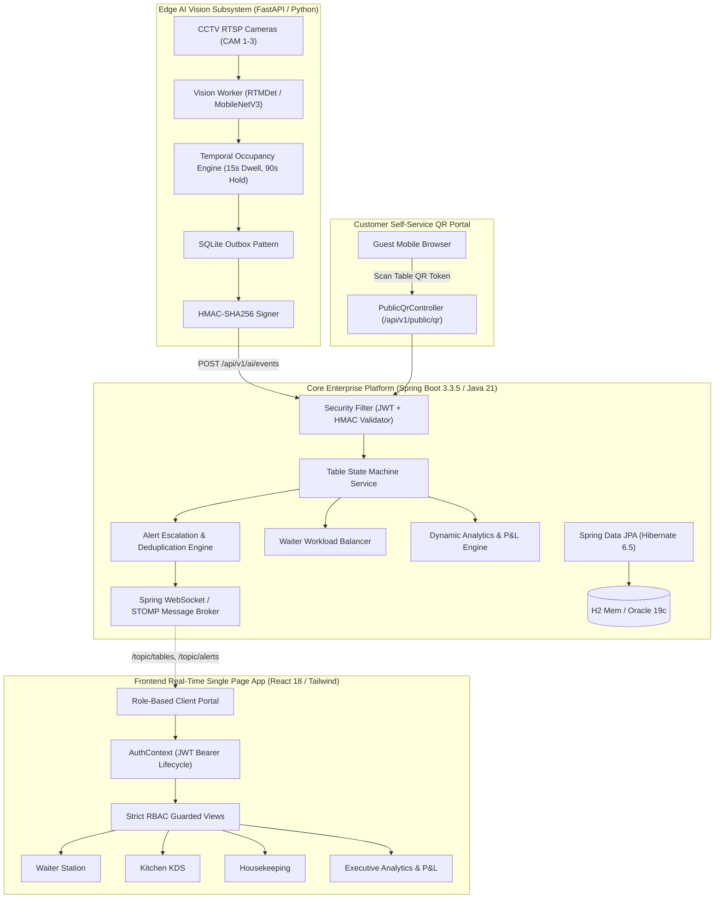

# Phase 1: Complete Project Discovery Report
**RESTROVISION Operations & Edge Vision Platform**  
**Audit Document**: `PROJECT_AUDIT_REPORT/01_PROJECT_DISCOVERY.md`  
**Date of Audit**: 2026-11-14  
**Audit Stage**: Pre-Production Quality & Security Baseline  

---

## 1. Executive Technology Stack Report

| Tier | Component | Technology | Version | Description & Role |
| :--- | :--- | :--- | :--- | :--- |
| **Backend Runtime** | Language | Java (LTS) | 21 (build 25 host) | Core enterprise language runtime |
| **Backend Framework** | Web / Security / Data | Spring Boot | 3.3.5 | Starter Web, Starter WebSocket, Starter Security, Starter Data JPA |
| **Build & Dependencies** | Build Engine | Apache Maven | 3.10.0 | Maven Compiler Plugin 3.13.0, Surefire 3.2.5 |
| **Security & Auth** | Token Engine | JJWT | 0.12.6 | JJWT API, Impl, Jackson with BCrypt password hashing & HMAC-SHA256 Edge verification |
| **API Documentation** | Specification | SpringDoc OpenAPI | 2.6.0 | Interactive Swagger UI (`/swagger-ui.html`) & OpenAPI spec (`/v3/api-docs`) |
| **Primary Database (Dev)** | In-Memory RDBMS | H2 Database | 2.3.232 | In-memory with Oracle compatibility mode (`MODE=Oracle`) |
| **Production Database** | Enterprise RDBMS | Oracle Database | 19c / 23c | Oracle JDBC Driver `ojdbc11` (23.5.0.24.07) under `oracle` profile |
| **Frontend Runtime** | SPA Framework | React | 18.3.1 | Single-page application architecture |
| **Frontend Bundler** | Build Tool | Vite | 5.4.10 / 5.4.21 | Hot Module Replacement, production rollup chunking |
| **Styling & Tokens** | CSS Engine | Tailwind CSS | 3.4.15 | PostCSS 8.4, Autoprefixer, Custom CSS token system (`tokens.css`) |
| **Real-Time Client** | Messaging Protocol | STOMP & SockJS | 7.0.0 / 1.6.1 | WebSockets over `/ws` topic subscriptions (`/topic/tables`, `/topic/alerts`) |
| **UI Components** | Icons & Helpers | Lucide React | 0.460.0 | SVG icon system; `clsx` & `tailwind-merge` class managers |
| **Edge AI Subsystem** | Microservice | Python / FastAPI | 3.11 / 0.110.0 | Local edge inference engine, SQLite outbox, camera state worker |
| **Containerization** | Orchestration | Docker Compose | 3.8 | Multi-container setup: `backend`, `frontend`, `edge-ai` |

---

## 2. High-Level Architecture Overview

RESTROVISION implements a **Distributed Hybrid Edge-to-Cloud / On-Premises Architecture** designed for zero-latency dining room automation:

### Architectural Key Concepts
1. **Multi-Tenancy**: Built with `TenantContext` ThreadLocal holding `restaurantId` extracted from JWT claims, enforced at repository/service queries.
2. **Asynchronous Edge Ingestion**: Edge AI events are ingested with idempotency keys (`event_uid`), confidence score filters ($\ge 0.70$), and HMAC signature verification.
3. **Temporal Table State Smoothing**: The Python edge engine applies minimum dwell ($15\text{ s}$), occupancy ratio thresholds ($80\%$), and vacancy hold timers ($90\text{ s}$) to prevent sensor flicker.
4. **WebSocket Push Distribution**: Floor state updates, kitchen order status transitions, and urgent service alerts are pushed over STOMP topics to active terminals.

---

## 3. Application Module Inventory

### Backend Modules (`Backend/src/main/java/com/restrovision/`)
- **`config`**:
  - `WebSocketConfig.java`: STOMP endpoint registration (`/ws`) and message broker destinations (`/topic`, `/app`).
  - `DataInitializer.java`: Pilot seed data populator (users, menu, tables, cameras, sample feedback, and orders).
- **`controller`**:
  - 12 REST Controllers exposing CRUD, state transitions, security, and public QR interactions.
  - `GlobalExceptionHandler.java`: RFC 7807 `ProblemDetail` standardized REST error responses.
- **`domain`**:
  - 21 JPA `@Entity` definitions modeling the restaurant operational domain.
- **`dto`**:
  - Request/response data transfer contracts (`AuthDtos`, `OrderDtos`, `TableDtos`, `FeedbackDtos`, `TaskDtos`, `AiEventEnvelopeDto`).
- **`repository`**:
  - 21 Spring Data JPA repository interfaces with multi-tenant filtering methods.
- **`security`**:
  - `SecurityConfig.java`: Spring Security 6 stateless filter chain, CORS configuration, session policies.
  - `JwtAuthFilter.java`: Bearer token parser, tenant injector, and refresh-token abuse rejector.
  - `JwtTokenProvider.java`: Token generation, validation, and claim parsing.
  - `HmacValidator.java`: SHA-256 payload integrity validator for edge node communications.
  - `TenantContext.java`: ThreadLocal tenant context isolator.
  - `CustomUserDetails.java` & `UserDetailsServiceImpl.java`: Identity and role authority provider.
- **`service`**:
  - `TableStateMachineService.java`: Table lifecycle transitions (`AVAILABLE` $\rightarrow$ `OCCUPIED` $\rightarrow$ `CLEANING` $\rightarrow$ `AVAILABLE`).
  - `AlertService.java`: Alert deduplication, escalation timers, and false alarm tagging.
  - `OrderService.java`: Order item state management, kitchen ticket lifecycle, delayed order tracking.
  - `AnalyticsService.java`: Dynamic intraday, 7-day, and 30-day financial P&L aggregation, M8 LightGBM quantile footfall forecasting, and M10 IndicBERT NLP sentiment aggregation.
  - `AiEventIngestionService.java`: Edge event verification, confidence thresholding, and idempotent state application.
  - `WorkloadService.java`: Waiter workload index computation based on active tables, open requests, and tasks.
  - `NotificationService.java`: Multi-channel notification record management.
  - `WaitingTimerScheduler.java`: Background scheduled task monitoring unattended tables and delayed orders.

---

## 4. API Endpoint Inventory (33 Endpoints Discovered)

| HTTP Method | Route | Controller | Minimum Role Required | Function & Description |
| :--- | :--- | :--- | :--- | :--- |
| `POST` | `/api/v1/auth/login` | `AuthController` | *PermitAll* | Authenticates email & password; returns JWT access & refresh tokens |
| `POST` | `/api/v1/auth/refresh` | `AuthController` | *PermitAll* | Exchanges valid refresh token for a new access token |
| `POST` | `/api/v1/auth/logout` | `AuthController` | Authenticated | Invalidates client session acknowledgement |
| `GET` | `/api/v1/auth/me` | `AuthController` | Authenticated | Retrieves current authenticated profile, role, and restaurant ID |
| `GET` | `/api/v1/tables` | `TableController` | `WAITER`, `CLEANING`, `MANAGER`, `OWNER` | Lists all restaurant tables with live occupancy and session data |
| `GET` | `/api/v1/tables/{id}` | `TableController` | `WAITER`, `CLEANING`, `MANAGER`, `OWNER` | Fetches details and active session for a specific table |
| `PUT` | `/api/v1/tables/{id}/status` | `TableController` | `WAITER`, `CLEANING`, `MANAGER`, `OWNER` | Manual staff override of table operational status |
| `POST` | `/api/v1/tables/{id}/seat` | `TableController` | `WAITER`, `MANAGER`, `OWNER` | Seats a party at an available table; creates active `TableSession` |
| `POST` | `/api/v1/tables/{id}/attend`| `TableController` | `WAITER`, `MANAGER`, `OWNER` | Marks table attended by assigned server |
| `PUT` | `/api/v1/tables/{id}/waiter`| `TableController` | `MANAGER`, `OWNER` | Reassigns assigned waiter to a specific table |
| `GET` | `/api/v1/alerts` | `AlertController` | Any Operational Role | Retrieves active unresolved operational alerts |
| `GET` | `/api/v1/alerts/all` | `AlertController` | `MANAGER`, `OWNER` | Historical log of all alerts across statuses |
| `PUT` | `/api/v1/alerts/{id}/acknowledge` | `AlertController` | Any Operational Role | Marks alert acknowledged by current employee |
| `PUT` | `/api/v1/alerts/{id}/resolve` | `AlertController` | Any Operational Role | Resolves alert and marks resolution timestamp |
| `PUT` | `/api/v1/alerts/{id}/false-alarm` | `AlertController` | Any Operational Role | Flags alert as false alarm for AI model feedback loop |
| `GET` | `/api/v1/orders` | `OrderController` | `WAITER`, `KITCHEN`, `MANAGER`, `OWNER` | Lists active restaurant orders |
| `GET` | `/api/v1/orders/{id}` | `OrderController` | `WAITER`, `KITCHEN`, `MANAGER`, `OWNER` | Fetches specific order and its order items |
| `POST` | `/api/v1/orders` | `OrderController` | `WAITER`, `MANAGER`, `OWNER` | Creates a new order tied to an active table session |
| `PUT` | `/api/v1/orders/{id}/status` | `OrderController` | `WAITER`, `KITCHEN`, `MANAGER`, `OWNER` | Updates high-level order status |
| `POST` | `/api/v1/orders/{id}/deliver`| `OrderController` | `WAITER`, `MANAGER` | Marks ready order delivered to table |
| `GET` | `/api/v1/orders/delayed` | `OrderController` | `KITCHEN`, `MANAGER`, `OWNER` | Identifies orders exceeding prep time targets |
| `GET` | `/api/v1/kitchen/stations` | `KitchenController` | `KITCHEN`, `MANAGER`, `OWNER` | Lists configured kitchen prep stations |
| `GET` | `/api/v1/kitchen/queue` | `KitchenController` | `KITCHEN`, `MANAGER`, `OWNER` | Retrieves station-specific active order items |
| `PUT` | `/api/v1/kitchen/orders/{id}/start` | `KitchenController` | `KITCHEN`, `MANAGER` | Transitions order to `PREPARING` |
| `PUT` | `/api/v1/kitchen/orders/{id}/ready` | `KitchenController` | `KITCHEN`, `MANAGER` | Marks kitchen order ready for server delivery |
| `PUT` | `/api/v1/kitchen/items/{id}/status` | `KitchenController` | `KITCHEN`, `MANAGER` | Granular per-item kitchen prep status transition |
| `GET` | `/api/v1/service-requests` | `ServiceRequestController` | `WAITER`, `MANAGER`, `OWNER` | Active guest assistance and bill requests |
| `POST` | `/api/v1/service-requests` | `ServiceRequestController` | `WAITER`, `MANAGER`, `OWNER` | Staff-initiated table assistance request |
| `PUT` | `/api/v1/service-requests/{id}/acknowledge` | `ServiceRequestController` | `WAITER`, `MANAGER`, `OWNER` | Acknowledges service request |
| `PUT` | `/api/v1/service-requests/{id}/complete` | `ServiceRequestController` | `WAITER`, `MANAGER`, `OWNER` | Completes and dismisses service request |
| `GET` | `/api/v1/tasks` | `TaskController` | `CLEANING`, `WAITER`, `MANAGER`, `OWNER` | Lists pending housekeeping & floor tasks |
| `POST` | `/api/v1/tasks` | `TaskController` | `MANAGER`, `OWNER` | Creates a new floor task |
| `PUT` | `/api/v1/tasks/{id}/assign` | `TaskController` | `MANAGER`, `OWNER` | Assigns task to a staff member |
| `PUT` | `/api/v1/tasks/{id}/start` | `TaskController` | `CLEANING`, `WAITER`, `MANAGER`, `OWNER` | Starts task execution |
| `PUT` | `/api/v1/tasks/{id}/complete` | `TaskController` | `CLEANING`, `WAITER`, `MANAGER`, `OWNER` | Finishes task and triggers table state update |
| `GET` | `/api/v1/cameras` | `CameraController` | `MANAGER`, `OWNER` | Lists configured edge cameras |
| `GET` | `/api/v1/cameras/{id}/zones` | `CameraController` | `MANAGER`, `OWNER` | Fetches polygon detection zones for camera |
| `POST` | `/api/v1/cameras/{id}/zones` | `CameraController` | `MANAGER`, `OWNER` | Configures new polygon zone |
| `PUT` | `/api/v1/cameras/{id}/maintenance` | `CameraController` | `MANAGER`, `OWNER` | Toggles camera maintenance status |
| `GET` | `/api/v1/employees` | `EmployeeController` | `MANAGER`, `OWNER` | Lists registered staff members |
| `GET` | `/api/v1/employees/workload` | `EmployeeController` | `MANAGER`, `OWNER` | Computes dynamic waiter workload indices |
| `POST` | `/api/v1/ai/events` | `AiEventController` | `AI_SERVICE` (HMAC + Token) | Ingests edge computer vision telemetry events |
| `GET` | `/api/v1/ai/events` | `AiEventController` | `MANAGER`, `OWNER` | Audits recent ingested AI events |
| `GET` | `/api/v1/analytics/overview`| `AnalyticsController` | `OWNER`, `MANAGER` | Daily/Weekly/Monthly P&L, crowd curve & AI forecast |
| `GET` | `/api/v1/analytics/feedback`| `AnalyticsController` | `OWNER`, `MANAGER` | Lists verified customer feedback records |
| `GET` | `/api/v1/public/qr/{token}/status` | `PublicQrController` | *PermitAll* | Resolves table status by secure QR token |
| `POST` | `/api/v1/public/qr/{token}/call-waiter` | `PublicQrController` | *PermitAll* | Triggers waiter call or bill request via table QR |
| `POST` | `/api/v1/public/feedback` | `PublicQrController` | *PermitAll* | Submits diner star rating and review comment |

---

## 5. Database Entity Inventory (21 JPA Entities)

1. `Restaurant`: Multi-tenant root organization entity with timezone and operational status.
2. `User`: User credentials, email, password hash, status (`ACTIVE`, `LOCKED`), and roles.
3. `Employee`: Staff profile tied to a User and Restaurant with role classification.
4. `RestaurantTable`: Dining room table with capacity, status (`AVAILABLE`, `OCCUPIED`, `CLEANING`), and source (`AI`, `STAFF`).
5. `TableSession`: Active dining session capturing timestamps (`seated_at`, `attended_at`, `ordered_at`, `closed_at`).
6. `Order`: Order header with status, unique code, and association with a TableSession.
7. `OrderItem`: Individual dish order lines with station routing, quantity, price, and prep timestamps.
8. `KitchenStation`: Preparation stations (e.g. Tandoor, Curry, Cold Prep).
9. `MenuCategory`: Category groupings with display orders and active flags.
10. `MenuItem`: Dish catalog items with ingredient costs, prep times, and prices.
11. `ServiceRequest`: Real-time guest call requests (`CALL_WAITER`, `REQUEST_BILL`, `WATER_REFILL`).
12. `StaffTask`: Housekeeping and turnover tasks with priorities and assignments.
13. `CleaningRecord`: Sanitation audit logs linked to tasks and tables.
14. `Alert`: Operational alerts generated by state engine or AI telemetry with deduplication keys.
15. `AiEvent`: Immutable record of ingested camera events with confidence scores.
16. `CustomerFeedback`: Diner feedback submissions with 1-5 star ratings and comments.
17. `AiFeedbackLabel`: AI classification audit trail for model refinement.
18. `AuditLog`: System audit trail recording actor, action, and before/after JSON state.
19. `Camera`: Edge CCTV camera registry with RTSP credential references and target FPS.
20. `CameraZone`: Coordinate polygon bounding zones mapped to tables or floor areas.
21. `EdgeNode`: On-premises physical edge compute node telemetry and heartbeat.

---

## 6. Frontend Page Inventory (9 Core Views)

| View | Route / Component | Primary User Role | Key Features |
| :--- | :--- | :--- | :--- |
| **Login** | `/login` (`Login.jsx`) | Public / All | Email/password form, quick 1-click test roles, credential validation |
| **Live Floor Plan** | Tab: `floor` (`FloorPlan.jsx`) | Waiter, Manager, Owner | 2D table grid, real-time occupancy status, party seating, attend button |
| **Alert Center** | Tab: `alerts` (`AlertCenter.jsx`) | All Operational Staff | Live alert feed, priority filters, acknowledge, resolve, false alarm tagging |
| **Kitchen KDS** | Tab: `kitchen` (`KitchenKds.jsx`) | Kitchen Chef, Manager | Ticket stream, station tabs, ticket start/ready toggles, item checkboxes |
| **Waiter Station** | Tab: `waiter` (`WaiterDashboard.jsx`)| Waiter, Manager, Owner | Active tables assigned, guest service calls, urgent bill requests |
| **Cleaning Tasks** | Tab: `cleaning` (`CleaningTasks.jsx`)| Housekeeping, Manager | Dirty table turnover queue, sanitization timer, task completion |
| **CCTV & AI Zones** | Tab: `cameras` (`CamerasZones.jsx`)| Manager, Owner | Live camera stream simulation, edge node telemetry, polygon editor |
| **Executive Analytics**| Tab: `analytics` (`Analytics.jsx`)| Owner, Manager | Daily/Weekly/Monthly P&L, crowd curves, M8 LightGBM forecast, M10 sentiment |
| **Customer QR Portal**| `/qr-portal` (`CustomerQrPortal.jsx`)| Diners (Public QR) | Mobile-responsive diner view: table info, call waiter, order bill, feedback |

---

## 7. External Dependency Inventory

### Maven Dependencies (Backend)
- `spring-boot-starter-web`: Spring MVC REST runtime.
- `spring-boot-starter-websocket`: STOMP protocol support.
- `spring-boot-starter-data-jpa`: Hibernate 6.5 object-relational mapping.
- `spring-boot-starter-security`: Spring Security 6 authentication/authorization.
- `spring-boot-starter-validation`: Bean Validation 3.0 / Hibernate Validator.
- `h2`: In-memory development database driver.
- `ojdbc11`: Oracle 23c enterprise production database driver.
- `jjwt-api`, `jjwt-impl`, `jjwt-jackson`: JWT parsing and signing.
- `springdoc-openapi-starter-webmvc-ui`: Swagger API explorer.

### Node Dependencies (Frontend)
- `react`, `react-dom`: Component rendering engine.
- `vite`: Build tool and dev server.
- `tailwindcss`, `postcss`, `autoprefixer`: CSS styling framework.
- `@stomp/stompjs`, `sockjs-client`: WebSocket STOMP transport layer.
- `lucide-react`: Modern SVG icon pack.
- `clsx`, `tailwind-merge`: Conditional class merging utilities.

---

## 8. Missing, Incomplete or Suspicious Implementation Report

1. **MISSING BACKEND DOCKERFILE**:
   - `docker-compose.yml` line 7 references `context: ./backend, dockerfile: Dockerfile`.
   - **Finding**: There is **no Dockerfile** inside `D:\RESTROVISION\Backend\`. Docker Compose build will crash immediately with `failed to solve: failed to read dockerfile`.
2. **DIRECTORY CASE-SENSITIVITY IN DOCKER COMPOSE**:
   - `docker-compose.yml` specifies context `./backend` (lowercase).
   - **Finding**: On Linux filesystems, directories are strictly case-sensitive. Because the directory is named `Backend`, Docker Compose will fail on any Linux host.
3. **FRONTEND DOCKERFILE REQUIRES PRE-BUILT ASSETS**:
   - `frontend/Dockerfile` uses `COPY dist /usr/share/nginx/html`.
   - **Finding**: It is not a multi-stage Docker build. If `npm run build` is not executed first on the host machine, building the frontend container fails.
4. **CORS HARDCODED PORT MISMATCH**:
   - `SecurityConfig.java` sets default allowed origins to `http://localhost:5173,http://localhost:3000,http://localhost:80`.
   - **Finding**: In environments where port 5173 is occupied, Vite binds to port 5174. Cross-origin browser requests directly to port 8080 fail with CORS errors unless routed through Vite's reverse proxy.
5. **FRONTEND TEST SUITE COMPLETELY ABSENT**:
   - **Finding**: While the backend includes 15 integration tests in `RestrovisionApplicationTests.java`, the frontend `package.json` contains zero unit or component test frameworks (no Vitest, Jest, or React Testing Library).
6. **PYTHON RUNTIME SHORTFALL ON HOST SYSTEM**:
   - **Finding**: Host system does not have Python 3.11 installed in standard PATH (`py.exe` targets non-existent `pythoncore-3.14-64`). Edge AI microservice relies entirely on its Docker container or requires a manual local Python virtualenv installation.
7. **ORACLE PROFILE REQUIRING MANUAL DDL EXECUTION**:
   - `application-oracle.yml` configures `ddl-auto: validate`.
   - **Finding**: There are no Flyway or Liquibase automated migration plugins configured in `pom.xml`. If deployed to an Oracle instance without manually executing `01_RESTROVISION_Oracle_Core_Schema_v2.0.sql`, application startup will fail validation.

---

### Discovery Verdict:
Phase 1 Complete. Full inventory established. Proceeding directly to **Phase 2: Software Architecture Audit**.
