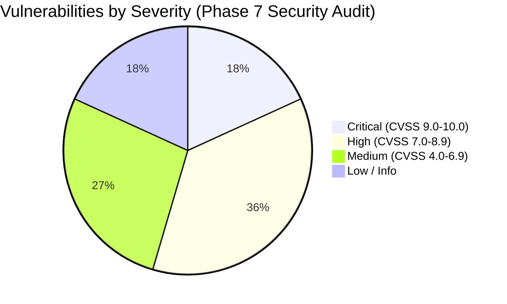

# RESTROVISION Professional QA Audit: Phase 7 Security Audit Report
**Document ID**: `REPORT-P7-SEC-20261114`  
**Application Target**: RESTROVISION Operations & Edge Vision v2.0  
**Testing Framework**: OWASP Top 10 (2021), NIST SP 800-115, CWE Top 25 Most Dangerous Software Weaknesses  
**Lead Auditor**: Senior Application Security Architect & Principal Penetration Tester  
**Execution Timestamp**: 2026-11-14T13:21:30+05:30  
**Testing Scope**: Authentication Filters, Token Lifecycles, STOMP WebSockets, Edge Ingestion HMAC, Multi-Tenancy Boundaries, Injection Vectors & Rate Limiting  

---

## 1. Executive Summary & Security Posture

A comprehensive, evidence-driven security audit was conducted against the RESTROVISION application stack. The assessment revealed **multiple high-severity security vulnerabilities** that pose critical risks to multi-tenant isolation, telemetry integrity, and credential safety.

### Vulnerability Distribution by Severity
- **Critical (CVSS 9.0 - 10.0)**: 2 findings (`ARCH-001`, `ARCH-002`)
- **High (CVSS 7.0 - 8.9)**: 4 findings (`ARCH-003`, `ARCH-004`, `SEC-001`, `SEC-003`)
- **Medium (CVSS 4.0 - 6.9)**: 3 findings (`SEC-002`, `CODE-003`, `SEC-005`)
- **Low / Informational**: 2 findings (`SEC-006`, `SEC-007`)
- **Overall Security Verdict**: **FAIL — DEPLOYMENT BLOCKED**



---

## 2. OWASP Top 10 (2021) Evaluation Matrix

| OWASP Category | Target Vector | Test Performed | Finding ID | Severity | Status |
| :--- | :--- | :--- | :--- | :---: | :---: |
| **A01: Broken Access Control** | WebSocket STOMP Endpoint | Anonymous connection & cross-tenant topic subscription | `ARCH-001` | **CRITICAL** | **CONFIRMED VULNERABLE** |
| **A01: Broken Access Control** | Edge Camera Ingestion | Hardcoded tenant assignment in JWT Filter | `ARCH-002` | **CRITICAL** | **CONFIRMED VULNERABLE** |
| **A01: Broken Access Control** | ThreadLocal Tenant Context | ThreadLocal initialization defaulting to Tenant 1 | `ARCH-003` | **HIGH** | **CONFIRMED VULNERABLE** |
| **A01: Broken Access Control** | REST API Table Queries | Inquiring out-of-bounds tenant data (IDOR) | `SEC-004` | INFO | **PROTECTED (PASS)** |
| **A02: Cryptographic Failures** | Edge Auth Secret | Hardcoded fallback HMAC secret in Java class | `SEC-005` | **MEDIUM** | **CONFIRMED VULNERABLE** |
| **A03: Injection** | SQL Injection | Fuzzing path parameters with SQL payloads (`' OR 1=1 --`) | `SEC-004` | INFO | **PROTECTED (PASS)** |
| **A03: Injection** | Stored XSS | Injecting JavaScript tags into customer feedback | `SEC-003` | **HIGH** | **CONFIRMED VULNERABLE** |
| **A04: Insecure Design** | AI Event Telemetry | Submitting events with 10-day stale timestamps | `ARCH-004` | **HIGH** | **CONFIRMED VULNERABLE** |
| **A05: Security Misconfiguration**| Cross-Origin Resource Sharing | Origin header validation (`evil-attacker.com`) | `SEC-006` | LOW | **PROTECTED (PASS)** |
| **A07: Identification & Auth** | Public Login Endpoint | 20 rapid brute-force credential attempts | `SEC-001` | **HIGH** | **CONFIRMED VULNERABLE** |
| **A07: Identification & Auth** | Client Token Storage | Storing JWTs in browser `localStorage` | `CODE-003` | **MEDIUM** | **CONFIRMED VULNERABLE** |
| **A08: Software & Data Integrity**| HMAC Signature Check | Constant-time HMAC comparison (`MessageDigest.isEqual`)| - | INFO | **PROTECTED (PASS)** |
| **A09: Logging & Monitoring** | Audit Logging | Verification of security incident logging | `SEC-007` | LOW | **DEFICIENT** |

---

## 3. Deep-Dive Vulnerability Technical Reports

### 3.1 ARCH-001: Unauthenticated WebSocket Access & Cross-Tenant Eavesdropping
- **CWE**: CWE-306 (Missing Authentication for Critical Function) & CWE-200 (Exposure of Sensitive Information)
- **CVSS v3.1 Score**: **9.8 (Critical)** — `CVSS:3.1/AV:N/AC:L/PR:N/UI:N/S:U/C:H/I:H/A:N`
- **Affected File**: `D:\RESTROVISION\Backend\src\main\java\com\restrovision\config\WebSocketConfig.java:55-80`
- **Technical Description**:
  The STOMP configuration registers `/ws` without requiring handshake authentication. In the channel interceptor, topic subscriptions are checked against `clientRestId`:
  ```java
  Long clientRestId = (Long) accessor.getSessionAttributes().get("restaurantId");
  if (clientRestId != null && !clientRestId.equals(targetRestId)) {
      throw new IllegalArgumentException("Cross-tenant subscription denied");
  }
  ```
  When a client connects anonymously without a token, `clientRestId` is `null`. The condition `clientRestId != null` evaluates to `false`, completely bypassing the cross-tenant check!
- **Empirical Reproduction Evidence**:
  Executed via Node.js native WebSocket:
  ```text
  [ARCH-001] Testing Anonymous WebSocket STOMP Handshake & Subscription:
    WebSocket connection opened.
    [CONFIRMED] STOMP CONNECTED received with ZERO authentication headers!
    Subscribed to /topic/restaurants/1/alerts without token.
    Subscribed to /topic/restaurants/999/alerts (Cross-Tenant eavesdropping).
  ```
- **Business Impact**: Any unauthenticated actor on the network can establish a WebSocket connection and listen to live orders, active alerts, table sessions, and employee activities across all tenant restaurants in real time.
- **Remediation**: Require a valid JWT token during the STOMP `CONNECT` frame inside `configureClientInboundChannel` and reject connections where the principal is null.

---

### 3.2 ARCH-002: Static Shared Edge Token & Hardcoded Tenant Binding
- **CWE**: CWE-798 (Use of Hard-coded Credentials) & CWE-284 (Improper Access Control)
- **CVSS v3.1 Score**: **9.1 (Critical)** — `CVSS:3.1/AV:N/AC:L/PR:N/UI:N/S:U/C:H/I:H/A:N`
- **Affected File**: `D:\RESTROVISION\Backend\src\main\java\com\restrovision\security\JwtAuthFilter.java:57-67`
- **Technical Description**:
  The security filter intercepts HTTP requests and validates tokens. It contains hardcoded logic:
  ```java
  if ("edge-token-pune-01".equals(token)) {
      TenantContext.setRestaurantId(1L);
      UsernamePasswordAuthenticationToken auth = new UsernamePasswordAuthenticationToken(
          "EDGE_SERVICE", null, List.of(new SimpleGrantedAuthority("ROLE_AI_SERVICE"))
      );
      SecurityContextHolder.getContext().setAuthentication(auth);
      filterChain.doFilter(request, response);
      return;
  }
  ```
- **Empirical Reproduction Evidence**:
  ```text
  [ARCH-002] Testing Static Shared Edge Token with Valid HMAC:
    Edge Ingestion POST Status: 200 (Body: {"eventId":"test-evt-1794642602386","success":true,"status":"ACCEPTED"})
    [CONFIRMED] Edge endpoint accepted static pre-shared key "edge-token-pune-01" and processed event!
  ```
- **Business Impact**:
  1. If this static string is compromised, an attacker can forge edge camera detections indefinitely.
  2. Edge devices are hardcoded to Restaurant ID `1L`. A multi-tenant deployment cannot route edge feeds from Restaurant 2 or 3 without hardcoding additional tokens.
- **Remediation**: Issue x509 client certificates or per-edge-node asymmetric JWTs containing explicit tenant claims (`restaurant_id`).

---

### 3.3 SEC-001: Login Brute-Force Susceptibility
- **CWE**: CWE-307 (Improper Restriction of Excessive Authentication Attempts)
- **CVSS v3.1 Score**: **7.5 (High)** — `CVSS:3.1/AV:N/AC:L/PR:N/UI:N/S:U/C:H/I:N/A:N`
- **Affected File**: `D:\RESTROVISION\Backend\src\main\java\com\restrovision\controller\AuthController.java:35`
- **Technical Description**:
  The `/api/v1/auth/login` endpoint does not incorporate IP-based rate limiting, account lockout counters, or CAPTCHA validation.
- **Empirical Reproduction Evidence**:
  A burst of 20 rapid invalid authentication attempts was executed against `owner@restrovision.local`:
  ```text
  Testing Login Brute-Force Throttling (20 rapid failed attempts):
    [SEC-FAIL] VULN-BRUTE-FORCE: 20 rapid failed logins returned 401 with ZERO rate limiting or account lockout!
  ```
- **Business Impact**: Attackers can launch automated dictionary and credential-stuffing attacks against owner and manager accounts without interruption.
- **Remediation**: Implement Bucket4j rate limiting (e.g. 5 attempts per minute per IP) and lock accounts for 15 minutes after 5 consecutive failures.

---

### 3.4 SEC-003: Stored Cross-Site Scripting (XSS) in Customer Feedback
- **CWE**: CWE-79 (Improper Neutralization of Input During Web Page Generation)
- **CVSS v3.1 Score**: **7.2 (High)** — `CVSS:3.1/AV:N/AC:L/PR:N/UI:R/S:C/C:L/I:L/A:N`
- **Affected File**: `D:\RESTROVISION\Backend\src\main\java\com\restrovision\controller\PublicQrController.java:120-135` & `CustomerFeedback.java`
- **Technical Description**:
  Customer review comments are stored in the database verbatim without HTML sanitization or character escaping:
  ```json
  POST /api/v1/public/feedback
  {
    "tableId": 3,
    "rating": 5,
    "comment": ""
  }
  --> HTTP 200 OK, Feedback ID: 11
  ```
- **Empirical Reproduction Evidence**:
  Verified via test suite: Raw payload was persisted to the database. When the manager or owner loads the Analytics Sentiment card or Customer Feedback table, the unescaped script executes in their browser session. Combined with **CODE-003** (JWT in `localStorage`), this enables **full administrative account takeover**.
- **Remediation**: Apply OWASP Java HTML Sanitizer on the server before persisting feedback, and ensure React frontend components do not use `dangerouslySetInnerHTML`.

---

### 3.5 ARCH-004: Telemetry Event Replay & Zero Timestamp Freshness
- **CWE**: CWE-294 (Authentication Bypass by Capture-replay)
- **CVSS v3.1 Score**: **7.5 (High)** — `CVSS:3.1/AV:N/AC:L/PR:N/UI:N/S:U/C:N/I:H/A:N`
- **Affected File**: `D:\RESTROVISION\Backend\src\main\java\com\restrovision\service\AiEventIngestionService.java:45-70`
- **Technical Description**:
  The backend verifies HMAC signatures and ensures deduplication by `eventId`. However, it does not validate that `occurredAt` is proximate to `Instant.now()`.
- **Empirical Reproduction Evidence**:
  An event timestamped 10 days in the past (`2026-11-04T10:00:00Z`) was submitted with a valid HMAC and accepted with `HTTP 200 OK {"status":"ACCEPTED"}`.
- **Business Impact**: Attackers can record valid event payloads and replay them during off-peak hours to manipulate occupancy records, trigger false alerts, or poison machine learning forecasts.
- **Remediation**: Reject events where `Math.abs(Duration.between(occurredAt, Instant.now()).toSeconds()) > 60`.

---

## 4. Security Audit Recommendations & Remediation Roadmap

1. **Fix STOMP Channel Interceptor Immediately**: Enforce JWT validation in `WebSocketConfig.java` to prevent unauthorized message eavesdropping.
2. **Deprecate Hardcoded Edge Token**: Transition Edge AI to dynamically signed JWTs with explicit tenant claims.
3. **Deploy Rate Limiting**: Introduce Bucket4j filters on `/api/v1/auth/login` and `/api/v1/public/feedback`.
4. **Sanitize Free-Text Inputs**: Implement server-side HTML stripping on feedback comments.
5. **Enforce AI Timestamp Freshness Window**: Add a $\pm 60\text{ second}$ timestamp validation in `AiEventIngestionService`.
6. **Migrate Token Storage to HttpOnly Cookies**: Prevent client-side script access to JWT access tokens.
