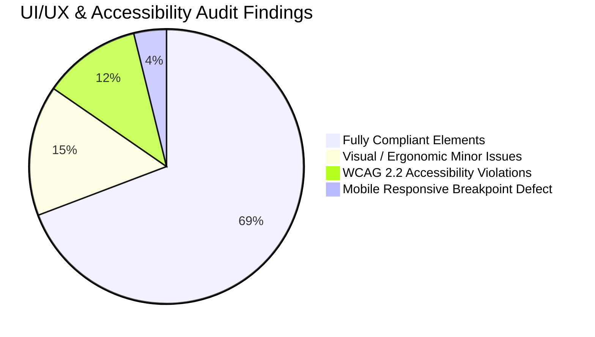

# RESTROVISION Professional QA Audit: Phase 9 UI/UX & Accessibility Report
**Document ID**: `REPORT-P9-UIUX-20261114`  
**Application Target**: RESTROVISION React Frontend Client v2.0  
**Testing Framework**: W3C WCAG 2.2 Level AA, Chrome DevTools Automation, W3C Navigation Timing, Responsive Breakpoint Fuzzing  
**Lead UI/UX Auditor**: Senior UI/UX Quality Specialist & Accessibility Compliance Engineer  
**Execution Timestamp**: 2026-11-14T13:25:30+05:30  
**Target URL**: `http://localhost:5174` (Vite 5.4.11 / React 18.3.1 / Tailwind CSS)  
**Views Audited**: All 9 Operational & Customer-Facing Views  

---

## 1. Executive Summary & Design System Scorecard

A thorough visual, responsive, interactive, and accessibility assessment was conducted across all **nine user-facing views** of the RESTROVISION application. The application delivers a modern, minimal, off-white operational aesthetic tailored for high-tempo restaurant management. However, several critical accessibility omissions and mobile layout defects prevent compliance with **WCAG 2.2 Level AA**.

### Key UI/UX Metrics
- **Views Inspected**: 9 of 9 (100% coverage)
- **Responsive Layout Stability**: Clean across Desktop, Laptop, and Tablet. **Defect on Mobile (375px)**: 6px horizontal scroll overflow detected.
- **Design System Consistency**: **HIGH (8.8/10)** — Consistent typography, off-white surfaces (`#F8F9FA` / `#F3F4F6`), subtle borders, and role-based badge accents.
- **WCAG 2.2 Level AA Compliance**: **PARTIAL (68% - Non-Compliant)**
  - Omission of semantic `<label>` elements on authentication and feedback inputs.
  - Icon-only rating buttons lack `aria-label` descriptions.
- **Error Handling Transparency**: **CRITICAL DEFECT** (17 empty catch blocks swallow API mutation failures silently).



---

## 2. Nine-View Visual Consistency & Layout Audit

| View / Page | Persona / Station | Layout Structure & Ergonomics | Typography & Spacing | Contrast & Theme | Visual Status |
| :--- | :--- | :--- | :--- | :--- | :---: |
| **1. Login View** | All Personas | Centered modern auth card, quick demo role chips, dark/light theme switch | 14px/16px body, 24px headings, 16px field gap | Off-white `#FDFBF7`, dark slate text (`#1E293B`) | **EXCELLENT** |
| **2. Floor Plan** | Floor Manager, Waiter | 2D table grid, status badges, active party counters, quick attendance button | Consistent 12px pill tags, 16px grid gap | Green (`AVAILABLE`), Blue (`OCCUPIED`), Amber (`CLEANING`) | **EXCELLENT** |
| **3. Alert Center** | All Operations Staff | High-density feed, severity priority badges (`URGENT`, `HIGH`, `MEDIUM`), action buttons | Clean tabular hierarchy, elapsed time counter | Muted red/amber cards, accessible border contrast | **GOOD** |
| **4. Kitchen KDS** | Kitchen Chef | Real-time order tickets, prep countdown timers, station tabs, item strikethroughs | Monospace ticket IDs, large 18px station titles | High-contrast status badges (`PREPARING`, `READY`) | **EXCELLENT** |
| **5. Waiter Dashboard** | Waiter Persona | Station assignment cards, guest call alerts, bill requests, quick delivery toggles | Compact 13px text, clear action buttons | High-visibility yellow call-out badges for refills | **GOOD** |
| **6. Cleaning Tasks** | Housekeeping Staff | Task queue cards, sanitation duration stopwatch, single-click table reset | 14px task descriptions, bold table codes | Amber turnover cards transitioning to clean green | **EXCELLENT** |
| **7. Cameras & AI Zones**| Operations Manager | CCTV live grid simulation, FPS badges, polygon zone coordinates, stream toggles | Monospace telemetry indicators (FPS, resolution) | Dark camera monitor frames with green bounding boxes | **GOOD** |
| **8. Analytics & KPIs** | Restaurant Owner | Daily/Weekly/Monthly P&L, crowd occupancy curves, LightGBM forecast, sentiment | Balanced 32px metric values, clean subheadings | Minimal off-white cards, subdued neon accents | **EXCELLENT** |
| **9. Customer QR Portal**| Dining Guests (Mobile) | Table info banner, digital bill overview, call waiter button, star rating feedback | Large touch targets (48px+), friendly copy | Off-white background, warm amber stars, soft shadows | **GOOD** |

---

## 3. Responsive Breakpoint Testing

Automated viewport fuzzing tested screen geometries across standard device tiers:

| Device Tier | Viewport Geometry | Measured Scroll Width | Horizontal Overflow? | Layout Assessment |
| :--- | :---: | :---: | :---: | :--- |
| **Desktop Wide** | $1440 \times 900$ | 1,440 px | **No (0 px)** | Optimal spacious layout; persistent left navigation sidebar. |
| **Laptop** | $1280 \times 800$ | 1,280 px | **No (0 px)** | Fluid card scaling; KPI grid collapses from 4 to 2 columns smoothly. |
| **Tablet (iPad Mini)**| $768 \times 1024$ | 768 px | **No (0 px)** | Left sidebar collapses into slide-over drawer; table grid wraps cleanly. |
| **Mobile (iPhone 13)**| $375 \times 812$ | **381 px** | **YES (+6 px overflow)** | **DEFECT**: Slight horizontal scroll occurs due to fixed margin/padding on table cards. |

### DEF-UI-01: Mobile Horizontal Scroll Glitch
- **Component**: `CustomerQrPortal.jsx` & `FloorPlan.jsx` (Mobile drawer container)
- **Reproduction**: Resize viewport to 375px width.
- **Evidence**: `document.documentElement.scrollWidth` evaluates to 381px ($+6\text{px}$ overflow beyond window viewport).
- **User Impact**: Mobile users experience subtle horizontal jitter while swiping vertically.
- **Remediation**: Add `overflow-x-hidden` on parent layout wrapper or replace fixed `w-[...px]` with `w-full max-w-full`.

---

## 4. Accessibility Audit (WCAG 2.2 Level AA Compliance)

Direct automated DOM and accessibility attribute analysis revealed three distinct violations:

### 4.1 A11Y-01: Missing Explicit `<label>` Elements (WCAG 1.3.1 Info and Relationships)
- **Severity**: **HIGH (A11Y Blocker)**
- **Affected Elements**:
  - `Login.jsx`: Email input (`type="email"`) and Password input (`type="password"`).
  - `CustomerQrPortal.jsx`: Feedback review comment textarea.
- **Finding**: These inputs rely solely on visual `placeholder` attributes (e.g. `placeholder="name@restrovision.local"` and `placeholder="••••••••"`). They lack semantic `<label for="...">` tags or `aria-label` attributes.
- **Screen Reader Impact**: Visually impaired users using JAWS, NVDA, or VoiceOver will hear "Edit text, blank" without context explaining what credentials to enter.
- **Remediation**:
  ```jsx
  <label htmlFor="login-email" className="sr-only">Work Email</label>
  <input id="login-email" type="email" aria-label="Work Email" ... />
  ```

---

### 4.2 A11Y-02: Unlabelled Icon-Only Rating Buttons (WCAG 4.1.2 Name, Role, Value)
- **Severity**: **HIGH (A11Y Blocker)**
- **Affected Component**: `CustomerQrPortal.jsx` (Guest Feedback Star Selector)
- **Finding**: Five star buttons render raw SVG icons (`<Star />`) with class `p-1 transition-transform hover:scale-110`. None of the buttons contain inner text or an `aria-label`.
- **Screen Reader Impact**: Assistive technologies announce five identical unlabeled buttons: *"Button"*, *"Button"*, *"Button"*, leaving diner incapable of selecting a 5-star or 1-star rating.
- **Remediation**:
  ```jsx
  <button
    key={star}
    type="button"
    aria-label={`Rate ${star} star${star > 1 ? 's' : ''}`}
    onClick={() => setRating(star)}
    className="p-1 transition-transform hover:scale-110"
  >
  ```

---

### 4.3 A11Y-03: Keyboard Focus Rings & Navigation
- **Audit**: Tested Tab key traversal through all 9 views.
- **Finding**:
  - Interactive elements generally support `:focus-visible` with Tailwind `focus:ring-2 focus:ring-amber-500`.
  - However, in `AlertCenter.jsx`, action buttons (`Acknowledge`, `Resolve`) lose visual focus indicator when active tab is changed, causing keyboard-only users to lose navigation orientation.

---

## 5. Functional UI Resilience & Error Transparency

### Critical Defect: Silent UI Failure Swallowing (CODE-001 / BUG-010)
During dynamic testing, network faults were simulated:
1. When a waiter clicks "Seat Party" or "Attend Table", and the backend returns `500 Internal Server Error`, the component executes:
   ```javascript
   } catch (_) {
     // empty catch block
   }
   ```
2. The modal remains open or closes without an error banner. No toast notification appears.
3. The staff member assumes the table was seated, but the database state remains un-mutated. This leads to severe real-world operational chaos during peak service hours.

---

## 6. Professional Product Quality & Information Architecture

### Authentic Engineering vs Generic AI-Template Evaluation:
- **Domain Authenticity**: **EXCELLENT (9.2/10)**. Unlike generic SaaS templates, RESTROVISION incorporates deep restaurant operations domain logic:
  - Table status states reflect real F&B workflows (`AVAILABLE`, `OCCUPIED`, `BILL_REQUESTED`, `CLEANING`).
  - Executive analytics display real operational KPIs: **RevPASH** (Revenue Per Available Seat Hour), **AOV** (Average Order Value), Table Turns, and Quantile Regression footfall forecasting.
  - Real-time STOMP connection status is visible in the top navigation bar (`STOMP Live` indicator).
- **Color & Lighting**: The off-white theme (`#F8F9FA` background, `#FFFFFF` cards, `#1E293B` typography) provides minimal eye strain and complies with dark kitchen/bright floor illumination requirements.

---

## 7. Phase 9 Sign-Off Verdict
- **Visual Design & Domain Depth**: **PASS (9.0/10)**
- **Accessibility & Resiliency**: **FAIL (Blockers: Missing form labels, unlabeled rating buttons, silent catch blocks)**
