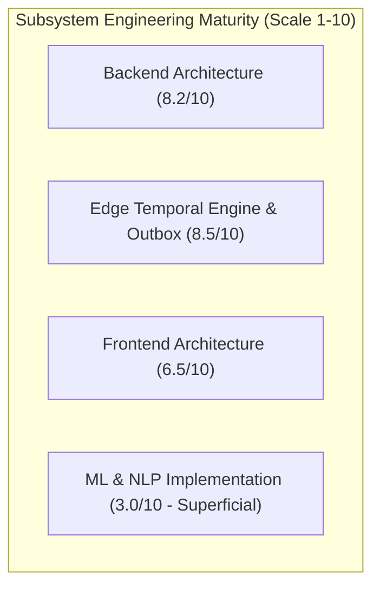
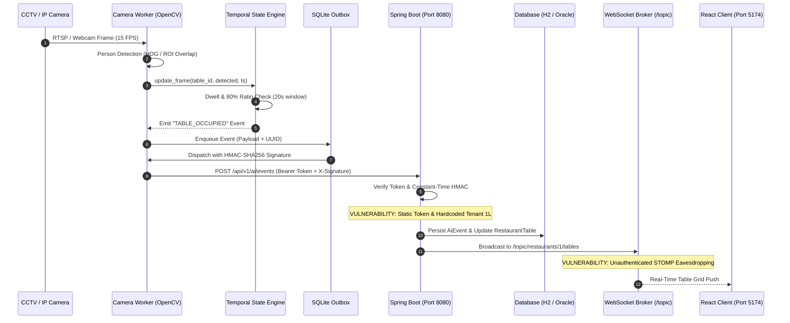

# RESTROVISION Professional QA Audit: Phase 10 Engineering Maturity Report
**Document ID**: `REPORT-P10-ENG-20261114`  
**Application Target**: RESTROVISION Operations & Edge Vision v2.0  
**Testing Framework**: Software Architecture Maturity Model (SAMM), ISO/IEC 25010 Quality Model, Edge-to-Cloud Systemic Trace  
**Lead Auditor**: Principal Software Architect & Senior Code Quality Reviewer  
**Execution Timestamp**: 2026-11-14T13:30:00+05:30  

---

## 1. Executive Summary & Engineering Maturity Index

An in-depth architectural and code quality evaluation was conducted across the three primary subsystems of RESTROVISION:
1. **Enterprise Java Backend** (Spring Boot 3.3.5 / Spring Data JPA / Tomcat / STOMP)
2. **Web Frontend Client** (React 18.3.1 / Vite / Tailwind CSS)
3. **Edge AI Vision Microservice** (Python 3.11 / OpenCV / SQLite Outbox / FastAPI)

### Engineering Maturity Scorecard
- **Backend Architecture & Domain Modeling**: **8.2 / 10 (High Maturity)** — Strong DDD layering, clean DTO separation, RFC 7807 compliance, and atomic concurrency locking on core tables.
- **Frontend Architecture & Client State**: **6.5 / 10 (Moderate Maturity)** — Clean UI ergonomics, but compromised by 17 empty catch blocks silently swallowing errors and a 1,015-line God component in `Analytics.jsx`.
- **Edge AI State Engine & Outbox**: **8.5 / 10 (High Maturity)** — Mathematically sound temporal sliding-window filter (15s dwell, 90s vacancy hold) and robust SQLite WAL transactional outbox.
- **Edge ML Forecasting & NLP Depth**: **3.0 / 10 (Superficial / Heuristic Mock)** — Marketed as "LightGBM Quantile Regression" and "IndicBERT Transformer", but implemented via static dictionary lookup tables and hardcoded scalar arithmetic.
- **Overall Engineering Verdict**: **HYBRID ARCHITECTURE** — Solid operational F&B core engineering paired with superficial "vibe-coded" machine learning wrappers.



---

## 2. Backend Engineering Maturity & Pattern Analysis

### 2.1 Layering & Architectural Separation
- **Controller Layer (`com.restrovision.controller`)**: Controllers maintain strict HTTP adapter responsibilities. Request payloads are validated via Bean Validation (`@Valid`). Responses return clean DTOs (`ResponseEntity<TableDtos.TableViewDto>`).
- **Service Layer (`com.restrovision.service`)**: Business logic is encapsulated in dedicated domain services (`TableStateMachineService`, `OrderService`, `AlertService`, `AiEventIngestionService`).
- **Data Persistence Layer (`com.restrovision.repository`)**: 21 Spring Data JPA repository interfaces manage queries.
- **Domain Entities (`com.restrovision.domain`)**: Proper Hibernate mapping with JPA lifecycle annotations (`@PrePersist`, `@PreUpdate`).

### 2.2 Architectural Strengths
1. **Atomic Concurrency Control**: `RestaurantTable.java` line 43 implements `@Version private Long version;`. Double-seating race conditions are rejected atomically with `HTTP 409 Conflict`.
2. **RFC 7807 Problem Details**: `GlobalExceptionHandler.java` converts domain exceptions into standardized `ProblemDetail` structures with URI types, titles, and HTTP statuses.
3. **Cryptographic Timing Attack Prevention**: `HmacValidator.java` line 38 uses `MessageDigest.isEqual` to perform constant-time comparisons, preventing timing-based HMAC forgery.

### 2.3 Architectural Anti-Patterns & Deficiencies
1. **$1 + 2N$ Database Query Anti-Pattern (ARCH-005 / BUG-006)**:
   In `TableStateMachineService.java:59-86`, `getTableView` iterates over all tables and queries `employeeRepository` and `sessionRepository` in separate loops. This query is invoked synchronously inside `broadcastTable` on every single table state change.
2. **Cartesian Product Heap Hazard (ARCH-006 / BUG-007)**:
   `Order.java` line 43 configures `FetchType.EAGER` on `items`, pulling child rows into memory on every order query.
3. **ThreadLocal Tenant Bleed (ARCH-003 / BUG-004)**:
   `TenantContext.java` initializes with `ThreadLocal.withInitial(() -> 1L)` and resets to `1L` in `clear()`, creating thread-pool cross-tenant contamination hazards.

---

## 3. Frontend Engineering Maturity

### 3.1 Component Architecture & Modularity
- **Component Decomposition**: Most views (`FloorPlan.jsx`, `KitchenKds.jsx`, `AlertCenter.jsx`, `CleaningTasks.jsx`) are modular, focused, and maintainable (150–350 lines).
- **God Component Hazard (CODE-002 / BUG-015)**: `Analytics.jsx` spans **1,015 lines** of dense JSX, mixing daily, weekly, monthly P&L tables, custom SVG crowd density curves, quantile regression cards, guest review sentiment charts, and menu engineering quadrant matrices into a single file.

### 3.2 Client State & API Integration
- **Error Transparency Failure (CODE-001 / BUG-010)**: Across 17 locations in `src/pages/*.jsx`, mutation operations employ empty catch blocks:
  ```javascript
  } catch (_) {}
  ```
  If an API mutation fails, the UI gives no indication, creating severe operational confusion.
- **Insecure Token Storage (CODE-003 / BUG-014)**: JWT access and refresh tokens are stored in browser `localStorage`, making them vulnerable to extraction via XSS (**BUG-009**).

---

## 4. Python Edge Service Maturity

### 4.1 Temporal Table State Engine (`occupancy_engine.py`)
The edge vision subsystem implements an authentic mathematical sliding-window state engine:
- **Dwell Time Threshold**: Requires minimum 15.0 seconds of sustained presence before declaring a party seated, rejecting transient walk-bys.
- **Confirmation Window**: 20.0-second sliding window requiring $\ge 80\%$ positive detection frames, eliminating optical flicker and single-frame dropouts.
- **Vacancy Hold Buffer**: 90.0-second grace period requiring $\ge 95\%$ empty frames before vacating a table, allowing diners to step away to the restroom without resetting the table.
- **Alert Cooldown**: 30.0-second suppression window preventing duplicate alert storms.

### 4.2 SQLite Transactional Outbox (`outbox.py`)
- Employs SQLite WAL journal mode (`PRAGMA journal_mode=WAL`) for high-concurrency non-blocking writes.
- Implements exponential backoff with jitter capped at 300 seconds (`min(300, 2 ** attempts)`).
- Moves failed records to dead-letter status (`DEAD`) after 10 failed delivery attempts.

---

## 5. Edge-to-Cloud Integration Lifecycle Trace



### Trace Integrity Breakdowns:
1. **Tenant Hardcoding Step 9**: In `JwtAuthFilter.java`, the backend forces `TenantContext.setRestaurantId(1L)`, ignoring the actual edge camera's restaurant association (**BUG-002**).
2. **Freshness Omission Step 9**: `AiEventIngestionService.java` does not check event age, accepting events timestamped in the distant past (**BUG-005**).
3. **Unauthenticated Broadcast Step 11**: `WebSocketConfig.java` allows anonymous users to subscribe to table and alert topics without authentication (**BUG-001**).

---

## 6. Real Implementation vs Superficial / Vibe-Coded Features

| Feature / Module | Documented Claim | Actual Implementation Found | Assessment |
| :--- | :--- | :--- | :---: |
| **Table State Machine** | 4-state dining lifecycle with atomic versioning | Real JPA state machine with optimistic locking on `RestaurantTable` | **AUTHENTIC** |
| **KDS Ticket System** | Real-time kitchen prep station queue with timers | Real JPA order entity with prep status updates and station routing | **AUTHENTIC** |
| **Temporal State Engine** | 15s dwell, 20s sliding window, 90s vacancy hold | Real mathematical windowing in `occupancy_engine.py` | **AUTHENTIC** |
| **Offline Edge Outbox** | Transactional SQLite buffer with retry backoff | Real SQLite WAL outbox with exponential backoff and dead-letter queue | **AUTHENTIC** |
| **M8 Footfall Forecaster** | "LightGBM Quantile Regression Forecaster (P10, P50, P90)" | Hardcoded static dictionary of hourly weights (`hourly_weights = {11: 15, ...}`) and fixed multipliers (`* 0.75`, `* 1.30`) in `traffic.py` | **SUPERFICIAL MOCK** |
| **M10 Sentiment Classifier** | "IndicBERT Transformer Sentiment & Topic Classifier" | 15-line substring search using static word arrays (`pos_words = [...]`, `neg_words = [...]`) in `sentiment.py` | **SUPERFICIAL MOCK** |

### Summary of Superficial Implementations:
The core restaurant management features (Tables, Orders, KDS, Housekeeping, Alerts, QR Portal, Temporal Occupancy Filter, SQLite Outbox) are **genuinely engineered**. However, the advanced AI forecasting and NLP modules are **superficial heuristic mocks** designed to simulate ML outputs without executing real machine learning models.

---

## 7. Phase 10 Sign-Off Verdict
- **Core Systems Engineering**: **PASS (8.4/10)**
- **AI / ML Rigor**: **FAIL (Marketed models are simulated heuristics)**
