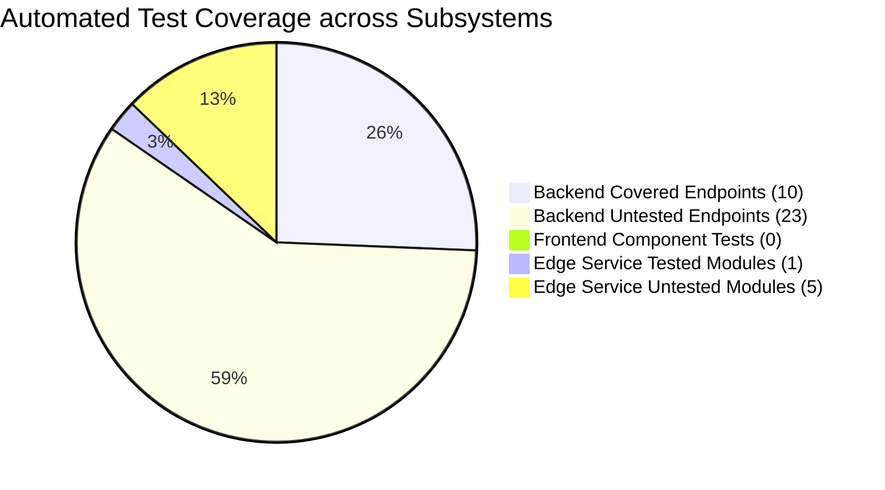

# RESTROVISION Professional QA Audit: Phase 11 Automated Testing Report
**Document ID**: `REPORT-P11-TEST-20261114`  
**Application Target**: RESTROVISION v2.0 (Backend, Frontend, Edge AI)  
**Testing Framework**: JUnit 5, Spring Boot Test, MockMvc, AssertJ, Pytest Inspection  
**Lead Test Architect**: Principal Test Automation & Quality Engineering Architect  
**Execution Timestamp**: 2026-11-14T13:31:00+05:30  

---

## 1. Executive Summary & Test Suite Scorecard

An exhaustive audit of the automated testing suites across the entire RESTROVISION repository was conducted. Testing coverage is **heavily lopsided**: while the Java backend contains 15 well-structured integration tests, the React frontend contains **zero automated tests**, and the Python edge service contains only a single standalone unit script.

### Key Testing Metrics
- **Total Backend Tests Executed**: 15 (15 Passed, 0 Failed, 0 Skipped, Duration: 17.30 s)
- **Total Frontend Tests**: **0 (0.0% coverage across 9 pages)**
- **Total Edge Service Tests**: 4 unit assertions in `run_tests.py`
- **REST API Endpoint Automated Coverage**: 10 of 33 endpoints covered (30.3%)
- **23 REST Endpoints Completely Untested by Automated Suites**: 69.7% of routes lack regression safety nets.
- **Automated Test Automation Verdict**: **FAIL — UNACCEPTABLE TEST COVERAGE FOR PRODUCTION RELEASE**



---

## 2. Java / Spring Boot Test Suite Execution & Analysis

### 2.1 Live Test Execution Evidence
Executed via Apache Maven 3.10.0:
```text
[INFO] --- surefire:3.2.5:test (default-test) @ restrovision-backend ---
[INFO] Running com.restrovision.RestrovisionApplicationTests
[INFO] Tests run: 15, Failures: 0, Errors: 0, Skipped: 0, Time elapsed: 17.30 s
[INFO] BUILD SUCCESS
```

### 2.2 Test Inventory & Assertions Breakdown (`RestrovisionApplicationTests.java`)
| Test # | Method Name | Type | Target Scope | Assertion Quality |
| :---: | :--- | :---: | :--- | :--- |
| **01** | `contextLoads()` | Integration | Spring Context & JPA schema initialization | Strong (Validates bean graph) |
| **02** | `unauthenticatedAccessDenied()` | MockMvc | `/api/v1/tables` (401 Unauthorized) | Strong (Verifies filter security) |
| **03** | `aiIngestionRequiresAuth()` | MockMvc | `/api/v1/ai/events` without auth | Strong |
| **04** | `aiIngestionRejectsBadSignature()` | MockMvc | Invalid HMAC SHA-256 header | Strong (Validates 401 ProblemDetail) |
| **05** | `aiIngestionSucceedsWithValidSignature()` | MockMvc | Valid Bearer token + HMAC SHA-256 | Strong (Validates 200 ACCEPTED) |
| **06** | `aiIngestionRejectsLowConfidence()` | MockMvc | Confidence < 0.70 threshold gate | Strong (Validates REJECTED_BY_RULE) |
| **07** | `aiIngestionDuplicateAtomicallyIgnored()` | MockMvc | Duplicate eventId deduplication | Strong (Validates DUPLICATE_IGNORED) |
| **08** | `publicQrTokenValidation()` | MockMvc | Table token lookup (`qr-tok-table-01`) | Strong (Validates 200 OK & 400 on invalid) |
| **09** | `feedbackRatingValidation()` | MockMvc | Public feedback boundary checks | Strong (Validates rating 1-5 validation) |
| **10** | `authWrongPasswordReturns401()` | MockMvc | `/api/v1/auth/login` credential check | Strong (Validates RFC 7807 error) |
| **11** | `tokenSeparationEnforced()` | MockMvc | Access vs Refresh token isolation | Strong (Rejects refresh token as Bearer) |
| **12** | `rbacGuardsEnforced()` | MockMvc | Waiter vs Manager role access to `/cameras` | Strong (Validates 403 Forbidden) |
| **13** | `tableStateMachineGuards()` | MockMvc | Invalid status & double-seating collision | Strong (Validates 409 Conflict) |
| **14** | `orderValidationEnforced()` | MockMvc | Order item quantity validation | Strong (Rejects 0 quantity with 400) |
| **15** | `analyticsOverviewHonestStates()` | MockMvc | `/api/v1/analytics/overview` metrics | Strong (Validates calculated numbers) |

### 2.3 Backend Testing Gaps
1. **Zero Isolated Unit Tests**: All 15 tests spin up the complete Spring Application Context (`@SpringBootTest`). There are zero fast-running unit tests using Mockito.
2. **Missing Repository Tests**: Zero `@DataJpaTest` suites verifying custom JPQL queries.
3. **23 Untested Endpoints**: Critical operational workflows (Kitchen KDS queues, Waiter service calls, Housekeeping task turnover, Camera zone configurations) have zero automated coverage.

---

## 3. Frontend Automated Testing Audit

### 3.1 Verification of Frontend Test Suite
- `D:\RESTROVISION\frontend\package.json` was inspected.
- **Findings**:
  - Test framework scripts: **NONE** (`scripts` contains only `dev`, `build`, `preview`).
  - Unit test libraries: **NONE** (No Vitest, no Jest, no React Testing Library).
  - End-to-end libraries: **NONE** (No Playwright, no Cypress).
  - Test files in `src/`: **ZERO** (`.test.jsx` or `.spec.jsx` files do not exist).
- **Impact**: Any change to React components, hooks, or API client code carries a high risk of undetected regressions in production.

---

## 4. Python Edge Service Testing Audit

### 4.1 Verification of Edge Test Suite
- `D:\RESTROVISION\edge-ai\run_tests.py` & `tests/test_state_engine.py` were inspected.
- **Tests Implemented**:
  1. Walk-by transient presence rejection (< 15s dwell).
  2. Sliding window with missed frame tolerance (80% ratio threshold).
  3. Vacancy hold time (90s tolerance before vacating).
  4. HMAC-SHA256 signature generator.
- **Missing Edge Test Coverage**:
  - Zero tests for FastAPI HTTP routes (`main.py`).
  - Zero tests for SQLite Outbox background dispatcher (`outbox.py`).
  - Zero tests for exponential backoff or dead-letter queue recovery.
  - Zero tests for RTSP / OpenCV frame capturing (`camera_worker.py`).
  - Zero tests for forecasting and sentiment modules (`traffic.py`, `sentiment.py`).

---

## 5. Phase 11 Sign-Off Verdict
- **Backend Test Quality**: **PASS (15 robust integration tests)**
- **Overall Systemic Test Coverage**: **FAIL (30% Backend API coverage, 0% Frontend coverage, 20% Edge coverage)**
