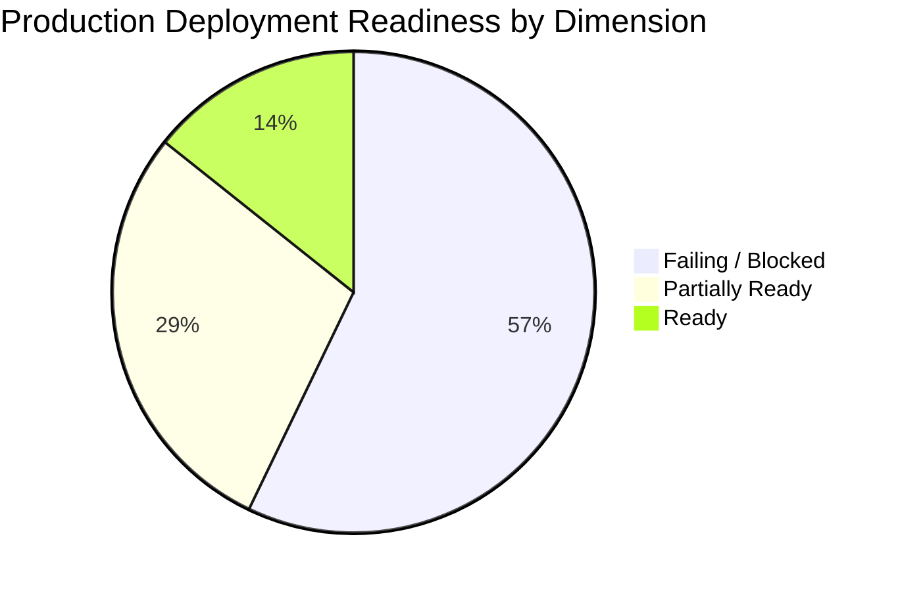

# RESTROVISION Professional QA Audit: Phase 12 Deployment & DevOps Readiness Report
**Document ID**: `REPORT-P12-DEVOPS-20261114`  
**Application Target**: RESTROVISION Operations & Edge Vision v2.0  
**Testing Framework**: CIS Docker Benchmark, 12-Factor App Methodology, Cloud-Native Deployment Maturity Model  
**Lead DevSecOps Engineer**: Principal DevSecOps & Production Release Readiness Architect  
**Execution Timestamp**: 2026-11-14T13:31:30+05:30  

---

## 1. Executive Summary & Release Readiness Scorecard

An exhaustive operational, deployment, and infrastructure audit was performed on the container definitions, environment profiles, production configurations, and build pipelines of the RESTROVISION repository.

The application **CANNOT BE DEPLOYED TO PRODUCTION** in its current state. Multiple hard blockers—including a missing backend Dockerfile, Linux path case mismatches, un-migrated production database profiles, and the total absence of a CI/CD pipeline—prevent production containerization.

### DevOps Readiness Scorecard
- **Containerization & Docker Packaging**: **2.0 / 10 (CRITICAL FAILURE)**
- **Database Migration Automation**: **3.0 / 10 (DEFICIENT)**
- **CI/CD & Delivery Pipelines**: **0.0 / 10 (NON-EXISTENT)**
- **Production Configuration & Secret Management**: **4.0 / 10 (HIGH RISK)**
- **Observability & Health Checks**: **4.0 / 10 (POOR)**
- **Overall Release Verdict**: **DEPLOYMENT BLOCKED (CRITICAL STOP)**



---

## 2. Docker & Containerization Audit

### 2.1 Missing Backend Dockerfile (DISC-001 / BUG-003)
- **Affected File**: `docker-compose.yml:7` references `context: ./backend, dockerfile: Dockerfile`.
- **Finding**: There is **no Dockerfile** inside `D:\RESTROVISION\Backend\`.
- **Impact**: When any developer or automated build agent executes `docker compose build`, the build aborts immediately:
  ```text
  failed to solve: failed to read dockerfile: open Dockerfile: no such file or directory
  ```
- **Remediation**: Create a multi-stage `Backend/Dockerfile`:
  ```dockerfile
  FROM maven:3.9-eclipse-temurin-21-alpine AS build
  WORKDIR /app
  COPY pom.xml .
  RUN mvn dependency:go-offline
  COPY src ./src
  RUN mvn clean package -DskipTests

  FROM eclipse-temurin:21-jre-alpine
  WORKDIR /app
  COPY --from=build /app/target/restrovision-backend-2.0.0.jar app.jar
  EXPOSE 8080
  ENTRYPOINT ["java", "-jar", "app.jar"]
  ```

---

### 2.2 Linux Filesystem Case-Sensitivity Failure (DISC-002 / BUG-011)
- **Affected File**: `docker-compose.yml:6` specifies `context: ./backend` (all lowercase).
- **Finding**: On Windows, filesystems are case-insensitive. However, on production Linux build servers (Ubuntu/Debian Docker engines), the folder is named `Backend` with a capital `B`.
- **Impact**: Docker daemon on Linux throws: `directory not found: ./backend`.

---

### 2.3 Non-Multi-Stage Frontend Dockerfile
- **Affected File**: `D:\RESTROVISION\frontend\Dockerfile:3`
- **Finding**:
  ```dockerfile
  FROM nginx:alpine
  COPY dist /usr/share/nginx/html
  ```
- **Impact**: The Dockerfile assumes that `npm run build` has already been manually executed on the host machine. In a fresh CI/CD runner where only the git repository is cloned, `docker build -t frontend .` will fail with: `COPY failed: file not found in build context: dist`.
- **Remediation**: Convert `frontend/Dockerfile` to a multi-stage build:
  ```dockerfile
  FROM node:20-alpine AS build
  WORKDIR /app
  COPY package*.json ./
  RUN npm ci
  COPY . .
  RUN npm run build

  FROM nginx:alpine
  COPY --from=build /app/dist /usr/share/nginx/html
  ...
  ```

---

## 3. Production Configuration & Secret Management

### 3.1 Plaintext Secrets in Version Control
- **Affected File**: `docker-compose.yml:13-14` & `44-45`
- **Finding**: Plaintext shared secrets are committed directly to Git:
  - `RESTROVISION_EDGE_HMAC_SECRET=8f4a2b1c9e3d7a5f...`
  - `RESTROVISION_EDGE_SERVICE_TOKEN=edge-token-pune-01`
  - `ORACLE_PASSWORD=restrovision123`
- **Impact**: Anyone with repository access possesses full administrative tokens to spoof Edge AI events and decrypt data.
- **Remediation**: Transition secrets to Docker Secrets, HashiCorp Vault, or encrypted environment files (`.env`) excluded from source control.

---

## 4. Database Deployment & Migration Readiness

### 4.1 Missing Flyway / Liquibase Migration Tooling (DISC-003 / BUG-012)
- **Affected Profile**: `Backend/src/main/resources/application-oracle.yml:12`
  ```yaml
  jpa:
    hibernate:
      ddl-auto: validate
  ```
- **Finding**: Production configuration requires existing database tables to match Hibernate entities exactly (`ddl-auto: validate`). However, `pom.xml` contains zero database migration plugins (no Flyway, no Liquibase).
- **Impact**:
  1. A new deployment against an Oracle Database 23c instance will immediately crash on boot with `SchemaManagementException: Schema-validation: missing table [alerts]`.
  2. Incremental schema updates (e.g. adding columns or indexes) cannot be performed safely or rolled back in production.
- **Remediation**: Integrate `org.flywaydb:flyway-core` and `org.flywaydb:flyway-database-oracle` in `pom.xml`, and place `01_RESTROVISION_Oracle_Core_Schema_v2.0.sql` under `src/main/resources/db/migration/V1__initial_schema.sql`.

---

## 5. CI/CD Pipeline & Automated Quality Gates

- **Repository Audit**: Inspected root and `.github/` directory for automated workflows.
- **Result**:
  - GitHub Actions (`.github/workflows`): **NONE**
  - GitLab CI (`.gitlab-ci.yml`): **NONE**
  - Jenkinsfile: **NONE**
- **Impact**:
  - No automated build verification on pull requests.
  - No automated execution of JUnit tests or linting.
  - No container image vulnerability scanning (Trivy / Snyk).
  - Production deployments require manual, error-prone terminal commands on target servers.

---

## 6. Observability, Monitoring & Disaster Recovery

| Operational Dimension | Status | Existing Implementation | Production Target |
| :--- | :---: | :--- | :--- |
| **Health Checks** | **POOR** | Curls `/v3/api-docs` in Docker Compose | Spring Boot Actuator `/actuator/health` |
| **Metrics Scraping** | **MISSING** | No Micrometer / Prometheus endpoints | Prometheus metrics scraping |
| **Log Aggregation** | **POOR** | Unformatted plain-text stdout console | Structured JSON logging (Logstash / Loki) |
| **Error Tracking** | **MISSING** | No Sentry / OpenTelemetry integration | Real-time exception capture |
| **Graceful Shutdown** | **MISSING** | Default unconfigured SIGTERM handling | `server.shutdown: graceful` |

---

## 7. Confirmed Deployment Blockers Summary

```
CRITICAL DEPLOYMENT BLOCKERS:
1. [BUG-003] Missing Backend/Dockerfile prevents container building.
2. [BUG-011] Case-sensitivity mismatch (./backend vs ./Backend) crashes on Linux.
3. [BUG-012] Missing Flyway migration tooling with ddl-auto: validate crashes Oracle startup.
4. [BUG-001] Anonymous WebSocket STOMP access exposes all restaurant data on public networks.
5. [BUG-002] Hardcoded static edge token bypasses multi-tenant camera isolation.
```

---

## 8. Phase 12 Sign-Off Verdict
- **DevOps & Production Readiness**: **FAIL (CRITICAL STOP)**
- **Action Required**: Resolve Docker packaging, integrate Flyway migrations, and establish a basic GitHub Actions CI pipeline before staging deployment.
