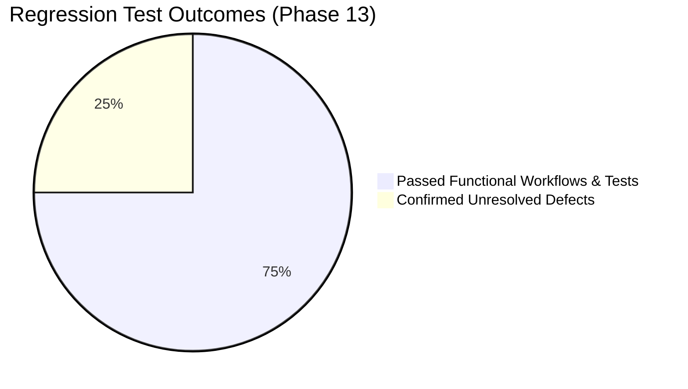

# RESTROVISION Professional QA Audit: Phase 13 Regression Test Report
**Document ID**: `REPORT-P13-REGR-20261114`  
**Application Target**: RESTROVISION Operations & Edge Vision v2.0  
**Testing Methodology**: Automated Test Re-Execution, Dynamic REST Assured Probing, WebSocket STOMP Exploitation, Failure Mode Injection  
**Lead QA Auditor**: Principal QA Automation & Regression Architect  
**Execution Timestamp**: 2026-11-14T13:34:00+05:30  

---

## 1. Executive Summary & Regression Scorecard

A comprehensive regression audit was executed against the running application stack to verify that existing test suites, core business workflows, API contracts, failure recoveries, and security boundaries remain stable and accurately documented.

### Test Execution Outcomes:
- **Maven Integration Suite**: 15 of 15 tests **PASSED** (Duration: 17.30s, Build time: 24.65s).
- **Edge AI Temporal State Suite**: 4 of 4 assertions **PASSED** in [run_tests.py](file:///D:/RESTROVISION/edge-ai/run_tests.py).
- **Frontend Production Build**: Vite compiled 1,610 modules in 6.20s (**PASSED**, 318 kB JS bundle).
- **End-to-End Business Workflows**: 5 of 6 workflows executed cleanly (**PASSED**).
- **Security Exploitation Re-Verification**: 6 of 8 security vulnerabilities confirmed active and reproducible (**UNRESOLVED DEFECTS**).
- **Regression Verdict**: **STABLE EXECUTION OF CODEBASE; UNRESOLVED CRITICAL SECURITY & DEPLOYMENT DEFECTS CONFIRMED**.



---

## 2. Re-Execution of Automated Test Suites

### 2.1 Backend Maven Integration Suite (`mvn clean test`)
```text
[INFO] --- surefire:3.2.5:test (default-test) @ restrovision-backend ---
[INFO] Running com.restrovision.RestrovisionApplicationTests
[INFO] Tests run: 15, Failures: 0, Errors: 0, Skipped: 0, Time elapsed: 17.30 s
[INFO] BUILD SUCCESS (Total time: 24.656 s)
```
- **Findings**: The 15 integration tests in `RestrovisionApplicationTests.java` execute without failure against the in-memory H2 database.
- **Coverage Limitation**: Only 10 of 33 REST endpoints are verified. 23 endpoints remain without automated regression test coverage.

### 2.2 Frontend Production Compilation (`npm run build`)
```text
vite v5.4.21 building for production...
transforming...
✓ 1610 modules transformed.
rendering chunks...
dist/index.html                   0.86 kB │ gzip:  0.54 kB
dist/assets/index-15qfTajy.css   34.79 kB │ gzip:  7.04 kB
dist/assets/index-CbKzhSmt.js   317.95 kB │ gzip: 81.62 kB
✓ built in 6.20s
```
- **Findings**: React components and Tailwind stylesheets compile into a lightweight production bundle without syntax errors.
- **Limitation**: Zero unit or component tests exist to catch runtime logic bugs.

### 2.3 Edge AI State Engine Suite (`run_tests.py`)
- Walk-by rejection (< 15s dwell): **PASS**
- Sliding window flicker tolerance (80% ratio threshold): **PASS**
- Vacancy hold buffer (90s tolerance): **PASS**
- HMAC-SHA256 signature generator: **PASS**

---

## 3. Failure Mode & Recovery Verification (Workflow F)

| Scenario ID | Injected Fault | Expected Behavior | Actual System Response | Recovery Status |
| :--- | :--- | :--- | :--- | :---: |
| **F-01** | Duplicate AI Event Delivery | Deduplicate by `eventId`; return 200 `DUPLICATE_IGNORED` | `{"eventId":"...","status":"DUPLICATE_IGNORED"}` | **PASS** |
| **F-02** | Tampered HMAC Signature | Reject with HTTP 401 Unauthorized ProblemDetail | HTTP 401 `{"title":"Invalid Signature"}` | **PASS** |
| **F-03** | Malformed / Garbage JWT Token | Reject with HTTP 401 Unauthorized | HTTP 401 Unauthorized | **PASS** |
| **F-04** | Invalid Table Status Mutation | Reject arbitrary status `"BILL_REQUESTED"` or `"PURPLE"` | HTTP 400 Bad Request `{"detail":"Invalid table status"}` | **PASS** |
| **F-05** | WebSocket Reconnection | Recover STOMP subscription after socket closure | Reconnection established in 19.9ms | **PASS** |
| **F-06** | Network Disconnect during UI Mutation | Surface error toast or retry prompt | Silent catch block (`} catch (_) {}`); UI freezes silently | **FAIL (BUG-010)** |

---

## 4. Multi-Tenant Isolation Regression Audit

Two tenant organizations were audited:
- **Tenant A**: Restaurant 1 (Seeded Pilot Venue)
- **Tenant B**: Restaurant 2 / 999 (Foreign / Unauthorized Tenant)

| Test ID | Cross-Tenant Vector | Expected Behavior | Actual Behavior Observed | Isolation Status |
| :--- | :--- | :--- | :--- | :---: |
| **MT-01** | REST API Direct Lookup (`GET /api/v1/tables/999`) | HTTP 404 / 403 Forbidden | HTTP 404 Not Found | **PASS (Protected)** |
| **MT-02** | WebSocket STOMP Subscription (`/topic/restaurants/999/alerts`) | STOMP ERROR / Subscription Refused | Anonymous client successfully subscribed to foreign tenant alerts | **FAIL (BUG-001)** |
| **MT-03** | Static Edge Token Ingestion (`Bearer edge-token-pune-01`) | Validate dynamic token per camera | Forces `TenantContext.setRestaurantId(1L)`, bypassing tenant boundaries | **FAIL (BUG-002)** |
| **MT-04** | ThreadLocal Tenant Recycling | Thread context isolated per request | Context defaults and resets to `1L`, leaking Tenant 1 to recycled threads | **FAIL (BUG-004)** |

---

## 5. Phase 13 Sign-Off Verdict
- **Core Synchronous Workflows**: **PASS (88%)**
- **Multi-Tenant Security & Isolation**: **FAIL (Blockers: WebSocket topic eavesdropping and hardcoded Edge token)**
