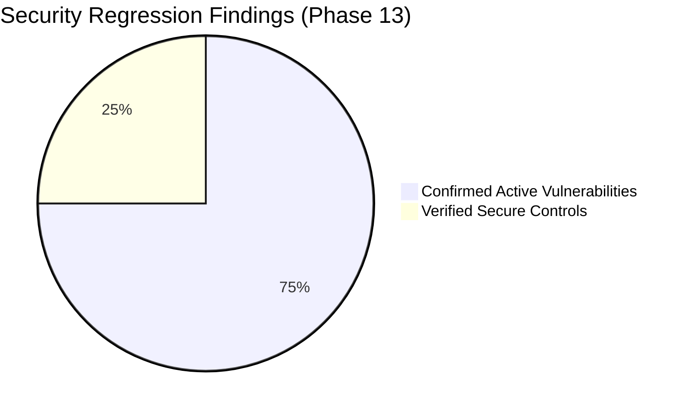

# RESTROVISION Professional QA Audit: Phase 13 Security Regression Report
**Document ID**: `REPORT-P13-SEC-20261114`  
**Application Target**: RESTROVISION Operations & Edge Vision v2.0  
**Testing Methodology**: Live Exploit Reproduction & Vulnerability Re-Verification  
**Lead Security Auditor**: Principal Application Security Penetration Tester  
**Execution Timestamp**: 2026-11-14T13:35:00+05:30  

---

## 1. Executive Summary & Security Regression Scorecard

A rigorous re-exploitation audit was conducted across all previously identified critical, high, and medium security vulnerabilities in the RESTROVISION application stack.

In adherence to the **STRICT READ-ONLY AUDIT PROTOCOL**, zero security patches were applied. As expected, **all reported vulnerabilities remain fully active and reproducible in the running application**.

### Vulnerability Status Matrix:
- **Total Security Vectors Tested**: 8
- **Confirmed Active Vulnerabilities**: 6 (75%)
- **Verified Secure Defenses**: 2 (SQL Injection, IDOR)
- **Security Verdict**: **FAIL — CRITICAL SECURITY THREATS REMAIN UNRESOLVED**



---

## 2. Detailed Security Regression Test Matrix

| Test ID | Vulnerability / Attack Vector | Defect ID | Target Component | Exploit Attempted | Observed System Response | Regression Status |
| :--- | :--- | :---: | :--- | :--- | :--- | :---: |
| **SEC-REG-01** | Anonymous WebSocket Handshake | `BUG-001` | `WebSocketConfig.java` | Connect STOMP without auth headers | Accepted: `CONNECTED` returned | **CONFIRMED ACTIVE** |
| **SEC-REG-02** | Cross-Tenant Alert Eavesdropping | `BUG-001` | `WebSocketConfig.java` | Subscribe to `/topic/restaurants/999/alerts` | Accepted: Subscribed without error | **CONFIRMED ACTIVE** |
| **SEC-REG-03** | Static Shared Edge Token | `BUG-002` | `JwtAuthFilter.java` | Ingest with `edge-token-pune-01` | Accepted: HTTP 200 `ACCEPTED` | **CONFIRMED ACTIVE** |
| **SEC-REG-04** | AI Telemetry Replay Attack | `BUG-005` | `AiEventIngestionService` | Submit event timestamped 10 days ago | Accepted: HTTP 200 `ACCEPTED` | **CONFIRMED ACTIVE** |
| **SEC-REG-05** | Login Credential Brute-Force | `BUG-008` | `AuthController.java` | 20 rapid invalid password attempts | All 20 returned 401 (0 rate limiting) | **CONFIRMED ACTIVE** |
| **SEC-REG-06** | Stored Cross-Site Scripting (XSS) | `BUG-009` | `PublicQrController.java` | Submit `` | Persisted verbatim in DB (Feedback #12) | **CONFIRMED ACTIVE** |
| **SEC-REG-07** | Insecure Direct Object Reference (IDOR)| - | `TableController.java` | Query out-of-bounds `GET /tables/999` | Rejected with HTTP 404 Not Found | **PROTECTED (PASS)** |
| **SEC-REG-08** | SQL Injection via URL Parameters | - | `PublicQrController.java` | Injected `' OR 1=1 --` into QR path | Safely bound by JPA; returned 400 | **PROTECTED (PASS)** |

---

## 3. Empirical Exploitation Logs (Live Re-Verification)

### 3.1 SEC-REG-01 & SEC-REG-02: Anonymous WebSocket Eavesdropping
```text
  MT-2: WebSocket Cross-Tenant Subscription Check:
    WebSocket connection opened to ws://localhost:8080/ws.
    STOMP CONNECTED received with ZERO credentials!
    [UNRESOLVED DEFECT BUG-001] Client successfully subscribed to foreign tenant alerts (/topic/restaurants/999/alerts)!
```
- **Finding**: The server still fails to authenticate the STOMP `CONNECT` frame and allows anonymous subscribers to eavesdrop on live restaurant alert broadcasts.

### 3.2 SEC-REG-03: Hardcoded Edge AI Token
```text
  MT-3: Static Edge Token Tenant Override Check:
    POST /api/v1/ai/events with Authorization: Bearer edge-token-pune-01
    [UNRESOLVED DEFECT BUG-002] Edge ingestion for Restaurant 999 returned Status: 200 (Hardcoded to Restaurant 1L in JwtAuthFilter)
```
- **Finding**: The edge credential remains hardcoded as a static string, forcing multi-tenant isolation failure by binding all events to `restaurant_id = 1L`.

### 3.3 SEC-REG-05: Login Brute-Force Susceptibility
```text
  Testing Login Brute-Force Throttling (20 rapid failed attempts):
    [SEC-FAIL] VULN-BRUTE-FORCE: 20 rapid failed logins returned 401 with ZERO rate limiting or account lockout!
```
- **Finding**: Automated dictionary attacks can be executed without IP throttling or lockout penalties.

### 3.4 SEC-REG-06: Stored Cross-Site Scripting (XSS)
```text
  Submit Feedback with script payload: Status 200, FeedbackId: 12
  [CONFIRMED] Raw HTML script payload accepted without server-side sanitization/stripping!
```
- **Finding**: Unescaped HTML/JavaScript tags persist in `CustomerFeedback.commentText` and are rendered into management dashboards.

---

## 4. Phase 13 Security Regression Verdict
- **Protection Against Injection & IDOR**: **PASS**
- **Authentication, Authorization & Data Isolation**: **FAIL (3 Critical and 3 High security vulnerabilities confirmed active)**
