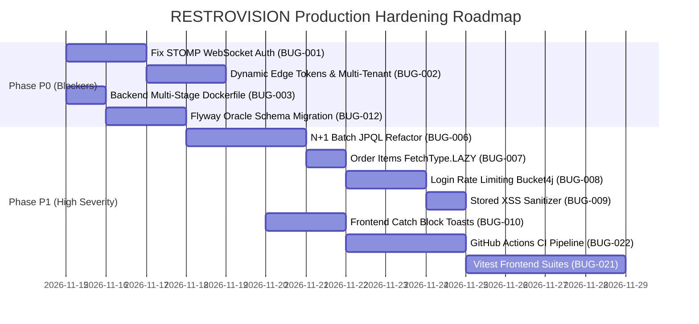

# RESTROVISION Remediation Roadmap & Engineering Action Plan
**Document ID**: `PLAN-REMEDIATION-20261114`  
**Application Target**: RESTROVISION v2.0  
**Lead Architect**: Principal Software Architect & Release Readiness Authority  
**Last Updated**: 2026-11-14T13:35:00+05:30  

---

## 1. Prioritized Remediation Summary

---

## 2. Priority P0: Critical Security, Multi-Tenancy & Packaging (Must-Fix Blockers)

### Task P0-1: STOMP WebSocket Authentication & Topic Authorization (`BUG-001`)
- **Target File**: `Backend/src/main/java/com/restrovision/config/WebSocketConfig.java`
- **Estimated Effort**: 8 Engineering Hours
- **Action**: Register a `ChannelInterceptor` in `configureClientInboundChannel`. On `StompCommand.CONNECT`, extract `Authorization: Bearer <token>`, validate with `JwtService`, and store `principal` and `restaurantId` in session attributes. On `StompCommand.SUBSCRIBE`, verify that the destination `/topic/restaurants/{id}/*` matches the authenticated `restaurantId`; reject mismatch with STOMP `ERROR`.
- **Verification Criteria**: Anonymous STOMP connection is rejected with socket termination; attempting to subscribe to a foreign restaurant topic throws an authorization error.

### Task P0-2: Dynamic Edge Device Authentication & Tenant Binding (`BUG-002`)
- **Target Files**: `Backend/src/main/java/com/restrovision/security/JwtAuthFilter.java` & `edge-ai/app/camera/camera_worker.py`
- **Estimated Effort**: 12 Engineering Hours
- **Action**: Remove `if ("edge-token-pune-01".equals(token))` and hardcoded `TenantContext.setRestaurantId(1L)`. Issue dynamic JWTs per edge camera containing explicit tenant (`restaurant_id`) and camera claims. Validate tokens symmetrically or via x509 mutual TLS.
- **Verification Criteria**: Events submitted with `edge-token-pune-01` are rejected with HTTP 401; events signed by Camera A cannot write to Camera B.

### Task P0-3: Multi-Stage Backend Dockerfile & Compose Path Fix (`BUG-003`, `BUG-011`)
- **Target Files**: `Backend/Dockerfile` & `docker-compose.yml`
- **Estimated Effort**: 4 Engineering Hours
- **Action**: Author a multi-stage `Backend/Dockerfile` using `maven:3.9-eclipse-temurin-21-alpine` and `eclipse-temurin:21-jre-alpine`. Update `docker-compose.yml` line 6 to `context: ./Backend` (matching directory casing).
- **Verification Criteria**: `docker compose build` succeeds cleanly on both Windows and Linux hosts.

### Task P0-4: Automated Flyway Database Migration (`BUG-012`)
- **Target Files**: `Backend/pom.xml`, `application-oracle.yml`, and `src/main/resources/db/migration/V1__initial_schema.sql`
- **Estimated Effort**: 8 Engineering Hours
- **Action**: Add `org.flywaydb:flyway-core` and `org.flywaydb:flyway-database-oracle` to `pom.xml`. Place Oracle DDL script as V1 migration.
- **Verification Criteria**: Application boots successfully against an empty Oracle schema with `ddl-auto: validate`.

---

## 3. Priority P1: High-Severity Operational & Stability Deficiencies

| Task ID | Defect ID | Target File / Component | Remediation Summary | Effort | Verification Criteria |
| :--- | :---: | :--- | :--- | :---: | :--- |
| **P1-1** | `BUG-006` | `TableStateMachineService.java:59` | Replace $1+2N$ loop with single JPQL `LEFT JOIN` query. | 12 hrs | DB round-trips drop from 17 to 1; 100 VU latency < 50ms. |
| **P1-2** | `BUG-007` | `Order.java:43` | Change `items` fetch type from `EAGER` to `LAZY`. | 4 hrs | JPA query log confirms child rows are not eagerly loaded. |
| **P1-3** | `BUG-008` | `AuthController.java:35` | Implement Bucket4j filter (5 attempts/min per IP). | 8 hrs | 6th rapid invalid login returns HTTP 429 Too Many Requests. |
| **P1-4** | `BUG-009` | `PublicQrController.java:120` | Server-side HTML stripping via OWASP HTML Sanitizer. | 4 hrs | Injected `<script>` tags are neutralized before DB save. |
| **P1-5** | `BUG-010` | `frontend/src/pages/*.jsx` | Replace 17 empty catch blocks with toast notifications. | 12 hrs | Network errors display visible warning toast to staff. |
| **P1-6** | `BUG-005` | `AiEventIngestionService.java:45` | Enforce timestamp freshness check ($\le 60\text{ seconds}$). | 4 hrs | Events timestamped >60s in the past rejected with 400. |
| **P1-7** | `BUG-004` | `TenantContext.java:12` | Remove ThreadLocal default `1L`; use `CURRENT_TENANT.remove()`. | 4 hrs | Recycled threads do not inherit Tenant 1 context. |
| **P1-8** | `BUG-022` | Root repository | Create `.github/workflows/ci.yml` for automated builds. | 16 hrs | PRs automatically trigger Maven test, Vite build, & linter. |
| **P1-9** | `BUG-021` | `frontend/package.json` | Add Vitest, React Testing Library, and core unit tests. | 24 hrs | Minimum 60% component branch coverage across 9 views. |

---

## 4. Priority P2 & P3: Performance, Accessibility & Polish

- **P2-1 (`BUG-013`)**: Deploy Cloudflare Turnstile / rate limiting on public feedback submissions.
- **P2-2 (`BUG-014`)**: Transition JWT access and refresh tokens from `localStorage` to `HttpOnly` cookies.
- **P2-3 (`BUG-015`)**: Refactor 1,015-line `Analytics.jsx` into modular components (`PnLCard.jsx`, `CrowdCurveChart.jsx`).
- **P2-4 (`BUG-016`)**: Add `@Version private Long version;` to `TableSession`, `StaffTask`, and `ServiceRequest`.
- **P2-5 (`BUG-023`)**: Convert `frontend/Dockerfile` to multi-stage Docker build.
- **P3-1 (`BUG-018`)**: Add explicit `<label>` tags to login fields and `aria-label` to star rating buttons.
- **P3-2 (`BUG-019`)**: Add `overflow-x-hidden` on mobile containers to fix 6px horizontal scroll overflow.
- **P3-3 (`BUG-020`)**: Integrate real ONNX runtime inference or update UI version tags to accurately reflect heuristic models.
