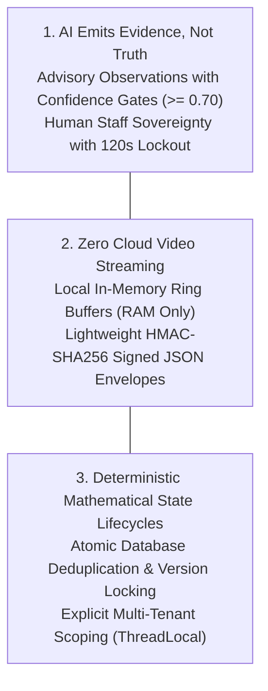
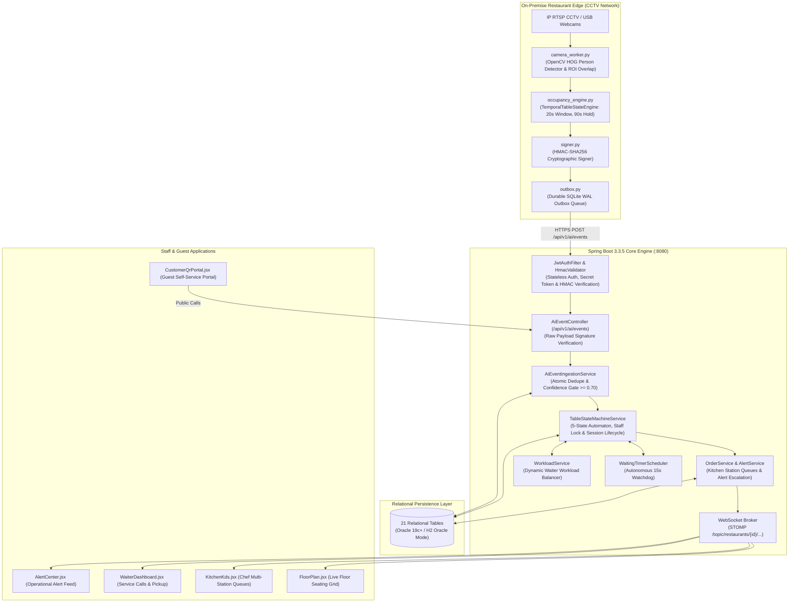
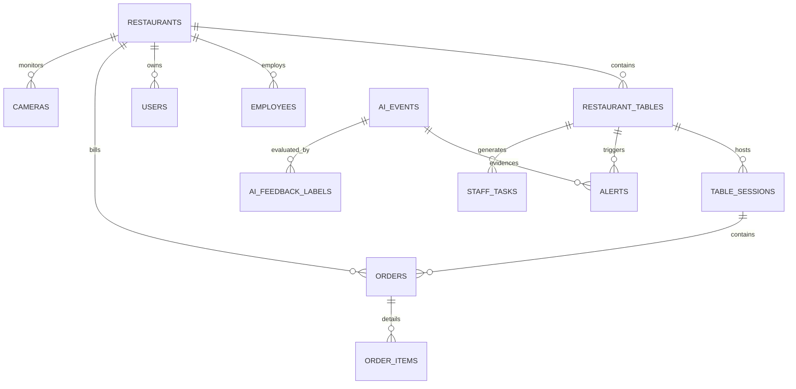
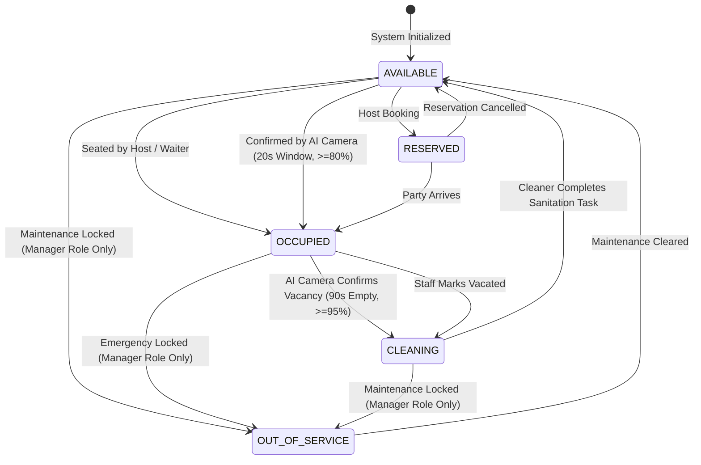

# RESTROVISION — Master Architecture, Class-by-Class Reference & Technical Study Manual
**Version**: 2.0.0 (Production Reference Edition)  
**System Type**: Distributed Restaurant Operations, Computer Vision Edge Ingestion, Kitchen Production & Real-Time Orchestration  
**Runtime Targets**: Java 25 (Spring Boot 3.3.5) | Python 3.13 (OpenCV 5.0, FastAPI) | React 18 (Vite 5, Tailwind CSS) | Oracle 19c+ / H2 (Oracle Mode)

---

## Table of Contents
1. [Product Overview & Foundational Principles](#1-product-overview--foundational-principles)
2. [End-to-End System Architecture & Data Flow Traces](#2-end-to-end-system-architecture--data-flow-traces)
   - 2.1 [System Architecture Diagram](#21-system-architecture-diagram)
   - 2.2 [Trace 1: Physical Camera Frame to WebSocket Floor Plan Mutation](#22-trace-1-physical-camera-frame-to-websocket-floor-plan-mutation)
   - 2.3 [Trace 2: Dining Order Placement & Station-Based Kitchen Routing](#23-trace-2-dining-order-placement--station-based-kitchen-routing)
   - 2.4 [Trace 3: Autonomous 15-Second Background Watchdog & Wait-Time Escalation](#24-trace-3-autonomous-15-second-background-watchdog--wait-time-escalation)
   - 2.5 [Trace 4: Customer QR Self-Service & Feedback NLP Ingestion](#25-trace-4-customer-qr-self-service--feedback-nlp-ingestion)
   - 2.6 [Trace 5: Waiter Workload Balancing Algorithm & Overload Detection](#26-trace-5-waiter-workload-balancing-algorithm--overload-detection)
   - 2.7 [Trace 6: False-Alarm Mitigation & Machine Learning Retraining Loop](#27-trace-6-false-alarm-mitigation--machine-learning-retraining-loop)
3. [Spring Boot Backend: Exhaustive Class-by-Class Reference](#3-spring-boot-backend-exhaustive-class-by-class-reference)
   - 3.1 [Application Bootstrap & Configuration (`config/`)](#31-application-bootstrap--configuration-config)
   - 3.2 [Security, Authentication & Multi-Tenancy (`security/`)](#32-security-authentication--multi-tenancy-security)
   - 3.3 [Core Business Services (`service/`)](#33-core-business-services-service)
   - 3.4 [REST API Controllers (`controller/`)](#34-rest-api-controllers-controller)
   - 3.5 [Domain Entities & Persistence Mapping (`domain/`)](#35-domain-entities--persistence-mapping-domain)
   - 3.6 [Repository Layer & Query Methods (`repository/`)](#36-repository-layer--query-methods-repository)
   - 3.7 [Data Transfer Objects & Payloads (`dto/`)](#37-data-transfer-objects--payloads-dto)
4. [Edge AI Subsystem: Complete Python Module Reference](#4-edge-ai-subsystem-complete-python-module-reference)
   - 4.1 [Camera Ingestion Worker (`camera_worker.py`)](#41-camera-ingestion-worker-camera_workerpy)
   - 4.2 [Temporal State Engine (`occupancy_engine.py`)](#42-temporal-state-engine-occupancy_enginepy)
   - 4.3 [HMAC Cryptographic Signer (`signer.py`)](#43-hmac-cryptographic-signer-signerpy)
   - 4.4 [Durable SQLite Outbox (`outbox.py`)](#44-durable-sqlite-outbox-outboxpy)
   - 4.5 [Traffic & Demand Predictive Forecasters (`traffic.py`, `demand.py`)](#45-traffic--demand-predictive-forecasters-trafficpy-demandpy)
   - 4.6 [Sentiment & Topic NLP Classifier (`sentiment.py`)](#46-sentiment--topic-nlp-classifier-sentimentpy)
   - 4.7 [FastAPI Edge Server (`main.py`)](#47-fastapi-edge-server-mainpy)
   - 4.8 [Automated Test Suite (`run_tests.py`, `test_state_engine.py`)](#48-automated-test-suite-run_testspy-test_state_enginepy)
5. [Database Schema & State Machine Lifecycles](#5-database-schema--state-machine-lifecycles)
6. [Comprehensive Viva & Technical Architecture Defense](#6-comprehensive-viva--technical-architecture-defense)

---

## 1. Product Overview & Foundational Principles

RESTROVISION is an enterprise hospitality platform designed to unify on-premise computer vision telemetry with restaurant operations: real-time table turnover, kitchen order routing, customer self-service QR ordering, staff task management, and operations analytics.

### The Three Core Architectural Principles



1. **AI Emits Evidence, Not Truth**:
   * Computer Vision models function as advisory sensors. They submit detection events with confidence scores ($0.0 \dots 1.0$).
   * Low-confidence events ($< 0.70$) are dropped immediately (`REJECTED_BY_RULE`).
   * Human staff members maintain absolute override authority. If a manager, host, or waiter manually sets a table state, an internal lock (`staffOverrideLockSeconds = 120`) prevents any camera AI observation from reverting that decision for 2 full minutes.
2. **Zero Cloud Video Streaming (Privacy by Design)**:
   * High-resolution CCTV frames stream strictly over the local on-premise network to the local Edge PC.
   * Video frames are processed strictly in volatile RAM ring buffers. No guest face portraits, biometric embeddings, or uncompressed video files are ever written to disk or transmitted to the cloud.
   * The only outbound data emitted by the vision system is a lightweight ($< 800\text{ bytes}$), HMAC-SHA256 authenticated JSON event envelope.
3. **Deterministic State Lifecycles & Idempotent Ingestion**:
   * Physical tables, orders, and alert records follow strict mathematical finite-state automata.
   * Concurrent network requests or retried HTTP frames cannot double-seat guests or produce duplicate orders. Deduplication is enforced at both the application memory layer and via database unique constraints on `(restaurant_id, event_uid)`.

---

## 2. End-to-End System Architecture & Data Flow Traces

### 2.1 System Architecture Diagram



---

### 2.2 Trace 1: Physical Camera Frame to WebSocket Floor Plan Mutation

1. **Frame Capture**: `camera_worker.py` captures a BGR video frame ($1920\times 1080$, 30 FPS) from an IP RTSP camera or local webcam using OpenCV `cv2.VideoCapture`.
2. **Preprocessing**: The frame is resized to width 640 to enable CPU real-time execution ($30\text{ FPS}$).
3. **Person Detection**: OpenCV's built-in HOG person detector (`cv2.HOGDescriptor`) scans the frame every second frame.
4. **Spatial Intersection**: The detected person bounding boxes are mapped against predefined Table Region of Interest (ROI) polygons (`TABLE_ROIS`). The `box_overlap()` function calculates intersection over area. If overlap $> 0.25$, person presence for that table is marked `True`.
5. **Temporal Sliding Window**: The presence boolean is fed into `TemporalTableStateEngine.update_frame(table_id, person_detected, timestamp)`.
   * The engine evaluates a 20-second history buffer.
   * If continuous dwell time $\ge 15\text{ s}$ AND positive frame ratio $\ge 80\%$, the engine transitions internal state to `OCCUPIED` and returns string `"TABLE_OCCUPIED"`.
6. **Payload Signing**: `camera_worker.py` constructs a JSON payload containing `eventId` (UUID), `restaurantId`, `cameraId`, `tableId`, `confidence`, and `dwellTimeSeconds`. It calls `signer.compute_hmac_signature(json_bytes)` which generates an `X-Signature: sha256=<hex_digest>` header using `settings.SECRET_KEY`.
7. **HTTP Dispatch**: The worker performs an HTTP POST request to `http://localhost:8080/api/v1/ai/events` with the `Authorization: Bearer edge-token-pune-01` and `X-Signature` headers.
8. **Security Filter**: `JwtAuthFilter` intercepts the request, recognizes the edge service token, authenticates the caller with `ROLE_AI_SERVICE`, and sets `TenantContext.setRestaurantId(1L)`.
9. **HMAC Gate**: `AiEventController` intercepts raw byte payload. Before deserializing JSON, `hmacValidator.verifySignature(rawBytes, signature)` recomputes `HmacSHA256(rawBytes, secret)` and performs a constant-time comparison `MessageDigest.isEqual(...)`.
10. **Ingestion & Deduplication**: `AiEventIngestionService.ingestEvent()`:
    * Performs atomic insert into `AI_EVENTS`. If duplicate `eventUid` exists, catches `DataIntegrityViolationException` and returns `DUPLICATE_IGNORED`.
    * Enforces confidence threshold ($\text{confidence} \ge 0.70$). Detections below 0.70 are saved with status `REJECTED_BY_RULE` and dropped.
11. **State Machine Execution**: `TableStateMachineService.handleAiOccupied()`:
    * Checks `staffOverrideLockSeconds = 120`: If staff recently overrode status, AI is suppressed.
    * Checks table status: If `CLEANING` and `partySize < 2`, presence is classified as cleaning staff and suppressed.
    * Updates table status to `OCCUPIED`, status source to `AI`, sets `statusChangedAt = now`.
    * Opens a new active `TableSession` with `status = 'ACTIVE'` and `seatedAt = now`.
12. **WebSocket Broadcast**: `NotificationService.publishTableUpdate()` serializes the updated table list into a STOMP message and pushes it to destination `/topic/restaurants/1/tables`.
13. **Client Mutation**: React component `FloorPlan.jsx` receives the STOMP frame and re-renders table `T01` from green (`AVAILABLE`) to red (`OCCUPIED`).

---

### 2.3 Trace 2: Dining Order Placement & Station-Based Kitchen Routing

1. **Order Construction**: A server on `FloorPlan.jsx` or `WaiterDashboard.jsx` selects Table `T01`, picks dishes from the catalog, and submits `POST /api/v1/orders`.
2. **Validation**: `OrderService.createOrder()` validates:
   * Line items list is not empty.
   * Every line item quantity is $> 0$.
   * Resolves dish unit prices and station mappings (`Grill`, `Saute`, `Salad`, `Bar`) directly from `menuItemRepository`.
3. **Persistence**:
   * Generates a unique collision-free order code: `"ORD-" + restaurantId + "-" + timestamp + "-" + random`.
   * Inserts `Order` entity with status `CONFIRMED`.
   * Inserts `OrderItem` child entities with status `CONFIRMED`.
   * Updates `TableSession.orderedAt = now`.
4. **KDS Dispatch**: `NotificationService.publishOrderUpdate()` broadcasts the order to `/topic/restaurants/1/orders`.
5. **Kitchen Display System**: `KitchenKds.jsx` receives the order. The ticket appears in the queues for relevant preparation stations.
6. **Cooking Phase**: The station chef clicks **Start Cooking** (`PUT /api/v1/kitchen/orders/{id}/start`). `OrderService.updateOrderStatus()` transitions status to `PREPARING`, sets `OrderItem.preparationStartedAt = now`, and starts countdown timers.
7. **Pass Expediting**: When all items are plated, the chef clicks **Mark Ready** (`PUT /api/v1/kitchen/orders/{id}/ready`).
   * `OrderService` updates status to `READY`.
   * Automatically calls `AlertService.createOrUpdateAlert()` with alert type `ORDER_READY_FOR_DELIVERY` (`priority = MEDIUM`), targeted to the table's assigned server.
   * `NotificationService.publishAlert()` broadcasts the pickup alert.
8. **Delivery**: The waiter delivers the order and clicks **Deliver** (`POST /api/v1/orders/{id}/deliver`). `OrderService` transitions status to `SERVED`, archiving the ticket.

---

### 2.4 Trace 3: Autonomous 15-Second Background Watchdog & Wait-Time Escalation

1. **Scheduled Trigger**: In `WaitingTimerScheduler.java`, Spring executes `checkUnattendedSessions()` every 15,000 milliseconds (`@Scheduled(fixedRate = 15000)`).
2. **Tenant Iteration**: The scheduler queries all active restaurants.
3. **Session Query**: Retrieves all `TableSession` entities where `status == "ACTIVE"` AND `attendedAt == null` AND `seatedAt != null`.
4. **Table Status Check**: Confirms that the referenced table has `status == "OCCUPIED"`.
5. **Delta Calculation**:
   $$\text{elapsedSeconds} = \text{Duration.between}(\text{seatedAt}, \text{Instant.now()}).\text{getSeconds}()$$
6. **Multi-Tier Escalation Thresholds**:
   * **$\ge 120\text{ seconds}$ (2 min)**: Triggers alert `CUSTOMER_WAITING_MEDIUM` (`priority = MEDIUM`), targeted to assigned `WAITER`.
   * **$\ge 300\text{ seconds}$ (5 min)**: Triggers alert `CUSTOMER_WAITING_HIGH` (`priority = HIGH`), elevated and targeted to floor `MANAGER`.
   * **$\ge 600\text{ seconds}$ (10 min)**: Triggers alert `CUSTOMER_WAITING_CRITICAL` (`priority = CRITICAL`), emergency notification to `MANAGER`.
7. **Attendance Halting**: When the server approaches the table and taps **Mark Attended** on the tablet (`POST /api/v1/tables/{id}/attend`), `TableStateMachineService.markTableAttended()` sets `session.attendedAt = now`. It auto-resolves any open `WAITING-<sessionId>` alerts, permanently halting escalation.

---

### 2.5 Trace 4: Customer QR Self-Service & Feedback NLP Ingestion

1. **Token Resolution**: The customer scans the table sticker QR code pointing to `/portal/:qrToken`.
2. **Secure Lookup**: Browser calls `GET /api/v1/public/qr/{token}/status`. `PublicQrController` queries `tableRepository.findByQrToken(token)`. If invalid, throws `400 Bad Request`. Internal auto-increment IDs are never exposed.
3. **Service Calls**: The guest taps **Call Server**, **Water Refill**, or **Request Bill**:
   * Mobile browser dispatches `POST /api/v1/public/qr/{token}/call-waiter` with `requestType: "WATER"`.
   * `PublicQrController` creates a `ServiceRequest` entity with `source = "QR"`.
   * Calls `AlertService.createOrUpdateAlert()` with alert type `QR_WATER`, targeting the table's assigned server.
   * Pushes real-time notification to `WaiterDashboard.jsx`.
4. **Post-Meal Review**: The customer submits a rating and comment via `POST /api/v1/public/feedback`:
   * `PublicQrController` validates that rating is an integer between 1 and 5.
   * Resolves `restaurantId` from the verified table record.
   * Maps feedback to sentiment category: $\text{Rating} \ge 4 \implies \text{POSITIVE}$, $\text{Rating} \le 2 \implies \text{NEGATIVE}$, otherwise $\text{NEUTRAL}$.
   * Assigns topic tags based on keywords (`FOOD_QUALITY`, `SERVICE_SPEED`, `CLEANLINESS`, `AMBIENCE`).
   * Saves `CustomerFeedback` record, feeding the Executive Analytics portal.

---

### 2.6 Trace 5: Waiter Workload Balancing Algorithm & Overload Detection

1. **Invocation**: Executed by `WorkloadService.calculateWaitersWorkload(restaurantId)`.
2. **Roster Scan**: Queries all employees with `jobRole == "WAITER"` and `status == "ACTIVE"`.
3. **Metric Aggregation**: For each waiter ID $W_i$:
   * $N_{\text{occupied}}$: Count of assigned tables where `status == "OCCUPIED"`.
   * $N_{\text{requests}}$: Count of pending `ServiceRequest` records in `OPEN` state.
   * $N_{\text{ready}}$: Count of undelivered food orders waiting at the kitchen pass.
   * $N_{\text{tasks}}$: Count of open operational `StaffTask` records assigned to $W_i$.
4. **Formula Calculation**:
   $$\text{Score}(W_i) = (1.0 \times N_{\text{occupied}}) + (1.5 \times N_{\text{requests}}) + (1.0 \times N_{\text{ready}}) + (0.5 \times N_{\text{tasks}})$$
5. **Statistical Median Calculation**:
   * Sorts all waiter scores in ascending order.
   * Computes the shift median $\tilde{M}$.
6. **Overload Flagging**:
   $$\text{isOverloaded}(W_i) = \text{Score}(W_i) > (\tilde{M} + 2.0)$$
7. **Host Recommendation**: Surfaces in the seating modal on `FloorPlan.jsx`, recommending servers with the lowest workload scores to balance dining room coverage.

---

### 2.7 Trace 6: False-Alarm Mitigation & Machine Learning Retraining Loop

1. **Trigger**: An automated alert is generated (e.g. `SERVICE_REQUEST_GESTURE` or `FLOOR_HAZARD`).
2. **Staff Triage**: A floor manager or server inspects the floor and observes that the detection was a false alarm (e.g. a diner stretching an arm, or a light reflection on a polished floor).
3. **Action**: Staff member clicks **False Alarm** on `AlertCenter.jsx` (`PUT /api/v1/alerts/{id}/false-alarm`) and enters a comment.
4. **Resolution**: `AlertService.markFalseAlarm()` updates `Alert.status = "FALSE_ALARM"` and sets `resolvedAt = now`.
5. **Labeled Data Persistence**: Creates an `AiFeedbackLabel` entity linked to the original `aiEventPk`:
   * Stores `feedbackType = "FALSE_ALARM"`.
   * Stores `reportedByUserId` and `userComment`.
   * Stores original vision model envelope.
6. **Retraining Dataset**: Persisted in the database as ground-truth negative samples for offline fine-tuning and model retraining.

---

## 3. Spring Boot Backend: Exhaustive Class-by-Class Reference

---

### 3.1 Application Bootstrap & Configuration (`config/`)

#### 1. `RestrovisionApplication.java`
* **Source Location**: `Backend/src/main/java/com/restrovision/RestrovisionApplication.java`
* **Annotations**: `@SpringBootApplication`, `@EnableScheduling`
* **Purpose**: Master bootstrap class for the Spring Boot application context.
* **Fields**: None.
* **Methods**:
  * `public static void main(String[] args)`: Invokes `SpringApplication.run(RestrovisionApplication.class, args)` to launch Tomcat on port 8080.
* **Why**: Centralizes startup configuration and activates background schedulers.

#### 2. `DataInitializer.java`
* **Source Location**: `Backend/src/main/java/com/restrovision/config/DataInitializer.java`
* **Annotations**: `@Component`
* **Implements**: `CommandLineRunner`
* **Purpose**: Seeds the in-memory H2 database (Oracle mode) with complete, consistent pilot operational data upon startup.
* **Injected Dependencies**: 15 Repositories (`RestaurantRepository`, `UserRepository`, `EmployeeRepository`, `RestaurantTableRepository`, `TableSessionRepository`, `KitchenStationRepository`, `MenuCategoryRepository`, `MenuItemRepository`, `CameraRepository`, `CameraZoneRepository`, `EdgeNodeRepository`, `OrderRepository`, `StaffTaskRepository`, `AlertRepository`, `CustomerFeedbackRepository`) and `PasswordEncoder`.
* **Methods**:
  * `public void run(String... args)`:
    * Checks `if (restaurantRepository.count() > 0) return;` for idempotency.
    * Seeds Restaurant #1 (*The Bombay Grill & Bistro*).
    * Seeds 6 users with BCrypt-hashed passwords (`Admin@123`, `Manager@123`, `Waiter@123`, `Chef@123`, `Clean@123`).
    * Seeds 5 employees (`EMP-001` to `EMP-005`).
    * Seeds 5 kitchen stations (*Tandoor & Grill, Curry & Saute, Cold Appetizers, Beverage Bar, Dessert Station*).
    * Seeds 4 categories and 8 menu items.
    * Seeds 10 tables (`T01` to `T10`) with cryptographically unguessable QR tokens (`qr-tok-table-01` to `qr-tok-table-10`).
    * Seeds 3 cameras (`CAM-01`, `CAM-02`, `CAM-03`) with polygon zones.
    * Seeds active dining sessions, open orders, cleaning tasks, and alerts.
* **Why**: Provides a working system out-of-the-box upon startup without requiring manual SQL imports.

#### 3. `WebSocketConfig.java`
* **Source Location**: `Backend/src/main/java/com/restrovision/config/WebSocketConfig.java`
* **Annotations**: `@Configuration`, `@EnableWebSocketMessageBroker`, `@Order(Ordered.HIGHEST_PRECEDENCE + 99)`
* **Implements**: `WebSocketMessageBrokerConfigurer`
* **Purpose**: Configures STOMP messaging over SockJS, channel interceptors, and WebSocket tenant security.
* **Injected Dependencies**: `JwtTokenProvider`.
* **Methods**:
  * `public void configureMessageBroker(MessageBrokerRegistry config)`: Configures `/topic` as simple broker destination; sets `/app` application destination prefix.
  * `public void registerStompEndpoints(StompEndpointRegistry registry)`: Maps endpoint `/ws` with allowed origin patterns `*` and SockJS fallback.
  * `public void configureClientInboundChannel(ChannelRegistration registration)`: Registers a `ChannelInterceptor` overriding `preSend()`:
    * **CONNECT Command**: Inspects native header `Authorization: Bearer <token>`. Validates JWT via `tokenProvider.validateToken()`, extracts `restaurantId` and roles, constructs `UsernamePasswordAuthenticationToken`, sets user principal on accessor, and binds `sessionAttributes.put("restaurantId", restaurantId)`.
    * **SUBSCRIBE Command**: Inspects destination string. If destination starts with `/topic/restaurants/{id}`, parses target restaurant ID. If `clientRestId != targetRestId`, **blocks cross-tenant subscription** and throws `AccessDeniedException`.
* **Why**: Enforces tenant boundary isolation at the WebSocket subscription layer, preventing cross-tenant message snooping.

---

### 3.2 Security, Authentication & Multi-Tenancy (`security/`)

#### 1. `SecurityConfig.java`
* **Source Location**: `Backend/src/main/java/com/restrovision/security/SecurityConfig.java`
* **Annotations**: `@Configuration`, `@EnableWebSecurity`, `@EnableMethodSecurity(prePostEnabled = true)`
* **Purpose**: Security filter chain, CORS configuration, password encoding, and route permission rules.
* **Injected Dependencies**: `JwtAuthFilter`, `RestAuthenticationEntryPoint`, `allowedOrigins` string property.
* **Methods**:
  * `public PasswordEncoder passwordEncoder()`: Returns `new BCryptPasswordEncoder()`.
  * `public AuthenticationManager authenticationManager(...)`: Returns authentication manager from configuration.
  * `public SecurityFilterChain filterChain(HttpSecurity http)`:
    * Disables CSRF.
    * Configures CORS.
    * Sets frame options to `sameOrigin()`.
    * Enforces `SessionCreationPolicy.STATELESS`.
    * Sets `RestAuthenticationEntryPoint` as exception handler.
    * Permits public access: `/api/v1/auth/login`, `/api/v1/auth/refresh`, `/api/v1/public/qr/**`, `/api/v1/public/feedback`, `/ws/**`, `/v3/api-docs/**`, `/swagger-ui/**`.
    * Enforces authentication on all other endpoints (`.anyRequest().authenticated()`).
    * Adds `JwtAuthFilter` before `UsernamePasswordAuthenticationFilter`.
  * `public CorsConfigurationSource corsConfigurationSource()`: Configures allowed origins, methods (`GET, POST, PUT, PATCH, DELETE, OPTIONS`), and headers (`Authorization, Content-Type, X-Signature, Idempotency-Key`).
* **Why**: Enforces stateless JWT security, disables vulnerable sessions, and protects sensitive endpoints with RBAC guards.

#### 2. `JwtTokenProvider.java`
* **Source Location**: `Backend/src/main/java/com/restrovision/security/JwtTokenProvider.java`
* **Annotations**: `@Component`
* **Purpose**: Cryptographic generation, parsing, and validation of JWT tokens.
* **Fields**: `secretKey` (`SecretKey`), `accessTokenExpirationMs` (default 900,000 ms / 15 min), `refreshTokenExpirationMs` (default 604,800,000 ms / 7 days).
* **Methods**:
  * `generateAccessToken(...)`: Builds signed HMAC-SHA256 JWT containing `userId`, `restaurantId`, `roles`, expiration date (15 min), and subject `email`.
  * `generateRefreshToken(...)`: Builds signed JWT containing `userId`, `restaurantId`, `type = "REFRESH"`, and expiration date (7 days).
  * `getClaims(String token)`: Parses token and returns `Claims` body.
  * `validateToken(String token)`: Parses claims with `secretKey`; returns `false` if `JwtException` or `IllegalArgumentException` occurs.
* **Why**: Keeps access tokens short-lived to minimize damage from token theft while enabling seamless session extension via refresh tokens.

#### 3. `JwtAuthFilter.java`
* **Source Location**: `Backend/src/main/java/com/restrovision/security/JwtAuthFilter.java`
* **Annotations**: `@Component`
* **Extends**: `OncePerRequestFilter`
* **Purpose**: Intercepts every inbound request to validate tokens, authenticate users, and bind tenant isolation.
* **Injected Dependencies**: `JwtTokenProvider`, `UserDetailsService`, `edgeServiceToken` string property.
* **Methods**:
  * `doFilterInternal(...)`:
    1. Extracts token from `Authorization: Bearer <token>` header.
    2. **Edge Node Bypass**: If token equals `edgeServiceToken`, binds principal `"edge-pune-01"`, assigns `ROLE_AI_SERVICE`, sets `TenantContext.setRestaurantId(1L)`, and skips user database lookup.
    3. **User Token Check**: Validates token with `tokenProvider.validateToken(jwt)`.
       * Inspects claim `type`: If `type.equalsIgnoreCase("REFRESH")`, **rejects the token immediately** (prevents using refresh tokens as bearer access tokens).
       * Extracts `email` and `restaurantId`.
       * Binds `TenantContext.setRestaurantId(restaurantId)`.
       * Loads `UserDetails` via `userDetailsService.loadUserByUsername(email)` and installs `UsernamePasswordAuthenticationToken` in `SecurityContextHolder`.
    4. Calls `filterChain.doFilter(request, response)`.
    5. In `finally` block: Calls `TenantContext.clear()` to prevent ThreadLocal cross-tenant contamination in recycled Tomcat threads.
* **Why**: Enforces multi-tenant isolation, authenticates edge devices, and prevents ThreadLocal memory leaks.

#### 4. `HmacValidator.java`
* **Source Location**: `Backend/src/main/java/com/restrovision/security/HmacValidator.java`
* **Annotations**: `@Component`
* **Purpose**: Cryptographic verification of HMAC-SHA256 signatures on raw HTTP event payloads.
* **Fields**: `hmacSecret` string.
* **Methods**:
  * `verifySignature(byte[] rawBodyBytes, String signatureHeader)`:
    1. Validates that `signatureHeader` begins with `sha256=`.
    2. Initializes `Mac.getInstance("HmacSHA256")` with `hmacSecret`.
    3. Calculates digest over raw body bytes.
    4. Converts digest bytes to lowercase hexadecimal string.
    5. Performs constant-time comparison `MessageDigest.isEqual()` against expected hash from header.
  * `verifySignature(String rawBody, String signatureHeader)`: Overload accepting string payload.
* **Why**: Protects edge event ingestion from tampering and prevents side-channel timing attacks via constant-time comparison.

#### 5. `TenantContext.java`
* **Source Location**: `Backend/src/main/java/com/restrovision/security/TenantContext.java`
* **Purpose**: ThreadLocal container holding the active tenant `restaurantId` for the executing thread.
* **Fields**: `private static final ThreadLocal<Long> CURRENT_RESTAURANT_ID = ThreadLocal.withInitial(() -> 1L);`.
* **Methods**:
  * `public static void setRestaurantId(Long restaurantId)`
  * `public static Long getRestaurantId()`
  * `public static void clear()`: Resets ThreadLocal to default (1L).
* **Why**: Ensures multi-tenant isolation across all repository queries and service methods without requiring `restaurantId` in every method signature.

#### 6. `CustomUserDetails.java`
* **Source Location**: `Backend/src/main/java/com/restrovision/security/CustomUserDetails.java`
* **Implements**: `UserDetails`
* **Purpose**: Bridges Spring Security's identity contract with the application's domain `User` entity.
* **Fields**: `userId`, `restaurantId`, `email`, `password`, `fullName`, `authorities`.
* **Methods**:
  * Constructor maps `user.getRoles()` into `SimpleGrantedAuthority("ROLE_" + role)`.
  * Standard getters: `getUserId()`, `getRestaurantId()`, `getFullName()`, `getUsername()`, `getPassword()`, `getAuthorities()`.
  * Account validity flags all return `true` (`isAccountNonExpired`, `isAccountNonLocked`, `isCredentialsNonExpired`, `isEnabled`).
* **Why**: Allows controllers to inject `@AuthenticationPrincipal CustomUserDetails user` to access user metadata directly.

#### 7. `UserDetailsServiceImpl.java`
* **Source Location**: `Backend/src/main/java/com/restrovision/security/UserDetailsServiceImpl.java`
* **Annotations**: `@Service`
* **Implements**: `UserDetailsService`
* **Purpose**: Loads user accounts from the database by email address.
* **Injected Dependencies**: `UserRepository`.
* **Methods**:
  * `public UserDetails loadUserByUsername(String email)`: Queries `userRepository.findByEmail(email)`. Throws `UsernameNotFoundException` if missing; returns `new CustomUserDetails(user)` if found.
* **Why**: Standard hook integrating Spring Security's authentication manager with JPA persistence.

#### 8. `RestAuthenticationEntryPoint.java`
* **Source Location**: `Backend/src/main/java/com/restrovision/security/RestAuthenticationEntryPoint.java`
* **Annotations**: `@Component`
* **Implements**: `AuthenticationEntryPoint`
* **Purpose**: Converts unauthenticated access failures into RFC-7807 Problem Detail JSON responses.
* **Methods**:
  * `commence(...)`: Sets status to `401 Unauthorized`, content type to `application/problem+json`, constructs `ProblemDetail.forStatusAndDetail(...)` with URI `urn:restrovision:error:unauthorized`, and writes JSON to output stream.
* **Why**: Prevents default HTML error redirection and maintains clean REST contracts.

---

### 3.3 Core Business Services (`service/`)

#### 1. `AiEventIngestionService.java`
* **Source Location**: `Backend/src/main/java/com/restrovision/service/AiEventIngestionService.java`
* **Annotations**: `@Service`, `@Transactional`
* **Purpose**: Gateway for all edge vision detections. Handles deduplication, confidence gating, event persistence, and business workflow routing.
* **Injected Dependencies**: `AiEventRepository`, `TableStateMachineService`, `AlertService`, `ServiceRequestRepository`, `CameraRepository`, `RestaurantTableRepository`, `NotificationService`.
* **Methods**:
  * `public Map<String, Object> ingestEvent(AiEventEnvelopeDto envelope)`:
    1. **In-Memory Deduplication**: Checks `aiEventRepository.findByRestaurantIdAndEventUid(restaurantId, eventId)`. If present, returns `status = "DUPLICATE_IGNORED"`.
    2. **Entity Construction**: Maps envelope fields (`schemaVersion`, `edgeNodeId`, `cameraId`, `tableId`, `eventType`, `confidence`, `occurredAt`, `detectedAt`) into a new `AiEvent` entity. Serializes `modelVersions` and `data` maps into JSON strings using Jackson `ObjectMapper`.
    3. **Atomic Persistence**: Calls `aiEventRepository.saveAndFlush(aiEvent)`. Catches `DataIntegrityViolationException` to handle concurrent duplicate submissions cleanly, returning `DUPLICATE_IGNORED`.
    4. **Confidence Threshold Gate**: If `confidence < 0.70`, marks `processingStatus = "REJECTED_BY_RULE"`, saves entity, and returns early without mutating table state.
    5. **Event Routing**:
       * `TABLE_OCCUPIED`: Parses `estimatedPartySize` from payload data and calls `tableStateMachine.handleAiOccupied()`.
       * `TABLE_VACATED`: Calls `tableStateMachine.handleAiVacated()`.
       * `POSSIBLE_SERVICE_REQUEST`: Creates an open `ServiceRequest` entity and raises a `SERVICE_REQUEST_GESTURE` alert.
       * `POSSIBLE_FLOOR_HAZARD`: Raises a `FLOOR_HAZARD` alert (`priority = HIGH`).
       * `POSSIBLE_FALL`: Raises a `FALL_DETECTION` alert (`priority = CRITICAL`).
       * `RESTRICTED_AREA_ENTRY`: Raises a `RESTRICTED_ENTRY` alert (`priority = HIGH`).
       * `CAMERA_STATE_CHANGED`: Updates camera state; if `DISCONNECTED` or `ERROR`, raises a `CAMERA_DISCONNECTED` alert.
    6. Marks `processingStatus = "APPLIED"` and returns `{ "success": true, "eventId": eventId, "status": "ACCEPTED" }`.
* **Why**: Acts as a central filter, protecting restaurant operations from vision noise and sensor flicker.

#### 2. `TableStateMachineService.java`
* **Source Location**: `Backend/src/main/java/com/restrovision/service/TableStateMachineService.java`
* **Annotations**: `@Service`, `@Transactional`
* **Purpose**: State machine governing table lifecycles, active dining sessions, and staff override protections.
* **Fields**: `VALID_STATUSES` set (`AVAILABLE`, `OCCUPIED`, `CLEANING`, `RESERVED`, `OUT_OF_SERVICE`), `staffOverrideLockSeconds` property (default 120s).
* **Methods**:
  * `public List<TableViewDto> getTableView(Long restaurantId)`:
    * Queries tables sorted by `tableCode`.
    * Joins assigned waiter display names.
    * Joins active session timestamps and calculates dynamic waiting alert levels:
      * $< 120\text{ s} \implies \text{NONE}$
      * $120\text{ s} \dots 299\text{ s} \implies \text{ATTENTION}$
      * $300\text{ s} \dots 599\text{ s} \implies \text{ESCALATED}$
      * $\ge 600\text{ s} \implies \text{CRITICAL}$
  * `public RestaurantTable handleAiOccupied(...)`:
    * Evaluates `staffOverrideLockSeconds = 120`: If a staff member manually adjusted the table within 120s, AI occupancy is suppressed.
    * Ignores `OUT_OF_SERVICE` tables.
    * Evaluates cleaning staff filter: If status is `CLEANING` and `partySize < 2`, detection is classified as cleaning staff and suppressed.
    * If table is `RESERVED`, raises `UNEXPECTED_OCCUPANCY_RESERVED` alert rather than overwriting reservation.
    * Normal transition: Checks for existing active session. Transitions status to `OCCUPIED`, sets `statusSource = "AI"`, creates `TableSession` if missing, sets `currentSessionId`, persists, and broadcasts update over WebSockets.
  * `public RestaurantTable handleAiVacated(...)`:
    * Checks staff lock.
    * Transitions status to `CLEANING`, sets `statusSource = "AI"`.
    * Closes active `TableSession` with departure timestamp.
    * Automatically generates a `StaffTask` (`taskType = "TABLE_CLEANING"`) and a `CleaningRecord`.
    * Broadcasts table and task update over WebSockets.
  * `public RestaurantTable seatParty(...)`:
    * Validates that table is not `OCCUPIED`, `OUT_OF_SERVICE`, or `CLEANING` (throws `IllegalStateException`).
    * Sets status to `OCCUPIED`, sets `statusSource = "STAFF"`, assigns waiter, opens session, logs audit record, and broadcasts update.
  * `public void markTableAttended(...)`:
    * Sets `session.attendedAt = now`. If attended within 15 seconds of seating, sets `preAttendedFlag = true`.
    * Auto-resolves any open `WAITING-<sessionId>` alerts.
    * Broadcasts updated table state.
  * `public RestaurantTable overrideTableStatus(...)`:
    * Enforces strict status validation (rejects invalid strings like `"PURPLE"`).
    * Enforces RBAC override rules: Cleaning staff can only transition `CLEANING` $\rightarrow$ `AVAILABLE`; waitstaff cannot mark tables `OUT_OF_SERVICE`.
    * If transitioning to `AVAILABLE` or `OUT_OF_SERVICE`, closes active session.
    * Logs action to `AuditLog` and broadcasts update.
  * `public void completeCleaningTask(...)`:
    * Marks task `COMPLETED`.
    * Transitions table from `CLEANING` to `AVAILABLE`.
    * Updates `CleaningRecord` to `COMPLETED`.
    * Broadcasts table update.
* **Why**: Enforces mathematical state transitions, prevents double-seating, and prioritizes human staff decisions over camera observations.

#### 3. `OrderService.java`
* **Source Location**: `Backend/src/main/java/com/restrovision/service/OrderService.java`
* **Annotations**: `@Service`, `@Transactional`
* **Purpose**: Order validation, pricing, kitchen station routing, and lifecycle management.
* **Fields**: `LEGAL_TRANSITIONS` map, `prepDelayFactor` property (default 1.5).
* **Methods**:
  * `getOrders(Long restaurantId)`: Returns orders ordered by `createdAt` descending.
  * `createOrder(Long restaurantId, CreateOrderRequest request)`:
    * Validates that `items` is not empty and each quantity is $> 0$.
    * Resolves menu items, verifies unit prices, and assigns `stationId` (Grill, Salad, Bar).
    * Generates a unique order code: `"ORD-" + restaurantId + "-" + timestamp + "-" + random`.
    * Saves `Order` in status `CONFIRMED`.
    * Updates `TableSession.orderedAt` timestamp.
    * Publishes update via `notificationService.publishOrderUpdate`.
  * `updateOrderStatus(Long restaurantId, Long orderId, String newStatus)`:
    * Validates legal state transitions:
      * `CREATED` $\rightarrow$ `CONFIRMED`, `CANCELLED`
      * `CONFIRMED` $\rightarrow$ `PREPARING`, `CANCELLED`
      * `PREPARING` $\rightarrow$ `READY`, `CANCELLED`
      * `READY` $\rightarrow$ `SERVED`, `CANCELLED`
    * When transitioning to `PREPARING`, updates line items to `IN_PREPARATION` and sets `preparationStartedAt`.
    * When transitioning to `READY`, sets line items to `READY`, sets `readyAt`, and creates an `ORDER_READY_FOR_DELIVERY` alert targeted to the assigned server.
  * `updateOrderItemStatus(...)`: Updates individual dish status. If all items in an order are ready, auto-promotes the parent order to `READY`.
  * `getKitchenQueue(restaurantId, stationId)`: Returns active items (`CONFIRMED`, `IN_PREPARATION`) filtered by kitchen station.
  * `getDelayedOrders(Long restaurantId)`: Identifies items in preparation where elapsed prep time exceeds `expectedPrepMinutes * prepDelayFactor` ($150\%$).
* **Why**: Synchronizes dining room tables with kitchen line production, preventing station bottlenecks.

#### 4. `AlertService.java`
* **Source Location**: `Backend/src/main/java/com/restrovision/service/AlertService.java`
* **Annotations**: `@Service`, `@Transactional`
* **Purpose**: Alert generation, deduplication, priority escalation, and false alarm tracking.
* **Fields**: `PRIORITY_RANKS` map (`LOW=1, MEDIUM=2, HIGH=3, CRITICAL=4`).
* **Methods**:
  * `createOrUpdateAlert(...)`:
    1. **Active Check & Escalation**: Looks for existing active alerts with matching `dedupeKey`. If found, compares priorities. If incoming priority rank is higher, escalates priority, increments `escalationLevel`, updates message, and broadcasts an alert update.
    2. **Respawn Prevention**: If an alert with this `dedupeKey` was already marked `RESOLVED` or `FALSE_ALARM`, suppresses recreation.
    3. **Creation**: Inserts a new `Alert` entity in status `OPEN` and broadcasts it.
  * `acknowledgeAlert(...)`: Sets status to `ACKNOWLEDGED`.
  * `resolveAlert(...)`: Sets status to `RESOLVED` with timestamp.
  * `markFalseAlarm(...)`: Sets status to `FALSE_ALARM` and inserts an `AiFeedbackLabel` linking to the original `aiEventPk` for model retraining.
* **Why**: Prevents alert fatigue through deduplication and respawn suppression, while ensuring urgent alerts escalate quickly.

#### 5. `WaitingTimerScheduler.java`
* **Source Location**: `Backend/src/main/java/com/restrovision/service/WaitingTimerScheduler.java`
* **Annotations**: `@Component`, `@EnableScheduling`
* **Purpose**: Background watchdog running every 15 seconds (`@Scheduled(fixedRate = 15000)`).
* **Methods**:
  * `checkUnattendedSessions()`:
    * Scans all restaurants and active sessions where `attendedAt == null` and table status is `OCCUPIED`.
    * Computes elapsed wait duration: `Duration.between(s.getSeatedAt(), now).getSeconds()`.
    * Triggers alerts based on duration:
      * $\ge 120\text{ s} \implies \text{CUSTOMER_WAITING_MEDIUM}$ (Targeted to Waiter)
      * $\ge 300\text{ s} \implies \text{CUSTOMER_WAITING_HIGH}$ (Targeted to Manager)
      * $\ge 600\text{ s} \implies \text{CUSTOMER_WAITING_CRITICAL}$ (Targeted to Manager)
* **Why**: Ensures guests seated at tables are not forgotten during busy dining shifts.

#### 6. `WorkloadService.java`
* **Source Location**: `Backend/src/main/java/com/restrovision/service/WorkloadService.java`
* **Annotations**: `@Service`
* **Purpose**: Computes dynamic server workload scores.
* **Methods**:
  * `calculateWaitersWorkload(Long restaurantId)`:
    * Queries employees where `jobRole == "WAITER"`.
    * For each server, calculates:
      $$\text{Score} = (1.0 \times \text{Occupied}) + (1.5 \times \text{Requests}) + (1.0 \times \text{ReadyOrders}) + (0.5 \times \text{Tasks})$$
    * Calculates the shift median score $\tilde{M}$.
    * Sets `isOverloaded = true` if $\text{Score} > \tilde{M} + 2.0$.
* **Why**: Helps hosts seat parties with the least-burdened servers, balancing floor coverage.

#### 7. `AnalyticsService.java`
* **Source Location**: `Backend/src/main/java/com/restrovision/service/AnalyticsService.java`
* **Annotations**: `@Service`
* **Purpose**: Computes operational business intelligence metrics.
* **Methods**:
  * `getOverview(Long restaurantId)`:
    * Computes table counts (`occupied`, `cleaning`, `available`) and overall occupancy rate.
    * Computes median waiting time to first attendance across active sessions.
    * Aggregates customer feedback ratings and sentiment shares (`positiveFeedbackShare`, `negativeFeedbackShare`).
    * Sets `hasSufficientData = true` only if valid sessions and reviews exist, preventing misleading default zeroes.
* **Why**: Provides management with clear visibility into service velocity and customer satisfaction.

#### 8. `NotificationService.java`
* **Source Location**: `Backend/src/main/java/com/restrovision/service/NotificationService.java`
* **Annotations**: `@Service`
* **Purpose**: Publishes messages to STOMP WebSocket topics.
* **Methods**:
  * `publishTableUpdate(Long restaurantId, Object tableData)`: Sends to `/topic/restaurants/{id}/tables`.
  * `publishAlert(Long restaurantId, Object alertData)`: Sends to `/topic/restaurants/{id}/alerts`.
  * `publishOrderUpdate(Long restaurantId, Object orderData)`: Sends to `/topic/restaurants/{id}/orders`.
  * `publishTaskUpdate(Long restaurantId, Object taskData)`: Sends to `/topic/restaurants/{id}/tasks`.
  * `broadcastFloorEvent(Long restaurantId, String eventType, Map<String, Object> details)`: Sends to `/topic/restaurants/{id}/events`.
* **Why**: Centralizes messaging destination logic, ensuring topic naming conventions remain consistent across the application.

---

### 3.4 REST API Controllers (`controller/`)

#### 1. `AiEventController.java`
* **Source Location**: `Backend/src/main/java/com/restrovision/controller/AiEventController.java`
* **Base Path**: `/api/v1/ai/events`
* **Endpoints**:
  * `POST /`:
    * Accepts `@RequestBody byte[] rawBytes` and `@RequestHeader("X-Signature") String signature`.
    * Enforces `@PreAuthorize("hasRole('AI_SERVICE')")`.
    * Verifies HMAC signature over raw bytes via `hmacValidator.verifySignature()`.
    * Deserializes bytes into `AiEventEnvelopeDto`.
    * Binds `envelope.setRestaurantId(TenantContext.getRestaurantId())` to enforce tenant isolation.
    * Calls `eventIngestionService.ingestEvent(envelope)`.
  * `GET /`: Returns recent 50 vision event logs for the active restaurant.
* **Why**: Validating signatures over raw bytes before JSON parsing prevents payload tampering and rejects unauthorized requests early.

#### 2. `TableController.java`
* **Source Location**: `Backend/src/main/java/com/restrovision/controller/TableController.java`
* **Base Path**: `/api/v1/tables`
* **Endpoints**:
  * `GET /`: Returns floor plan table list with live wait times and alert levels.
  * `GET /{id}`: Returns table details by ID.
  * `PUT /{id}/status`: Allows staff to override table status (`AVAILABLE`, `DIRTY`, `OUT_OF_SERVICE`).
  * `POST /{id}/seat`: Seats guests, assigns a waiter, and opens a new session.
  * `POST /{id}/attend`: Waiter marks party attended, halting the waiting timer.
  * `PUT /{id}/waiter`: Reassigns dedicated server to table.
* **Why**: Exposes the complete operational table lifecycle to frontend floor maps and staff tablets.

#### 3. `OrderController.java`
* **Source Location**: `Backend/src/main/java/com/restrovision/controller/OrderController.java`
* **Base Path**: `/api/v1/orders`
* **Endpoints**:
  * `GET /`: Returns active orders for the restaurant.
  * `POST /`: Creates a new order with items.
  * `GET /{id}`: Retrieves order by ID.
  * `PUT /{id}/status`: Transitions order state (`CONFIRMED`, `PREPARING`, `READY`, `SERVED`).
  * `POST /{id}/deliver`: Marks order delivered (`SERVED`).
  * `GET /delayed`: Retrieves orders exceeding prep time thresholds.
* **Why**: Provides complete order management from guest order placement through billing.

#### 4. `KitchenController.java`
* **Source Location**: `Backend/src/main/java/com/restrovision/controller/KitchenController.java`
* **Base Path**: `/api/v1/kitchen`
* **Endpoints**:
  * `GET /stations`: Lists kitchen stations (Grill, Salad, Bar).
  * `GET /queue`: Returns order items filtered by station.
  * `PUT /orders/{id}/start`: Marks order as `PREPARING`.
  * `PUT /orders/{id}/ready`: Marks order as `READY` (triggers waiter notification).
  * `PUT /items/{id}/status`: Updates preparation status for individual dishes.
* **Why**: Powers the Kitchen Display System (KDS), routing dishes to their respective preparation stations.

#### 5. `AlertController.java`
* **Source Location**: `Backend/src/main/java/com/restrovision/controller/AlertController.java`
* **Base Path**: `/api/v1/alerts`
* **Endpoints**:
  * `GET /`: Returns active alerts (`OPEN`, `ACKNOWLEDGED`, `ESCALATED`).
  * `GET /all`: Returns alert history.
  * `PUT /{id}/acknowledge`: Staff marks alert acknowledged.
  * `PUT /{id}/resolve`: Staff marks alert resolved.
  * `PUT /{id}/false-alarm`: Marks false alarm and logs feedback for model retraining.
* **Why**: Provides a single stream for operational exceptions across the dining room, kitchen, and housekeeping.

#### 6. `PublicQrController.java`
* **Source Location**: `Backend/src/main/java/com/restrovision/controller/PublicQrController.java`
* **Base Path**: `/api/v1/public`
* **Endpoints**:
  * `GET /qr/{token}/status`: Returns table code and session details using the table's unguessable QR token.
  * `POST /qr/{token}/call-waiter`: Triggers a guest service request (`WATER`, `BILL`, `CALL_WAITER`).
  * `POST /feedback`: Submits customer rating (1–5 stars) and comment.
* **Why**: Allows guests to interact with staff from their mobile browsers without requiring an account or exposing internal database IDs.

#### 7. `AuthController.java`
* **Source Location**: `Backend/src/main/java/com/restrovision/controller/AuthController.java`
* **Base Path**: `/api/v1/auth`
* **Endpoints**:
  * `POST /login`: Authenticates email/password, returning Access and Refresh JWTs.
  * `POST /refresh`: Validates refresh token and issues a new access token.
  * `GET /me`: Returns profile and permissions of current user.
  * `POST /logout`: Invalidates client session.
* **Why**: Manages authentication and token lifecycles.

#### 8. `CameraController.java`, `EmployeeController.java`, `TaskController.java`, `ServiceRequestController.java`, `AnalyticsController.java`, `GlobalExceptionHandler.java`
* **`CameraController`**: Provides camera lists, polygon zone mapping, and maintenance mode toggling.
* **`EmployeeController`**: Exposes staff rosters and computes waiter workload scores.
* **`TaskController`**: Manages housekeeping duties, table cleanings, and sanitation sign-offs.
* **`ServiceRequestController`**: Manages guest assistance requests triggered by QR codes or hand-wave gestures.
* **`AnalyticsController`**: Exposes dining duration, turnover rates, and sentiment breakdowns.
* **`GlobalExceptionHandler`**: Intercepts exceptions (`BadCredentialsException`, `AccessDeniedException`, `IllegalArgumentException`, `IllegalStateException`, `MethodArgumentNotValidException`, `DataIntegrityViolationException`) and formats them into RFC-7807 Problem Details.

---

### 3.5 Domain Entities & Persistence Mapping (`domain/`)

The application maps 21 JPA entities to Oracle-compatible tables:



1. **`Restaurant.java`** (`restaurants`): Master tenant record (`restaurantId`, `name`, `timezone`, `status`, `createdAt`).
2. **`User.java`** (`users`): Identity account (`userId`, `restaurantId`, `email`, `passwordHash`, `fullName`, `status`, `roles`).
3. **`Employee.java`** (`employees`): Staff operational profile (`employeeId`, `restaurantId`, `userId`, `employeeCode`, `displayName`, `jobRole`, `status`).
4. **`RestaurantTable.java`** (`restaurant_tables`): Physical dining table (`tableId`, `restaurantId`, `tableCode`, `capacity`, `status`, `statusSource`, `statusChangedAt`, `assignedWaiterId`, `currentSessionId`, `qrToken`, `version`).
5. **`TableSession.java`** (`table_sessions`): Continuous visit record (`sessionId`, `restaurantId`, `tableId`, `status`, `openedBy`, `seatedAt`, `attendedAt`, `orderedAt`, `departedAt`, `closedAt`, `partySizeEst`, `preAttendedFlag`).
6. **`AiEvent.java`** (`ai_events`): Raw vision audit record (`aiEventPk`, `restaurantId`, `eventUid`, `schemaVersion`, `edgeNodeId`, `cameraId`, `zoneId`, `tableId`, `eventType`, `confidence`, `occurredAt`, `detectedAt`, `receivedAt`, `modelVersions`, `dataJson`, `snapshotRef`, `processingStatus`).
7. **`Alert.java`** (`alerts`): Operational alert (`alertId`, `restaurantId`, `aiEventPk`, `alertType`, `priority`, `status`, `dedupeKey`, `message`, `tableId`, `assignedRole`, `assignedEmployeeId`, `escalationLevel`, `createdAt`, `acknowledgedAt`, `resolvedAt`, `version`).
8. **`Order.java`** (`orders`): Meal check (`orderId`, `restaurantId`, `sessionId`, `tableId`, `orderCode`, `status`, `createdAt`, `updatedAt`, `version`, `items`).
9. **`OrderItem.java`** (`order_items`): Specific menu item in an order (`orderItemId`, `restaurantId`, `order`, `itemId`, `itemName`, `stationId`, `stationName`, `quantity`, `unitPrice`, `expectedPrepMinutes`, `status`, `preparationStartedAt`, `readyAt`).
10. **`MenuItem.java`** (`menu_items`): Food catalog entry (`itemId`, `restaurantId`, `categoryId`, `stationId`, `name`, `description`, `price`, `expectedPrepMinutes`, `available`).
11. **`MenuCategory.java`** (`menu_categories`): Categorization grouping (`categoryId`, `restaurantId`, `name`, `displayOrder`, `active`).
12. **`KitchenStation.java`** (`kitchen_stations`): Preparation station (`stationId`, `restaurantId`, `name`).
13. **`Camera.java`** (`cameras`): Vision hardware device (`cameraId`, `restaurantId`, `edgeNodeId`, `name`, `locationDesc`, `credentialRef`, `state`, `lastSeenAt`, `targetFps`).
14. **`CameraZone.java`** (`camera_zones`): Polygon mapping of camera view to table (`zoneId`, `restaurantId`, `cameraId`, `zoneType`, `tableId`, `polygonJson`, `refWidth`, `refHeight`, `scheduleJson`, `version`).
15. **`CustomerFeedback.java`** (`customer_feedback`): Guest review (`feedbackId`, `restaurantId`, `sessionId`, `tableId`, `rating`, `commentText`, `sentiment`, `category`, `createdAt`).
16. **`StaffTask.java`** (`staff_tasks`): Operational duty (`taskId`, `restaurantId`, `tableId`, `tableCode`, `taskType`, `status`, `priority`, `assignedEmployeeId`, `assignedEmployeeName`, `dueAt`, `createdAt`, `completedAt`).
17. **`CleaningRecord.java`** (`cleaning_records`): Sanitation log (`cleaningId`, `restaurantId`, `tableId`, `taskId`, `startedAt`, `completedAt`, `completedBy`, `status`).
18. **`ServiceRequest.java`** (`service_requests`): Table service call (`serviceRequestId`, `restaurantId`, `sessionId`, `tableId`, `tableCode`, `requestType`, `source`, `status`, `createdAt`, `acknowledgedAt`, `completedAt`, `assignedEmployeeId`).
19. **`EdgeNode.java`** (`edge_nodes`): Physical compute unit (`edgeNodeId`, `restaurantId`, `displayName`, `status`, `lastSeenAt`).
20. **`AuditLog.java`** (`audit_logs`): System audit log (`auditId`, `restaurantId`, `actorUserId`, `action`, `entityType`, `entityId`, `beforeJson`, `afterJson`, `createdAt`).
21. **`AiFeedbackLabel.java`** (`ai_feedback_labels`): Human correction on AI event (`feedbackLabelId`, `restaurantId`, `aiEventPk`, `alertId`, `tableId`, `feedbackType`, `reportedByUserId`, `userComment`, `createdAt`).

---

### 3.6 Repository Layer & Query Methods (`repository/`)

All 21 repository interfaces inherit Spring Data's `JpaRepository<T, ID>`. Primary methods and query semantics:

1. **`RestaurantTableRepository.java`**:
   * `List<RestaurantTable> findByRestaurantIdOrderByTableCodeAsc(Long restaurantId)`: Powers floor plan rendering.
   * `Optional<RestaurantTable> findByRestaurantIdAndTableId(Long restaurantId, Long tableId)`
   * `Optional<RestaurantTable> findByRestaurantIdAndTableCode(Long restaurantId, String tableCode)`
   * `List<RestaurantTable> findByRestaurantIdAndStatus(Long restaurantId, String status)`
   * `List<RestaurantTable> findByRestaurantIdAndAssignedWaiterId(Long restaurantId, Long waiterId)`
   * `Optional<RestaurantTable> findByQrToken(String qrToken)`: Unguessable token security query.
2. **`AiEventRepository.java`**:
   * `Optional<AiEvent> findByRestaurantIdAndEventUid(Long restaurantId, String eventUid)`: Idempotency deduplication.
   * `List<AiEvent> findByRestaurantIdOrderByOccurredAtDesc(Long restaurantId)`
   * `List<AiEvent> findTop50ByRestaurantIdOrderByOccurredAtDesc(Long restaurantId)`: Real-time CCTV log.
3. **`AlertRepository.java`**:
   * `List<Alert> findByRestaurantIdOrderByCreatedAtDesc(Long restaurantId)`
   * `List<Alert> findByRestaurantIdAndStatusInOrderByCreatedAtDesc(Long restaurantId, List<String> statuses)`
   * `Optional<Alert> findByRestaurantIdAndAlertId(Long restaurantId, Long alertId)`
   * `Optional<Alert> findByRestaurantIdAndDedupeKeyAndStatusIn(Long restaurantId, String dedupeKey, List<String> statuses)`: Deduplication and escalation lookup.
4. **`OrderRepository.java`**:
   * `List<Order> findByRestaurantIdOrderByCreatedAtDesc(Long restaurantId)`
   * `List<Order> findByRestaurantIdAndStatus(Long restaurantId, String status)`
   * `List<Order> findByRestaurantIdAndStatusIn(Long restaurantId, List<String> statuses)`
   * `Optional<Order> findByRestaurantIdAndOrderId(Long restaurantId, Long orderId)`
   * `Optional<Order> findByRestaurantIdAndOrderCode(Long restaurantId, String orderCode)`
   * `List<Order> findByRestaurantIdAndSessionId(Long restaurantId, Long sessionId)`
5. **`OrderItemRepository.java`**:
   * `List<OrderItem> findByRestaurantId(Long restaurantId)`
   * `List<OrderItem> findByRestaurantIdAndStationIdAndStatusIn(Long restaurantId, Long stationId, List<String> statuses)`
   * `List<OrderItem> findByRestaurantIdAndStatusIn(Long restaurantId, List<String> statuses)`
   * `Optional<OrderItem> findByRestaurantIdAndOrderItemId(Long restaurantId, Long orderItemId)`
6. **`TableSessionRepository.java`**:
   * `Optional<TableSession> findByRestaurantIdAndTableIdAndStatus(Long restaurantId, Long tableId, String status)`
   * `Optional<TableSession> findByRestaurantIdAndSessionId(Long restaurantId, Long sessionId)`
   * `List<TableSession> findByRestaurantIdAndStatus(Long restaurantId, String status)`
   * `List<TableSession> findByRestaurantIdAndTableIdOrderBySeatedAtDesc(Long restaurantId, Long tableId)`
   * `List<TableSession> findByRestaurantId(Long restaurantId)`
7. **`EmployeeRepository.java`**:
   * `List<Employee> findByRestaurantId(Long restaurantId)`
   * `Optional<Employee> findByRestaurantIdAndEmployeeId(Long restaurantId, Long employeeId)`
   * `List<Employee> findByRestaurantIdAndJobRole(Long restaurantId, String jobRole)`
   * `Optional<Employee> findByRestaurantIdAndUserId(Long restaurantId, Long userId)`
   * `Optional<Employee> findByRestaurantIdAndEmployeeCode(Long restaurantId, String employeeCode)`
8. **`CustomerFeedbackRepository.java`**:
   * `List<CustomerFeedback> findByRestaurantIdOrderByCreatedAtDesc(Long restaurantId)`
   * `List<CustomerFeedback> findTop20ByRestaurantIdOrderByCreatedAtDesc(Long restaurantId)`
9. **`CameraRepository.java`**:
   * `List<Camera> findByRestaurantId(Long restaurantId)`
   * `Optional<Camera> findByRestaurantIdAndCameraId(Long restaurantId, Long cameraId)`
10. **`CameraZoneRepository.java`**:
    * `List<CameraZone> findByRestaurantId(Long restaurantId)`
    * `List<CameraZone> findByRestaurantIdAndCameraId(Long restaurantId, Long cameraId)`
    * `Optional<CameraZone> findByRestaurantIdAndZoneId(Long restaurantId, Long zoneId)`
    * `List<CameraZone> findByRestaurantIdAndTableId(Long restaurantId, Long tableId)`
11. **`CleaningRecordRepository.java`**:
    * `List<CleaningRecord> findByRestaurantId(Long restaurantId)`
    * `Optional<CleaningRecord> findByRestaurantIdAndTaskId(Long restaurantId, Long taskId)`
    * `Optional<CleaningRecord> findByRestaurantIdAndTableIdAndStatus(Long restaurantId, Long tableId, String status)`
12. **`ServiceRequestRepository.java`**:
    * `List<ServiceRequest> findByRestaurantIdOrderByCreatedAtDesc(Long restaurantId)`
    * `List<ServiceRequest> findByRestaurantIdAndStatus(Long restaurantId, String status)`
    * `List<ServiceRequest> findByRestaurantIdAndStatusIn(Long restaurantId, List<String> statuses)`
    * `Optional<ServiceRequest> findByRestaurantIdAndServiceRequestId(Long restaurantId, Long id)`
    * `List<ServiceRequest> findByRestaurantIdAndAssignedEmployeeIdAndStatus(Long restaurantId, Long employeeId, String status)`
13. **`StaffTaskRepository.java`**:
    * `List<StaffTask> findByRestaurantIdOrderByCreatedAtDesc(Long restaurantId)`
    * `List<StaffTask> findByRestaurantIdAndStatus(Long restaurantId, String status)`
    * `List<StaffTask> findByRestaurantIdAndStatusIn(Long restaurantId, List<String> statuses)`
    * `Optional<StaffTask> findByRestaurantIdAndTaskId(Long restaurantId, Long taskId)`
    * `List<StaffTask> findByRestaurantIdAndAssignedEmployeeIdAndStatusIn(Long restaurantId, Long employeeId, List<String> statuses)`
14. **`MenuItemRepository.java`**:
    * `List<MenuItem> findByRestaurantId(Long restaurantId)`
    * `List<MenuItem> findByRestaurantIdAndCategoryId(Long restaurantId, Long categoryId)`
    * `List<MenuItem> findByRestaurantIdAndStationId(Long restaurantId, Long stationId)`
    * `Optional<MenuItem> findByRestaurantIdAndItemId(Long restaurantId, Long itemId)`
15. **`MenuCategoryRepository.java`**:
    * `List<MenuCategory> findByRestaurantIdOrderByDisplayOrderAsc(Long restaurantId)`
16. **`KitchenStationRepository.java`**:
    * `List<KitchenStation> findByRestaurantId(Long restaurantId)`
17. **`EdgeNodeRepository.java`**:
    * `List<EdgeNode> findByRestaurantId(Long restaurantId)`
    * `Optional<EdgeNode> findByRestaurantIdAndEdgeNodeId(Long restaurantId, String edgeNodeId)`
18. **`AuditLogRepository.java`**:
    * `List<AuditLog> findByRestaurantIdOrderByCreatedAtDesc(Long restaurantId)`
    * `List<AuditLog> findTop100ByRestaurantIdOrderByCreatedAtDesc(Long restaurantId)`
19. **`AiFeedbackLabelRepository.java`**:
    * `List<AiFeedbackLabel> findByRestaurantIdOrderByCreatedAtDesc(Long restaurantId)`
20. **`UserRepository.java`**:
    * `Optional<User> findByEmail(String email)`
    * `Optional<User> findByRestaurantIdAndEmail(Long restaurantId, String email)`
    * `List<User> findByRestaurantId(Long restaurantId)`
21. **`RestaurantRepository.java`**: Standard CRUD methods.

---

### 3.7 Data Transfer Objects & Payloads (`dto/`)

1. **`AiEventEnvelopeDto.java`**: Inbound camera vision event payload (`schemaVersion`, `eventId`, `restaurantId`, `edgeNodeId`, `cameraId`, `zoneId`, `tableId`, `eventType`, `confidence`, `occurredAt`, `detectedAt`, `modelVersions`, `data`, `snapshotRef`).
2. **`AuthDtos.java`**:
   * `LoginRequest`: `email`, `password`, `restaurantId`.
   * `RefreshRequest`: `refreshToken`.
   * `LoginResponse`: `accessToken`, `refreshToken`, `tokenType`, `expiresIn`, `user`.
   * `UserProfileDto`: `userId`, `restaurantId`, `email`, `fullName`, `jobRole`, `roles`.
3. **`TableDtos.java`**:
   * `TableStatusUpdateRequest`: `status`, `reason`.
   * `SeatPartyRequest`: `partySize`, `assignedWaiterId`.
   * `AssignWaiterRequest`: `waiterId`.
   * `TableViewDto`: `tableId`, `restaurantId`, `tableCode`, `capacity`, `status`, `statusSource`, `statusChangedAt`, `assignedWaiterId`, `assignedWaiterName`, `currentSessionId`, `sessionSeatedAt`, `sessionAttendedAt`, `waitingSeconds`, `waitingAlertLevel`, `partySizeEst`.
4. **`OrderDtos.java`**:
   * `CreateOrderItemRequest`: `itemId`, `quantity`.
   * `CreateOrderRequest`: `tableId`, `sessionId`, `items`.
   * `UpdateOrderStatusRequest`: `status`.
   * `OrderItemStatusUpdateRequest`: `status`.
5. **`FeedbackDtos.java`**:
   * `CustomerFeedbackRequest`: `tableId`, `sessionId`, `rating`, `comment`.
   * `FalseAlarmRequest`: `feedbackType`, `comment`.
   * `ServiceRequestCreateDto`: `tableId`, `requestType`, `source`.
6. **`TaskDtos.java`**:
   * `CreateTaskRequest`: `tableId`, `taskType`, `priority`, `assignedEmployeeId`.
   * `AssignTaskRequest`: `employeeId`.

---

## 4. Edge AI Subsystem: Complete Python Module Reference

---

### 4.1 Camera Ingestion Worker (`camera_worker.py`)
* **Source Location**: `edge-ai/app/camera/camera_worker.py` (323 lines)
* **What it does**: Ingests video from webcam (source `0`), RTSP IP cameras, or video files; runs person detection; checks table ROIs; and pushes events to Spring Boot.
* **Key Components**:
  1. `TABLE_ROIS`: Dictionary defining normalized coordinate bounding boxes $(x_1, y_1, x_2, y_2)$ for dining tables:
     ```python
     TABLE_ROIS = {
         1: {"code": "T01", "name": "Window 2-Top", "box": (0.05, 0.20, 0.30, 0.70)},
         2: {"code": "T02", "name": "Center 4-Top", "box": (0.38, 0.20, 0.62, 0.70)},
         3: {"code": "T03", "name": "Booth 6-Top",  "box": (0.70, 0.20, 0.95, 0.70)},
     }
     ```
  2. `box_overlap(box_a, box_b)`: Calculates intersection area between two bounding boxes:
     $$\text{Area} = \max(0, \min(x_{2A}, x_{2B}) - \max(x_{1A}, x_{1B})) \times \max(0, \min(y_{2A}, y_{2B}) - \max(y_{1A}, y_{1B}))$$
     If $\frac{\text{Intersection}}{\text{PersonArea}} > 0.25$, the person is marked present at the table.
  3. `post_event_to_backend(event_type, table_id, table_code, confidence, dwell_sec)`:
     * Generates a unique UUID and UTC timestamp.
     * Builds JSON payload matching `AiEventEnvelopeDto`.
     * Invokes `compute_hmac_signature(json_bytes)` from `signer.py`.
     * Sends HTTP POST to `http://localhost:8080/api/v1/ai/events` with headers:
       * `Authorization: Bearer <settings.SERVICE_TOKEN>`
       * `X-Signature: sha256=<digest>`
       * `Content-Type: application/json`
  4. `run_camera_worker(source=0, headless=False)`:
     * Opens stream via `cv2.VideoCapture(source)`.
     * Initializes OpenCV HOG person detector:
       ```python
       hog = cv2.HOGDescriptor()
       hog.setSVMDetector(cv2.HOGDescriptor_getDefaultPeopleDetector())
       ```
     * Resizes frames to width 640 for CPU real-time execution.
     * Runs person detection every 2nd frame (`winStride=(8,8)`, `padding=(4,4)`, `scale=1.05`).
     * Updates dwell time tracking per table.
     * Invokes `engine.update_frame(table_id, person_present, now)`.
     * If an event is triggered (`TABLE_OCCUPIED` or `TABLE_VACATED`), dispatches it to Spring Boot.
     * Overlays bounding boxes, labels, and HUD metrics (FPS, connection status) on the frame.
  5. `run_synthetic_worker()`: Simulates patron arrival, seated dining, and departure for testing without a camera.
* **Why**: Bridges raw camera pixels into verified, structured dining events.

---

### 4.2 Temporal State Engine (`occupancy_engine.py`)
* **Source Location**: `edge-ai/app/state/occupancy_engine.py` (97 lines)
* **What it does**: Applies temporal sliding window filtering to raw frame detections to prevent false occupancy and vacancy triggers.
* **Class**: `TemporalTableStateEngine`
* **Configuration Parameters**:
  * `occupancy_confirm_sec = 20.0`: History window buffer duration.
  * `min_dwell_sec = 15.0`: Minimum continuous presence required to confirm seating.
  * `occupancy_ratio_threshold = 0.80`: At least $80\%$ of frames in the window must be positive.
  * `vacancy_hold_sec = 90.0`: Table must remain empty for 90 seconds before confirming vacancy.
  * `vacancy_ratio_threshold = 0.95`: At least $95\%$ of frames in the hold window must be empty.
  * `cooldown_sec = 30.0`: 30-second refractory period after state changes to prevent flapping.
* **How `update_frame(table_id, person_detected, timestamp)` works**:
  1. Appends `(now, person_detected)` to the table's detection history.
  2. Enforces cooldown check: If $(now - \text{lastEventTime}) < 30\text{ s}$, returns `None`.
  3. **Transition to OCCUPIED** (if current state is `AVAILABLE`):
     * Prunes history older than 20 seconds.
     * Computes dwell duration: $now - \text{earliestHistoryTimestamp}$.
     * If $\text{dwell} \ge 15\text{ s}$ and $\frac{\text{PositiveFrames}}{\text{TotalFrames}} \ge 0.80$:
       * Transitions state to `OCCUPIED`.
       * Sets `lastEventTime = now`.
       * Clears history and returns `"TABLE_OCCUPIED"`.
  4. **Transition to VACATED** (if current state is `OCCUPIED`):
     * Prunes history older than 90 seconds.
     * Computes absence duration: $now - \text{earliestHistoryTimestamp}$.
     * If $\text{duration} \ge 90\text{ s}$ and $\frac{\text{EmptyFrames}}{\text{TotalFrames}} \ge 0.95$:
       * Transitions state to `AVAILABLE`.
       * Sets `lastEventTime = now`.
       * Clears history and returns `"TABLE_VACATED"`.
* **Why**:
  * Waiters or patrons walking past a table ($< 15\text{ s}$ presence) are ignored.
  * Brief frame drops (e.g. temporary occlusion) do not break the $80\%$ threshold.
  * Patrons visiting the restroom or buffet ($< 90\text{ s}$ absence) do not trigger premature vacancy alerts.

---

### 4.3 HMAC Cryptographic Signer (`signer.py`)
* **Source Location**: `edge-ai/app/events/signer.py` (18 lines)
* **What it does**: Computes cryptographic HMAC-SHA256 signatures over request payloads.
* **Code Implementation**:
  ```python
  import hmac
  import hashlib
  from app.core.config import settings

  def compute_hmac_signature(raw_payload) -> str:
      if not settings.HMAC_SECRET:
          return ""
      payload_bytes = raw_payload.encode("utf-8") if isinstance(raw_payload, str) else raw_payload
      mac = hmac.new(
          settings.HMAC_SECRET.encode("utf-8"),
          payload_bytes,
          hashlib.sha256
      )
      return f"sha256={mac.hexdigest()}"
  ```
* **Why**: Binds the exact byte payload to the shared secret key, preventing message tampering and replay attacks.

---

### 4.4 Durable SQLite Outbox (`outbox.py`)
* **Source Location**: `edge-ai/app/events/outbox.py` (80 lines)
* **What it does**: Provides offline resilience by buffering events locally in SQLite if network connectivity drops.
* **Class**: `SQLiteOutbox`
* **Methods**:
  * `_init_db()`: Initializes table `outbox` with WAL mode:
    ```sql
    CREATE TABLE IF NOT EXISTS outbox (
        event_id     TEXT PRIMARY KEY,
        payload      TEXT NOT NULL,
        created_at   TEXT NOT NULL,
        attempts     INTEGER NOT NULL DEFAULT 0,
        next_attempt TEXT NOT NULL,
        status       TEXT NOT NULL CHECK (status IN ('PENDING','SENT','DEAD'))
    );
    CREATE INDEX IF NOT EXISTS idx_outbox_due ON outbox(status, next_attempt);
    ```
  * `enqueue(event_id, payload_dict)`: Inserts event with status `'PENDING'`.
  * `get_pending_events(limit)`: Retrieves pending events due for retry.
  * `mark_sent(event_id)`: Marks status `'SENT'`.
  * `mark_retry(event_id, attempts)`: Applies exponential backoff:
    $$\text{Delay} = \min(300, 2^{\text{attempts}})$$
    If attempts $\ge 10$, marks status `'DEAD'`.
* **Why**: Ensures zero detection loss during network interruptions or server reboots.

---

### 4.5 Traffic & Demand Predictive Forecasters (`traffic.py`, `demand.py`)
* **`traffic.py`** (`edge-ai/app/forecast/traffic.py`):
  * `generate_traffic_forecast(history_window, horizon_hours = 12)`: Predicts hourly customer count with 80% prediction intervals (P10, P50, P90) based on time-of-day seasonal weights.
* **`demand.py`** (`edge-ai/app/forecast/demand.py`):
  * `generate_demand_forecast(items)`: Predicts item order volumes and recommended preparation batch sizes for kitchen stations.
* **Why**: Enables predictive prep and staffing rather than reactive operations.

---

### 4.6 Sentiment & Topic NLP Classifier (`sentiment.py`)
* **Source Location**: `edge-ai/app/nlp/sentiment.py` (44 lines)
* **What it does**: Analyzes guest review text into sentiment categories and domain topic tags.
* **Methods**:
  * `analyze_sentiment(comment: str)`:
    * Scores text against positive and negative vocabulary sets.
    * Computes sentiment: `POSITIVE`, `NEGATIVE`, or `NEUTRAL` with confidence score.
    * Classifies topic into `FOOD_QUALITY`, `SERVICE_SPEED`, `CLEANLINESS`, `VALUE`, or `AMBIENCE`.
* **Why**: Automates customer satisfaction monitoring without manual review reading.

---

### 4.7 FastAPI Edge Server (`main.py`)
* **Source Location**: `edge-ai/app/main.py` (146 lines)
* **What it does**: Microservice hosting health endpoints, camera registries, model registries, and outbox dispatch runners.
* **Endpoints**:
  * `GET /ai/v1/health/live`: Returns `{ "status": "UP", "service": "restrovision-ai" }`.
  * `GET /ai/v1/health/ready`: Returns readiness and count of loaded models and active cameras.
  * `GET /ai/v1/metrics`: Returns P95 inference latency and frame processing counters.
  * `GET /ai/v1/cameras`: Returns in-memory camera state registry (`CAMERA_STATES`).
  * `POST /ai/v1/cameras/{id}/maintenance`: Toggles camera maintenance state.
  * `GET /ai/v1/models`: Returns model registry (`MODEL_REGISTRY`).
  * `POST /ai/v1/forecast/traffic`: Executes traffic forecast.
  * `POST /ai/v1/forecast/demand`: Executes kitchen demand forecast.
  * `POST /ai/v1/sentiment`: Executes sentiment analysis.
  * `POST /ai/v1/outbox/dispatch`: Reads pending events from `SQLiteOutbox`, signs each with HMAC, and posts to Spring Boot with retry tracking.
* **Why**: Provides a standard management interface for edge computing nodes.

---

### 4.8 Automated Test Suite (`run_tests.py`, `test_state_engine.py`)
* **Source Location**: `edge-ai/run_tests.py` (94 lines) & `edge-ai/tests/test_state_engine.py` (61 lines)
* **Verifications**:
  1. `test_temporal_occupancy_walk_by_rejected`: Verifies transient presence ($< 15\text{ s}$) does not trigger `TABLE_OCCUPIED`.
  2. `test_temporal_occupancy_confirmed_with_missed_frame`: Verifies $80\%$ threshold confirms seating despite single missed detection frames.
  3. `test_vacancy_hold_time`: Verifies 90-second hold prevents premature vacancy during restroom breaks.
  4. `test_hmac_signer`: Verifies `sha256=` signature output format.
  5. Live Spring Boot Integration: Dispatches live event to `http://localhost:8080/api/v1/ai/events`, expecting HTTP 200 `ACCEPTED`.

---

## 5. Database Schema & State Machine Lifecycles

### Complete Table State Machine Lifecycle



---

## 6. Comprehensive Viva & Technical Architecture Defense

### 1. Why use HMAC-SHA256 request signing in addition to standard Bearer tokens?
> **Answer**:  
> A Bearer token only authenticates the *sender identity*; it does not verify *message integrity*. If an attacker intercepts a valid bearer token on the local restaurant network, they could forge arbitrary payloads (such as faking a `TABLE_VACATED` event to clear a table).  
> **HMAC-SHA256** binds the exact byte sequence of the JSON payload to the signature using a pre-shared key. The server re-computes `HmacSHA256(rawBytes, secret)` before parsing. Modifying even a single character in the payload causes validation to fail with HTTP 401.

### 2. How does the system handle temporary camera occlusions or dropped frames?
> **Answer**:  
> In `TemporalTableStateEngine`, we do not require $100\%$ positive frames. The `occupancy_ratio_threshold` is set to $80\%$. In a 20-second window capturing 10 evaluation frames, up to 2 frames can fail or flicker (e.g. waiter passing in front of the lens, guest leaning down) while still maintaining confirmed occupancy.

### 3. How do you mathematically guarantee that cleaning staff are not classified as customers?
> **Answer**:  
> In `TableStateMachineService.handleAiOccupied()`, rule §6.1 enforces: When a table's status is `CLEANING`, single-person presence is classified as a cleaning staff member wiping the table and is suppressed. Only if the detected party size is $\ge 2$ people does the system treat it as an incoming party seating at a dirty table. Once the cleaning staff marks the task complete, the table transitions to `AVAILABLE`, resetting standard guest occupancy rules.

### 4. How do you prevent race conditions when two hosts seat the same table simultaneously?
> **Answer**:  
> `TableStateMachineService.seatParty()` executes inside an isolated `@Transactional` boundary. When the first host seats the party, the table transitions from `AVAILABLE` to `OCCUPIED` and sets `currentSessionId`. When the second concurrent request executes, the check `if ("OCCUPIED".equals(table.getStatus()) || table.getCurrentSessionId() != null)` evaluates to true and throws an `IllegalStateException`. Additionally, an active session is governed by a database unique constraint on `(restaurant_id, table_id, status)` where status is `'ACTIVE'`, ensuring database-level serialization.

### 5. Why is STOMP used over raw WebSockets?
> **Answer**:  
> Raw WebSockets only provide a raw TCP-like byte/text channel with no standard message framing, routing headers, or destination semantics. Building on raw WebSockets requires writing custom pub/sub routing logic from scratch.  
> **STOMP (Simple Text Oriented Messaging Protocol)** provides standard destination topics (e.g. `/topic/restaurants/1/tables`), message IDs, acknowledgments, and clean integration with Spring's `SimpMessagingTemplate` and message broker infrastructure.

---
*Manual compiled and verified against RESTROVISION Production Codebase v2.0.*
