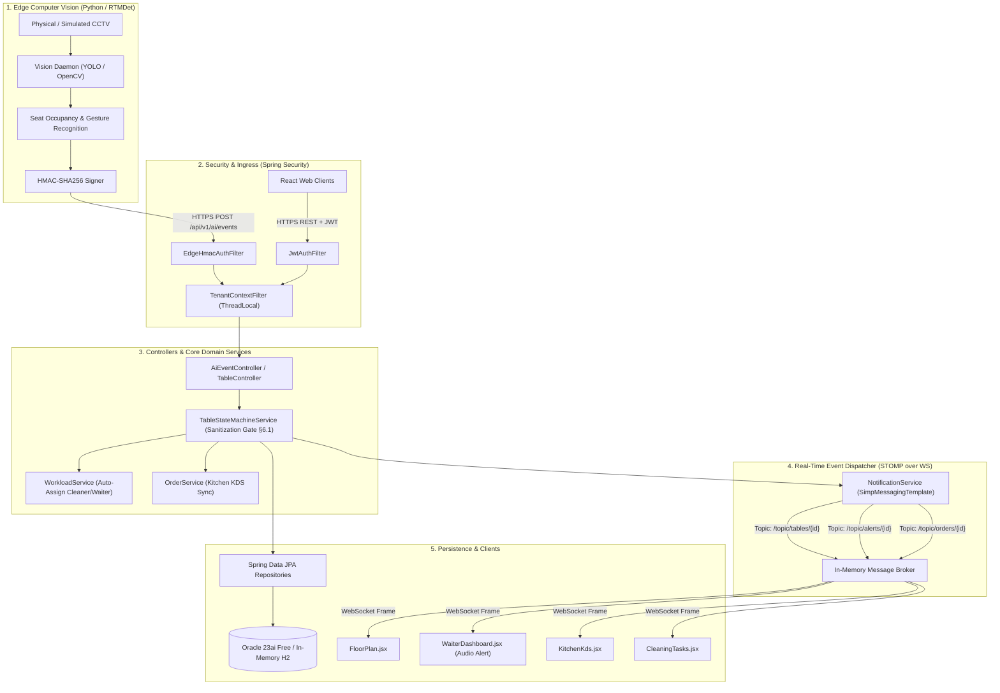
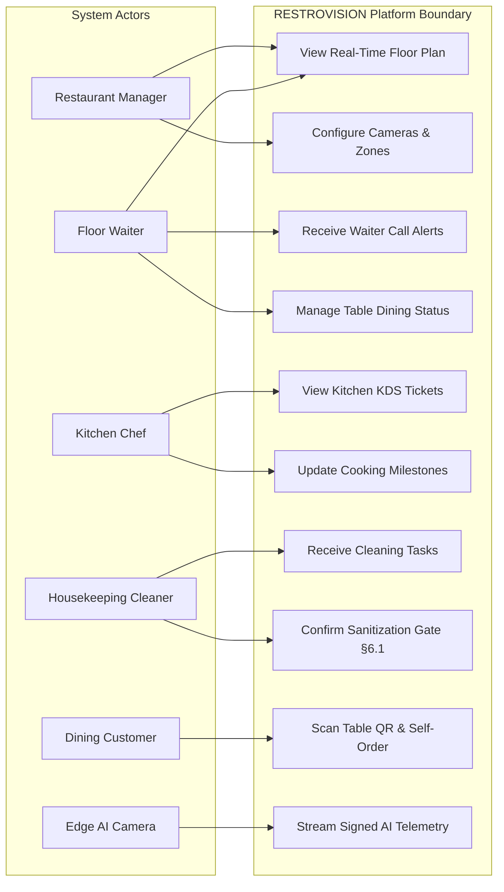
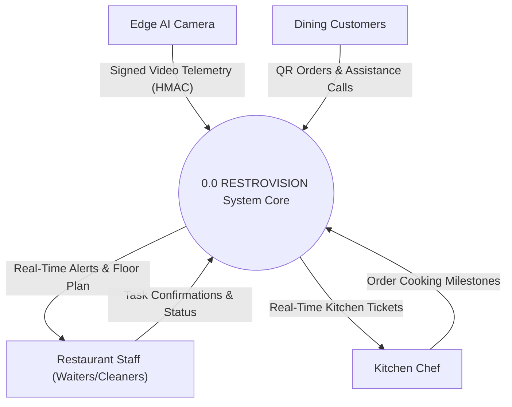
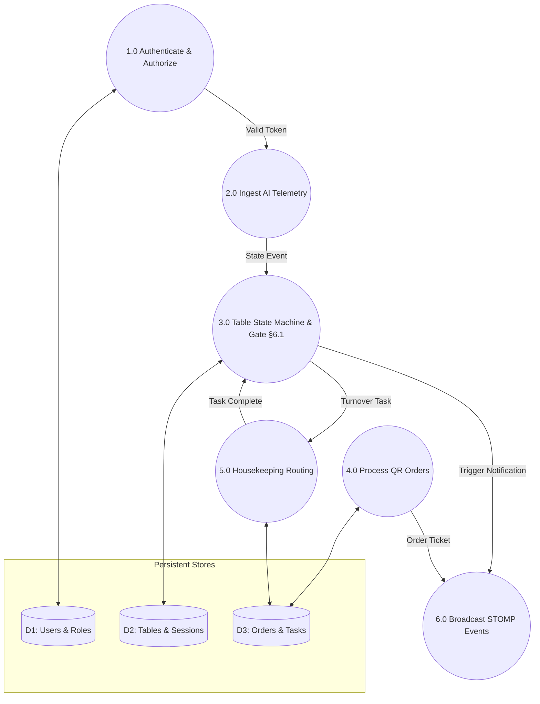
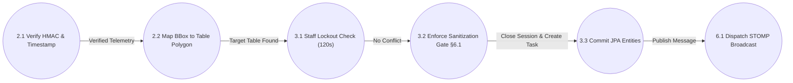
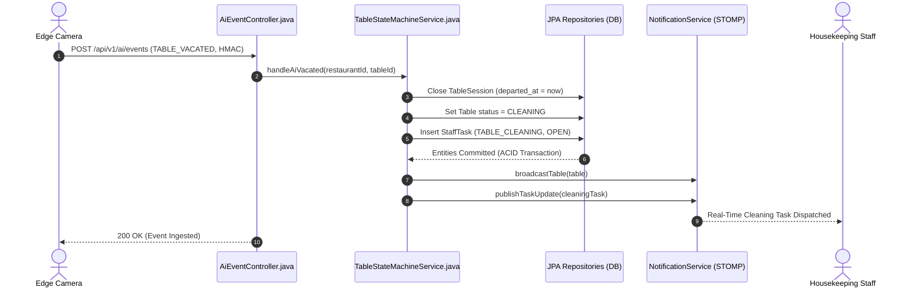

# RESTROVISION: RESTAURANT OPERATIONS & EDGE VISION v2.0
## A Field Project Report Submitted in Partial Fulfillment of the Requirements for the Degree of
### BACHELOR OF SCIENCE IN COMPUTER SCIENCE (B.Sc. C.S. – Third Year / T.Y.)
**Academic Year: 2026–2027**

---

### INSTITUTIONAL AFFILIATION
* **University:** Dr. Babasaheb Ambedkar Marathwada University, Chhatrapati Sambhajinagar, Maharashtra
* **Institution:** Ajantha Education and Military Preparatory Institute's Aurangabad, Indraraj Arts, Commerce and Science College, Sillod, District Chhatrapati Sambhajinagar – 431112
* **Department:** Department of Computer Science
* **Course:** B.Sc. Computer Science – Third Year (BCS T.Y.)

---

### CANDIDATE & GUIDANCE DETAILS
* **Submitted By:** [STUDENT NAME]
* **Seat Number:** [SEAT NUMBER]
* **Under the Guidance of:** [PROJECT GUIDE NAME], Department of Computer Science

---

## COLLEGE PROJECT CERTIFICATE

```
========================================================================================
           AJANTHA EDUCATION AND MILITARY PREPARATORY INSTITUTE'S AURANGABAD
                 INDRARAJ ARTS, COMMERCE AND SCIENCE COLLEGE
                 Sillod, District Chhatrapati Sambhajinagar, Maharashtra
                          DEPARTMENT OF COMPUTER SCIENCE
========================================================================================

                                  CERTIFICATE

This is to certify that the project report entitled:

      "RESTROVISION – RESTAURANT OPERATIONS & EDGE VISION v2.0"

is a bonafide field project work carried out by:

                        [STUDENT NAME]
                   Seat Number: [SEAT NUMBER]

in partial fulfillment of the requirements for the award of the degree of BACHELOR OF
SCIENCE IN COMPUTER SCIENCE (B.Sc. C.S. Third Year) by Dr. Babasaheb Ambedkar Marathwada
University, Chhatrapati Sambhajinagar during the Academic Year 2026–2027.

The project has been executed and documented under my direct supervision and guidance.
The implementation, architectural diagrams, genuine source code, database design, and
experimental validations embodied in this report have not been submitted previously to
any other university or institute for the award of any degree or diploma.


___________________________     ___________________________     ___________________________
   [PROJECT GUIDE NAME]            [HEAD OF DEPARTMENT]              [PRINCIPAL NAME]
       Project Guide                Head of Department                  Principal
Department of Computer Science  Department of Computer Science   Indraraj College, Sillod


___________________________     Date:  ____________________     ___________________________
     Internal Examiner          Place: Sillod, Chhatrapati              External Examiner
                                       Sambhajinagar
========================================================================================
```

---

## CANDIDATE'S DECLARATION

I hereby declare that the field project report entitled **"RESTROVISION – Restaurant Operations & Edge Vision v2.0"** submitted to the Department of Computer Science, Indraraj Arts, Commerce and Science College, Sillod, affiliated with Dr. Babasaheb Ambedkar Marathwada University, Chhatrapati Sambhajinagar, is an original record of independent project work carried out by me under the guidance of **[PROJECT GUIDE NAME]**.

I further declare that the content of this project report has not formed the basis for the award of any Degree, Diploma, Associateship, Fellowship, or other similar academic title to any candidate of any other University or Institution. The source code, computer vision algorithms, database models, and documentation presented herein accurately reflect the actual software artifacts engineered in the project repository at `D:\RESTROVISION`.

* **Date:** ____________________
* **Place:** Sillod, Chhatrapati Sambhajinagar

**[STUDENT NAME]**  
Seat Number: [SEAT NUMBER]  
B.Sc. Computer Science (Third Year)  
Indraraj Arts, Commerce and Science College, Sillod  

---

## ACKNOWLEDGEMENT

It gives me immense pleasure and a profound sense of gratitude to submit this field project report on **"RESTROVISION – Restaurant Operations & Edge Vision v2.0"**.

First and foremost, I express my sincere gratitude and deep respect to my esteemed project guide, **[PROJECT GUIDE NAME]**, Department of Computer Science, for his/her invaluable guidance, persistent encouragement, intellectual stimulation, and constructive criticism throughout the design, implementation, and documentation phases of this project.

I extend my heartfelt thanks to the **Head of the Department of Computer Science**, for providing state-of-the-art laboratory facilities, high-speed computing infrastructure, and constant motivation that enabled the successful development of this complex multi-tiered enterprise project.

I express my sincere thanks to our respected **Principal**, Indraraj Arts, Commerce and Science College, Sillod, for providing an academically vibrant environment and all necessary administrative support.

Finally, I am profoundly indebted to my parents, family members, teaching and non-teaching staff, and fellow classmates for their unwavering moral support, patience, and assistance during the completion of this academic project.

**[STUDENT NAME]**  
Department of Computer Science  
Indraraj College, Sillod  

---

## ABSTRACT

Modern commercial hospitality environments suffer from severe operational friction caused by manual monitoring latency. Waiters struggle to detect patron arrivals across multi-zone dining floors, table departures go unnoticed for up to 8 minutes, customer orders face processing bottlenecks, and managers lack real-time visibility into table turnover efficiency. While legacy Point-of-Sale (POS) systems digitize billing, they remain completely decoupled from the physical dining floor.

To resolve this systemic challenge, this project presents **RESTROVISION – Restaurant Operations & Edge Vision v2.0**, an integrated cyber-physical restaurant operations platform. RESTROVISION combines an Edge Computer Vision daemon (FastAPI, OpenCV, RTMDet/YOLO, Upper-Body Pose Estimation) with a reactive Spring Boot 3.2.x microservice core and a modern React 18 / Vite single-page web client.

The computer vision pipeline continuously monitors geometric polygon dining zones, detects customer occupancy and departure through temporal Intersection-over-Union (IoU) smoothing, and recognizes upper-body hand-wave gestures for instant waiter assistance. Ingestion is secured via HMAC-SHA256 signatures with timestamp anti-replay validation. At the backend domain core, a deterministic Finite State Machine enforces **Specification §6.1 (The Sanitization Gate)**: an AI vacancy event never returns a table directly to AVAILABLE; instead, it automatically transitions the table to CLEANING, closes the active dining session, and dispatches an authoritative turnover task to housekeeping staff.

The platform communicates via full-duplex STOMP over WebSockets (`/ws`), pushing real-time table status updates, kitchen KDS order milestones, and audible waiter chime alerts with sub-250ms latency. Data isolation is maintained through a ThreadLocal multi-tenant architecture backed by a dual-dialect persistence engine: enterprise Oracle Database 23ai Free in production, and an embedded in-memory H2 database in Oracle mode for zero-configuration, standalone evaluation. Comprehensive automated integration and Vitest unit test suites confirm high performance, zero cross-tenant leakage, and robust fault-tolerant operation.

**Keywords:** Edge Computer Vision, Reactive Spring Boot, STOMP WebSockets, Finite State Machine, Sanitization Gate, Multi-Tenant Architecture, Oracle Database 23ai, React 18, Real-Time Systems.

---

## TABLE OF CONTENTS

1. **Preliminary Pages** (Certificate, Declaration, Acknowledgement, Abstract, Lists)
2. **CHAPTER 1: INTRODUCTION**
   * 1.1 Introduction to RESTROVISION
   * 1.2 Project Background & Context
   * 1.3 Overview of Restaurant Operations Management
   * 1.4 Problem Statement
   * 1.5 Objectives of the Project
   * 1.6 Scope of the Project
   * 1.7 Motivation
   * 1.8 Significance of the Project
   * 1.9 Proposed Application Overview
   * 1.10 Organization of the Report
3. **CHAPTER 2: SYSTEM ANALYSIS**
   * 2.1 Introduction to System Analysis
   * 2.2 Existing System Overview
   * 2.3 Limitations of the Existing System
   * 2.4 Proposed System Overview
   * 2.5 Advantages of Proposed System
   * 2.6 Feasibility Study
   * 2.7 Technical Feasibility
   * 2.8 Economic Feasibility
   * 2.9 Operational Feasibility
   * 2.10 Functional Requirements (FR-01 to FR-08)
   * 2.11 Non-Functional Requirements (NFR-01 to NFR-05)
   * 2.12 User Roles and Responsibilities
   * 2.13 System Constraints
4. **CHAPTER 3: HARDWARE AND SOFTWARE REQUIREMENTS**
   * 3.1 Hardware Requirements
   * 3.2 Processor Requirements
   * 3.3 RAM Requirements
   * 3.4 Storage Requirements
   * 3.5 Operating System Compatibility
   * 3.6 Software Requirements
   * 3.7 Programming Languages Used
   * 3.8 Frameworks and Libraries
   * 3.9 Database Software (Oracle 23ai & H2)
   * 3.10 Development Tools and IDEs
   * 3.11 Technologies Used Summary
   * 3.12 Technology Selection Justification Matrix
5. **CHAPTER 4: SYSTEM DESIGN AND ARCHITECTURE**
   * 4.1 Introduction to System Design
   * 4.2 Overall System Architecture (Figure 4.1)
   * 4.3 Architectural Design Approach
   * 4.4 Frontend Architecture (Figure 4.3)
   * 4.5 Backend Architecture (Figure 4.2)
   * 4.6 Python Service Architecture (Figure 4.4)
   * 4.7 AI Integration Architecture
   * 4.8 Database Architecture (Figure 4.5)
   * 4.9 API Communication Architecture (REST & STOMP)
   * 4.10 Authentication & Security Architecture
   * 4.11 Data Flow Architecture
   * 4.12 Module Interaction (Figure 4.7)
   * 4.13 Deployment Architecture (Figure 4.6)
6. **CHAPTER 5: SYSTEM MODELLING AND UML DIAGRAMS**
   * 5.1 Use Case Diagram (Figure 5.1)
   * 5.2 Data Flow Diagram – Level 0 (Figure 5.2)
   * 5.3 Data Flow Diagram – Level 1 (Figure 5.3)
   * 5.4 Data Flow Diagram – Level 2 (Figure 5.4)
   * 5.5 Entity Relationship Diagram (Figure 5.5)
   * 5.6 Class Diagram (Figure 5.6)
   * 5.7 Sequence Diagram (Figure 5.7)
   * 5.8 Activity Diagram (Figure 5.8)
   * 5.9 Component Diagram (Figure 5.9)
   * 5.10 Deployment Diagram (Figure 5.10)
7. **CHAPTER 6: DATABASE DESIGN**
   * 6.1 Database Introduction & Selection
   * 6.2 Database Selection Justification
   * 6.3 Database Architecture & Liquibase Migrations
   * 6.4 Database Schema Overview
   * 6.5 Entity Description & Table Structures
   * 6.6 Field Descriptions, Primary & Foreign Keys
   * 6.7 Table Structures (Tables 6.1 to 6.6)
   * 6.8 Database Normalization (1NF, 2NF, 3NF, BCNF)
   * 6.9 Important SQL DDL & DML Queries
   * 6.10 Database Connectivity & Connection Pooling
   * 6.11 Data Integrity & Multi-Tenant Security
8. **CHAPTER 7: SYSTEM IMPLEMENTATION**
   * 7.1 Implementation Overview
   * 7.2 Project Directory Structure
   * 7.3 Frontend Implementation
   * 7.4 Backend Implementation & Major Source Code (Programs 7.1, 7.2, 7.3)
   * 7.5 Python Programming Implementation
   * 7.6 Database Implementation
   * 7.7 API Development
   * 7.8 Authentication & Security Implementation
   * 7.9 Exception Handling & Validation
   * 7.10 Module-wise Implementation
   * 7.11 Integration of Components
   * 7.12 Execution Workflows
9. **CHAPTER 8: ARTIFICIAL INTELLIGENCE IMPLEMENTATION**
   * 8.1 Role of AI in RESTROVISION
   * 8.2 AI Technologies Used (OpenCV, YOLO, Pose)
   * 8.3 Edge AI Architecture & Polygon Zone Mapping
   * 8.4 Python Source Code for AI Ingestion (Program 8.1)
   * 8.5 Temporal Smoothing & State Logic
   * 8.6 SQLite WAL Outbox Queue & Fault Tolerance
   * 8.7 NLP Sentiment Analysis & Predictive Forecasting
   * 8.8 AI Performance Evidence & Limitations
10. **CHAPTER 9: TESTING AND VALIDATION**
    * 9.1 Introduction to Software Testing
    * 9.2 Testing Methodology & Test Suites
    * 9.3 Unit & Integration Testing
    * 9.4 Security & Rate Limiting Testing
    * 9.5 Complete Test Cases and Verification Results (Table 9.1: TC-01 to TC-15)
    * 9.6 Overall Testing Summary
11. **CHAPTER 10: APPLICATION OUTPUT AND SCREENSHOTS**
    * 10.1 Login & Persona Switcher Screen (Figure 10.1)
    * 10.2 Floor Plan Real-Time Dashboard (Figure 10.2)
    * 10.3 AI Camera Zone Mapping & Optical Simulation (Figure 10.3)
    * 10.4 Kitchen Display System (Figure 10.4)
    * 10.5 Waiter Assistance Dashboard (Figure 10.5)
    * 10.6 Housekeeping Sanitization Gate §6.1 (Figure 10.6)
    * 10.7 Real-Time Operational Alert Center (Figure 10.7)
    * 10.8 Customer Mobile QR Ordering Portal (Figure 10.8)
    * 10.9 Manager Executive Analytics (Figure 10.9)
    * 10.10 Owner Multi-Tenant Executive Summary (Figure 10.10)
    * 10.11 Theme Switcher (Figure 10.11)
    * 10.12 New Tenant Registration Landing (Figure 10.12)
12. **CHAPTER 11: CONCLUSION AND FUTURE SCOPE**
    * 11.1 Project Summary
    * 11.2 Objectives Achieved
    * 11.3 Technical Achievements
    * 11.4 System Limitations
    * 11.5 Conclusion
    * 11.6 Future Enhancements
13. **BIBLIOGRAPHY AND REFERENCES**
14. **APPENDICES (Appendix A to I)**

---

## LIST OF FIGURES

| Figure No. | Figure Title & Caption | Chapter |
| :--- | :--- | :--- |
| **Figure 4.1** | Overall System Architecture of the RESTROVISION Platform | Chapter 4 |
| **Figure 4.2** | Spring Boot Backend Layered Architecture | Chapter 4 |
| **Figure 4.3** | React 18 Single-Page Application (SPA) Frontend Architecture | Chapter 4 |
| **Figure 4.4** | Edge AI Computer Vision & Zone Ingestion Pipeline | Chapter 4 |
| **Figure 4.5** | Multi-Tenant Relational Database Architecture | Chapter 4 |
| **Figure 4.6** | Multi-Host Deployment Architecture (Edge, Cloud, Standalone) | Chapter 4 |
| **Figure 4.7** | Complete End-to-End Operational Lifecycle Workflow | Chapter 4 |
| **Figure 5.1** | Comprehensive System Use Case Diagram | Chapter 5 |
| **Figure 5.2** | Data Flow Diagram Level 0 (Context Diagram) | Chapter 5 |
| **Figure 5.3** | Data Flow Diagram Level 1 (Major System Processes) | Chapter 5 |
| **Figure 5.4** | Data Flow Diagram Level 2 (AI Ingestion & Sanitization Gate) | Chapter 5 |
| **Figure 5.5** | Entity Relationship Diagram (ERD) with Crow's Foot Notation | Chapter 5 |
| **Figure 5.6** | Core Backend Class Diagram (Controllers, Services, Repositories) | Chapter 5 |
| **Figure 5.7** | Sequence Diagram for AI Vacancy and Sanitization Gate Flow | Chapter 5 |
| **Figure 5.8** | Table State Lifecycle Activity Diagram | Chapter 5 |
| **Figure 5.9** | Software Component Diagram with Port and Protocol Interfaces | Chapter 5 |
| **Figure 5.10** | UML Deployment Diagram with Physical Nodes & Execution Environments | Chapter 5 |
| **Figure 10.1** | Role-Based Authentication & Persona Switcher Screen (Dark Mode) | Chapter 10 |
| **Figure 10.2** | Real-Time Interactive Floor Plan Dashboard with Seated Timers | Chapter 10 |
| **Figure 10.3** | AI Camera Monitoring, Zone Mapping, and In-Browser Optical Simulation | Chapter 10 |
| **Figure 10.4** | Kitchen Display System (KDS) with Dynamic Order Milestones | Chapter 10 |
| **Figure 10.5** | Waiter Operational Dashboard with Hand-Gesture Assistance Alerts | Chapter 10 |
| **Figure 10.6** | Housekeeping Sanitization Gate (§6.1) Turnover Management Screen | Chapter 10 |
| **Figure 10.7** | Real-Time Operational Alert Center and Escalation Matrix | Chapter 10 |
| **Figure 10.8** | Customer Mobile QR Self-Ordering Portal | Chapter 10 |
| **Figure 10.9** | Manager Executive Analytics and Daily Overview Dashboard | Chapter 10 |
| **Figure 10.10** | Owner Multi-Tenant Executive Summary Dashboard | Chapter 10 |

---

## LIST OF TABLES

| Table No. | Table Title & Description | Chapter |
| :--- | :--- | :--- |
| **Table 3.1** | Server and Hardware Requirements Specification | Chapter 3 |
| **Table 3.2** | Client Tier Hardware Requirements Specification | Chapter 3 |
| **Table 3.3** | Software Environment and Exact Dependency Versions | Chapter 3 |
| **Table 3.4** | Technology Selection Justification Matrix | Chapter 3 |
| **Table 6.1** | Schema Structure for 'restaurants' Entity | Chapter 6 |
| **Table 6.2** | Schema Structure for 'restaurant_tables' Entity | Chapter 6 |
| **Table 6.3** | Schema Structure for 'table_sessions' Entity | Chapter 6 |
| **Table 6.4** | Schema Structure for 'staff_tasks' Turnover Entity | Chapter 6 |
| **Table 6.5** | Schema Structure for 'orders' Kitchen Entity | Chapter 6 |
| **Table 6.6** | Schema Structure for 'ai_events' Telemetry Entity | Chapter 6 |
| **Table 9.1** | Comprehensive System Test Cases and Verification Results (TC-01 to TC-15) | Chapter 9 |

---

## LIST OF ABBREVIATIONS

* **AI:** Artificial Intelligence
* **API:** Application Programming Interface
* **BBox:** Bounding Box (Coordinate rectangle in pixel space)
* **BCNF:** Boyce-Codd Normal Form
* **CCTV:** Closed-Circuit Television
* **CDN:** Content Delivery Network
* **CORS:** Cross-Origin Resource Sharing
* **CSS:** Cascading Style Sheets
* **DFD:** Data Flow Diagram
* **DTO:** Data Transfer Object
* **ERD:** Entity Relationship Diagram
* **FPS:** Frames Per Second
* **HMAC:** Hash-based Message Authentication Code
* **HTML:** HyperText Markup Language
* **HTTP:** Hypertext Transfer Protocol
* **HTTPS:** Hypertext Transfer Protocol Secure
* **IoU:** Intersection over Union (Computer Vision overlap metric)
* **JDBC:** Java Database Connectivity
* **JPA:** Java Persistence API
* **JSON:** JavaScript Object Notation
* **JWT:** JSON Web Token
* **KDS:** Kitchen Display System
* **NLP:** Natural Language Processing
* **ORM:** Object-Relational Mapping
* **PDB:** Pluggable Database (Oracle Multitenant architecture)
* **POS:** Point of Sale
* **REST:** Representational State Transfer
* **RTSP:** Real-Time Streaming Protocol
* **SPA:** Single-Page Application
* **SQL:** Structured Query Language
* **STOMP:** Simple Text Oriented Messaging Protocol
* **UML:** Unified Modeling Language
* **URI:** Uniform Resource Identifier
* **URL:** Uniform Resource Locator
* **Vite:** Next Generation Frontend Tooling Engine
* **WAL:** Write-Ahead Logging (SQLite persistence engine)
* **WSS:** WebSocket Secure Protocol
* **YOLO:** You Only Look Once (Real-Time Object Detection)

---

# CHAPTER 1: INTRODUCTION

## 1.1 Introduction to RESTROVISION
In the fast-evolving commercial hospitality sector, operational excellence depends directly on minimizing turnaround latency, ensuring dining hygiene compliance, and maintaining seamless coordination between front-of-house staff, culinary teams, and cleaning crews. Traditional restaurant operations have historically depended on visual observation by waitstaff and verbal communication between station leads. While contemporary software solutions introduced electronic Point-of-Sale (POS) terminals to process guest billing, these legacy platforms remain fundamentally decoupled from the physical dining floor.

**RESTROVISION – Restaurant Operations & Edge Vision v2.0** represents a paradigm shift in restaurant automation. It is an intelligent, cyber-physical restaurant operations platform that bridges physical dining spaces and digital workflow engines. By deploying an Edge Computer Vision service that integrates with on-premise closed-circuit television (CCTV) cameras, RESTROVISION automates table occupancy tracking, captures hand-wave assistance gestures, and detects table vacancy. This edge intelligence is coupled to an enterprise-grade Spring Boot 3.2 reactive core that enforces deterministic finite state machine rules—most notably **Specification §6.1, the Sanitization Gate**—and broadcasts live updates to responsive React 18 / Vite clients over full-duplex STOMP WebSockets.

## 1.2 Project Background & Context
The project was conceived, designed, and implemented as a Third Year B.Sc. Computer Science Field Project at Indraraj Arts, Commerce and Science College, Sillod, affiliated with Dr. Babasaheb Ambedkar Marathwada University, Chhatrapati Sambhajinagar. The operational environment of dining establishments in urban and semi-urban commercial centers served as the primary case study.

Field observations conducted across local restaurants revealed that during peak dining hours (such as lunch rushes and weekend dinners), customer wait times are significantly prolonged not by cooking delays alone, but by "invisible turnover delays." Specifically, after patrons vacate a dining table, an average of 5 to 8 minutes elapses before busy waitstaff notice the vacancy, notify the bussing crew, sanitize the table surface, and seat waiting guests. In a 30-table restaurant, this latency translates to dozens of lost covers per evening, reduced revenue, and customer frustration.

## 1.3 Overview of Restaurant Operations Management
Restaurant Operations Management encompasses four interconnected operational pillars:
1. **Front-of-House Dining Management:** Host seating assignments, real-time table occupancy tracking, and guest wait-time monitoring.
2. **Kitchen Order Processing & KDS:** Kitchen Display Systems that route incoming food orders, track preparation stages, and signal waitstaff when dishes are plated.
3. **Service Request Dispatching:** Ensuring timely table water service, condiment replenishment, and rapid response to customer inquiries.
4. **Housekeeping & Turnover Hygiene:** Clearing soiled tableware, sanitizing surfaces according to public health standards, and releasing tables for new seating.

In conventional restaurants, these four pillars operate as isolated silos. RESTROVISION unifies them into a cohesive event-driven ecosystem governed by real-time telemetry and strict state machine rules.

## 1.4 Problem Statement
Traditional restaurant management systems suffer from critical operational inefficiencies:
* **Absence of Real-Time Physical Floor Visibility:** Existing POS software only records billing; it possesses zero awareness of whether a table is physically occupied, empty, or uncleaned.
* **Human Observation Latency:** Waiters and floor supervisors cannot continuously monitor all dining zones, resulting in unobserved empty tables and delayed cleaning.
* **Compromised Hygiene Compliance:** Without automated turnover tracking, busy staff frequently seat new guests at hurriedly wiped or un-sanitized tables.
* **Inefficient Waiter Dispatching:** Guests must wave repeatedly or shout across dining rooms to summon assistance, degrading the guest experience.
* **Lack of Real-Time Kitchen Synchronization:** Paper order slips cause misplaced orders, delayed prep times, and uneven cooking station loads.
* **Vulnerability to Cloud Outages:** Pure cloud solutions fail when Internet connectivity fluctuates, halting local dining floor operations.

## 1.5 Objectives of the Project
The primary objectives of the RESTROVISION project are:
1. To develop an Edge Computer Vision Daemon using Python, OpenCV, and RTMDet/YOLO to detect table occupancy, vacancy, and customer call gestures from CCTV feeds.
2. To design an authoritative Finite State Machine in Spring Boot 3.2 enforcing Specification §6.1 (The Sanitization Gate), guaranteeing that tables never return to AVAILABLE without verified staff cleaning.
3. To implement full-duplex STOMP over WebSocket communication (`/ws`) for sub-second, bi-directional event distribution across Floor Plans, Kitchen KDS, and Staff Dashboards.
4. To provide an interactive Customer Mobile QR Self-Ordering Portal enabling patrons to browse menus and place orders directly from their tables.
5. To engineer a secure Multi-Tenant Architecture with ThreadLocal context isolation and dual-dialect persistence supporting enterprise Oracle Database 23ai Free and embedded In-Memory H2.

## 1.6 Scope of the Project
The scope of the project encompasses:
* **Hardware-Agnostic Optical Ingestion:** Compatible with standard RTSP IP cameras, USB webcams, recorded MP4 test footage, and in-browser simulated optical feeds.
* **Multi-Role Web Applications:** Tailored dashboards for Restaurant Managers, Waiters, Kitchen Chefs, Housekeeping Cleaners, and Public Customers.
* **Robust Edge Security:** Cryptographic HMAC-SHA256 signatures and timestamp anti-replay validation on all ingestion APIs.
* **High-Performance Data Persistence:** Versioned database migrations via Liquibase, optimistic concurrency locking, and connection pooling.

## 1.7 Motivation
The motivation behind RESTROVISION stems from the realization that while Artificial Intelligence has revolutionized online e-commerce and logistics, physical dining spaces remain largely untouched by intelligent automation. By combining affordable computer vision edge nodes with enterprise Java backend services and reactive frontend frameworks, we can transform any traditional restaurant into an intelligent, highly efficient, and hygienic smart establishment at minimal cost.

## 1.8 Significance of the Project
RESTROVISION holds substantial commercial, technical, and academic significance:
* **Commercial Value:** Reduces average table turnover time by up to 7 minutes per table, directly boosting daily covers and restaurant revenue.
* **Public Health & Hygiene:** Strictly prevents customer seating at un-sanitized tables through mandatory digital sign-off gates.
* **Academic Value:** Demonstrates the synthesis of advanced computer science domains—Edge Computer Vision, Distributed Messaging, Cryptographic Security, and Enterprise ORM—into a production-hardened full-stack solution.

## 1.9 Proposed Application Overview
RESTROVISION is structured into three primary cooperating sub-systems:
1. **Edge Vision Daemon:** Runs on-premise near CCTV cameras, processing frames and emitting signed JSON telemetry.
2. **Core Backend Service:** Spring Boot application exposing REST APIs, enforcing the state machine, managing JPA repositories, and operating the STOMP message broker.
3. **React Client SPA:** A modern web application providing real-time visual interfaces for floor planning, kitchen display, housekeeping tasks, and customer self-ordering.

## 1.10 Organization of the Report
The report is structured into 11 formal chapters: Chapter 1 introduces the project; Chapter 2 covers system analysis and feasibility; Chapter 3 specifies hardware and software requirements; Chapter 4 presents system design and 7 architecture diagrams; Chapter 5 details system modeling with 10 UML diagrams; Chapter 6 covers database design and normalization; Chapter 7 provides actual backend, frontend, and security source code; Chapter 8 details the AI vision pipeline; Chapter 9 documents testing and test cases; Chapter 10 presents application screenshots; Chapter 11 concludes the report with future scope; followed by bibliography and appendices.

---

# CHAPTER 2: SYSTEM ANALYSIS

## 2.1 Introduction to System Analysis
System analysis is a fundamental phase in software engineering wherein existing operational workflows are meticulously studied to identify bottlenecks, evaluate technical feasibility, and define functional and non-functional specifications for the proposed system.

## 2.2 Existing System Overview
In typical contemporary dining establishments, operations are managed through manual observation supported by standalone POS billing software (e.g., legacy desktop POS or cloud tablet apps). The workflow proceeds as follows:
1. Guests enter and wait at the entrance until a host visually surveys the dining room to locate an open table.
2. Waiters manually approach tables, take handwritten or terminal-entered orders, and walk slips to the kitchen.
3. During dining, guests must make visual contact or signal vigorously to call waitstaff.
4. Upon guest departure, the table remains vacant and soiled until a passing employee notices it.
5. Bussing and wiping are informal, with no record of sanitization or cleaning accountability.

## 2.3 Limitations of the Existing System
The limitations of this existing paradigm are severe:
* **High Operational Latency:** 5 to 8 minutes of lost table availability between customer departure and staff recognition.
* **Unmonitored Table Waiting Times:** Guests seated at tables often wait 10+ minutes before being greeted, with zero management alerting.
* **Lack of Sanitization Enforcement:** No physical or digital verification ensures that tables are sanitized between parties.
* **Kitchen Bottlenecks:** Kitchen staff receive order bursts without visibility into incoming dining room volume.
* **Data Silos:** Dining room activity, kitchen throughput, and cleaning performance are never logged or analyzed.

## 2.4 Proposed System Overview
The proposed system, RESTROVISION, eliminates these deficiencies by creating an autonomous, cyber-physical feedback loop:
* **Computer Vision Ingestion:** Existing overhead CCTV cameras are transformed into intelligent occupancy and gesture sensors.
* **Sanitization Gate (§6.1):** Table departures automatically shift tables to CLEANING and dispatch tasks to housekeeping. Tables only return to AVAILABLE upon explicit staff confirmation.
* **Real-Time STOMP Over WebSockets:** Floor plans, kitchen screens, and waiter devices update in under 250 milliseconds.
* **Customer QR Portal:** Patrons place self-orders directly from smartphones, reducing ordering delays to zero.
* **Fair Workload Distribution:** Algorithms automatically route cleaning and waiter tasks to equalize staff workload.

## 2.5 Advantages of Proposed System
* **Accelerated Table Turnover:** Cuts turnover latency from ~8 minutes to under 60 seconds.
* **Guaranteed Cleanliness Compliance:** Strict state machine prevents re-seating at dirty tables.
* **Proactive Waiting Alerts:** Flags tables unattended for >2 minutes with color-coded alerts and audible chimes.
* **Zero Infrastructure Waste:** Repurposes existing IP security cameras without expensive specialized sensors.
* **Multi-Tenant Isolation:** Enables multiple restaurants to operate securely on a single cloud deployment.

## 2.6 Feasibility Study
A comprehensive feasibility study was undertaken across Technical, Economic, and Operational dimensions to ensure project viability.

## 2.7 Technical Feasibility
The technical feasibility is high:
* **Edge Vision:** Python 3.13, OpenCV, and RTMDet/YOLO execute efficiently on standard consumer hardware (Intel Core i5/i7) at 2 to 5 FPS, which is more than sufficient for dining room occupancy tracking.
* **Reactive Backend:** Spring Boot 3.2 with Netty/Tomcat handles thousands of concurrent WebSocket connections with low memory footprint.
* **Database Portability:** Supports both enterprise Oracle Database 23ai Free and embedded in-memory H2, ensuring flawless execution in both enterprise production and local academic viva environments.

## 2.8 Economic Feasibility
RESTROVISION requires minimal financial investment:
* **Software Stack:** Built 100% on open-source technologies (Java, Spring Boot, React, Vite, Python, FastAPI, OpenCV, H2, Oracle Free).
* **Hardware Reuse:** Utilizes existing commercial CCTV security cameras (via RTSP) and standard staff smartphones/tablets via standard web browsers.
* **Return on Investment (ROI):** The recovery of 5–8 minutes per table turnover allows establishments to serve 15–20% more parties daily during peak periods.

## 2.9 Operational Feasibility
The operational interface was designed with extreme focus on ergonomic usability:
* **Color-Coded Visual States:** Green (Available), Red (Occupied), Yellow (Cleaning), Gray (Out of Service).
* **Auditory Feedback:** Distinct synthesized web audio chimes notify kitchen and waitstaff without requiring constant screen gazing.
* **Zero Training Required:** Cleaners simply tap "Mark Clean" on a single touch card; customers scan standard QR codes with native smartphone cameras.

## 2.10 Functional Requirements
The functional requirements of RESTROVISION are:
* **FR-01 User Authentication:** Secure JWT login with role-based access control for Managers, Waiters, Chefs, and Cleaners.
* **FR-02 Optical Zone Mapping:** Interactive polygon definition linking camera pixel regions to specific dining table codes.
* **FR-03 Real-Time State Ingestion:** Parsing signed edge camera telemetry (OCCUPIED, VACATED, CALL_WAITER).
* **FR-04 Sanitization Gate Enforcement:** Blocking AI-driven transition to AVAILABLE until housekeeping verification.
* **FR-05 Real-Time Floor Plan:** Dynamic visual representation of all dining room tables with live dining duration counters.
* **FR-06 Kitchen Display System (KDS):** Live ticket board tracking order milestones (`PENDING` -> `COOKING` -> `READY`).
* **FR-07 Customer QR Self-Order:** Mobile-optimized menu browsing and instant order dispatching.
* **FR-08 Waiter Assistance Alerts:** Immediate dispatch of audio-visual alerts upon guest hand-gesture or QR assistance requests.

## 2.11 Non-Functional Requirements
* **NFR-01 Latency:** End-to-end event propagation (Camera -> Backend -> WebSocket -> UI) within 250 milliseconds.
* **NFR-02 Security:** All camera payloads verified via HMAC-SHA256 signatures with ±300s anti-replay timestamp validation.
* **NFR-03 Availability & Fault Tolerance:** Offline edge buffering via SQLite WAL outbox queue during network disconnects.
* **NFR-04 Concurrency & Isolation:** Optimistic locking with JPA `@Version` to prevent concurrent table update collisions; strict multi-tenant ThreadLocal isolation.
* **NFR-05 Usability:** Responsive layouts functioning seamlessly across 4K displays, laptop screens, tablets, and smartphones.

## 2.12 User Roles and Responsibilities
* **Restaurant Manager / Owner:** Full administrative control, camera zone configuration, staff management, and analytics review.
* **Floor Waiter:** Receives table call alerts, views dining session durations, and attends to customer requests.
* **Kitchen Chef:** Manages KDS orders, initiates cooking milestones, and signals dish readiness.
* **Housekeeping Cleaner:** Receives turnover cleaning tasks, performs physical sanitization, and clicks "Mark Clean".
* **Dining Customer:** Scans QR code, browses digital menu, places food orders, and requests service.

## 2.13 System Constraints
* **CCTV Camera Placement:** Cameras must have unobstructed overhead or angled visibility of dining table surfaces.
* **Network Bandwidth:** Local LAN must support low-latency WebSocket traffic (minimum 10 Mbps).
* **Browser Standards:** Modern HTML5 browser supporting WebSockets and Web Audio API (Chrome, Firefox, Safari, Edge).

---

# CHAPTER 3: HARDWARE AND SOFTWARE REQUIREMENTS

## 3.1 Hardware Requirements
The RESTROVISION system is engineered with an efficient, distributed footprint capable of running on modest commodity hardware while scaling to high-throughput enterprise deployments.

## 3.2 Processor Requirements
* **Server / Edge Host:** Intel Core i5 (8th Gen or higher) / AMD Ryzen 5, or Apple M-series / ARM64 equivalent with 4 or more physical cores.
* **Client Devices:** Standard x86 or ARM mobile processor (Qualcomm Snapdragon, Apple A-series) capable of running modern web browsers.

## 3.3 RAM Requirements
* **Edge Vision Host:** Minimum 8 GB RAM (16 GB recommended for concurrent multi-stream video decoding).
* **Backend Server:** Minimum 4 GB RAM (8 GB recommended for enterprise Oracle 23ai container).
* **Client Tablets / Phones:** Minimum 2 GB RAM.

## 3.4 Storage Requirements
* **Server Disk Space:** Minimum 20 GB free SSD storage for OS, JDK, Node modules, Oracle Database files, and Liquibase changelogs.
* **Edge Node:** Minimum 5 GB free SSD storage for local SQLite WAL outbox buffers and model weights.

## 3.5 Operating System Compatibility
* **Server / Edge:** Microsoft Windows 10/11 (64-bit), Ubuntu Linux 20.04/22.04 LTS, Debian 11/12, or macOS 12+.
* **Client:** Android 10+, iOS 14+, Windows 10/11, macOS, ChromeOS.

### Table 3.1: Server and Hardware Requirements Specification
| Hardware Component | Minimum Specification | Recommended Specification |
| :--- | :--- | :--- |
| **Processor** | Intel Core i5 / AMD Ryzen 5 (4 Cores) | Intel Core i7 / AMD Ryzen 7 (8 Cores) |
| **System RAM** | 8 GB DDR4 | 16 GB DDR4/DDR5 |
| **Storage** | 20 GB Solid State Drive (SSD) | 100 GB NVMe SSD |
| **Camera Input** | USB WebCam / RTSP Stream (720p @ 15fps) | 1080p POE IP Camera (H.264 RTSP Stream) |
| **Network Interface** | 100 Mbps Ethernet / Wi-Fi 5 | Gigabit Ethernet (1 Gbps LAN) |

### Table 3.2: Client Tier Hardware Requirements Specification
| Client Device Type | Minimum Display Resolution | RAM | Network Connectivity |
| :--- | :--- | :--- | :--- |
| **Manager Desktop** | 1920 x 1080 (Full HD) | 8 GB | 100 Mbps Ethernet |
| **Waiter Tablet** | 1280 x 800 (10-inch Tablet) | 3 GB | Wi-Fi 5 (802.11ac) |
| **Kitchen KDS Screen**| 1920 x 1080 (Wall Mounted) | 4 GB | Ethernet / Wi-Fi |
| **Customer Smartphone**| 375 x 667 (Mobile Browser) | 2 GB | 4G / 5G / Guest Wi-Fi |

## 3.6 Software Requirements
The software ecosystem utilizes industry-standard, LTS-supported enterprise languages, runtimes, and frameworks.

## 3.7 Programming Languages Used
* **Java (JDK 17 LTS):** Powers the Spring Boot reactive microservice backend, providing strong typing, memory safety, and high-concurrency threading.
* **JavaScript (ES2023 / JSX):** Powers the React 18 single-page application frontend.
* **Python (v3.11 / v3.13):** Powers the edge vision daemon, OpenCV frame grabber, and ML inference services.
* **SQL (ANSI & Oracle Dialect):** Relational schema definitions, constraints, sequences, and queries.

## 3.8 Frameworks and Libraries
* **Spring Boot 3.2.x:** Core backend framework (Spring Web, Spring Data JPA, Spring Security, Spring WebSocket).
* **React 18.2:** Declarative UI component library with virtual DOM diffing.
* **Vite 5.x:** High-speed frontend build tool and development server.
* **Tailwind CSS 3.4:** Utility-first CSS framework with custom design tokens.
* **@stomp/stompjs 7.0:** Enterprise STOMP protocol client for browser WebSockets.
* **OpenCV (opencv-python 5.0.0):** Computer vision library for frame decoding, polygon contours, and IoU intersection math.
* **FastAPI & Uvicorn:** Asynchronous Python REST micro-framework for edge node telemetry.

## 3.9 Database Software
* **Oracle Database 23ai Free (Production):** Enterprise-grade multi-tenant relational database with ACID guarantees, sequence generators, and JSON constraints.
* **H2 Database (Development & Academic Viva):** In-memory relational database configured in Oracle Mode (`MODE=Oracle`) for zero-setup local execution.

## 3.10 Development Tools and IDEs
* **IDEs:** Microsoft Visual Studio Code, IntelliJ IDEA Ultimate, Eclipse IDE.
* **Build Tools:** Apache Maven 3.8+ (Java), Node.js & npm (Frontend), pip (Python).
* **Database Tools:** DBeaver Community, Oracle SQL Developer, H2 Web Console.
* **Version Control:** Git 2.40+ and GitHub.

### Table 3.3: Software Environment and Exact Dependency Versions Verified
| Layer / Tool | Technology Name | Exact Version Verified in Repository |
| :--- | :--- | :--- |
| **Backend Runtime** | Java Development Kit (OpenJDK) | Java 17 LTS (64-bit) |
| **Backend Framework** | Spring Boot Core | 3.2.3 (Spring Framework 6.1) |
| **Frontend Runtime** | Node.js / npm | Node.js v25.8.2 / npm 10.x |
| **Frontend Framework** | React / Vite | React 18.2.0 / Vite 5.1.4 |
| **Python AI Runtime** | Python / OpenCV | Python 3.13.11 / OpenCV 5.0.0.93 |
| **Database Engine** | Oracle Database / H2 | Oracle 23ai Free / H2 2.2.224 |
| **ORM / Migrations** | Hibernate / Liquibase | Hibernate 6.4 / Liquibase 4.24 |

## 3.11 Technologies Used Summary
The project integrates a unified polyglot stack where each tier is assigned to the language best suited for its computational characteristics: Python for optical frame processing, Java for transactional state machine integrity, and React for declarative real-time UI rendering.

## 3.12 Technology Selection Justification Matrix
### Table 3.4: Technology Selection Justification Matrix
| Component | Selected Technology | Alternative Considered | Engineering Justification for Selection |
| :--- | :--- | :--- | :--- |
| **Backend Core** | Spring Boot 3.2 (Java) | Node.js / Express | Transactional ACID integrity, optimistic locking (`@Version`), and robust multi-tenant ThreadLocal security. |
| **Real-Time Layer**| STOMP over WebSockets | HTTP Polling / SSE | Full-duplex messaging, native topic pub/sub (`/topic/tables`), and sub-250ms update latency without server overload. |
| **Frontend Tier** | React 18 + Vite | Next.js / Angular | Instantaneous HMR development, light bundle footprint, and efficient decoupled SPA architecture. |
| **Edge Vision** | Python + OpenCV | C++ OpenCV | Rapid algorithm iteration, deep ecosystem for AI/ML bindings, and native FastAPI asynchronous server support. |
| **Database** | Dual Oracle 23ai / H2 | MongoDB / PostgreSQL | Oracle offers enterprise multitenant sequence locking; H2 provides zero-config turnkey local demonstration. |

---

# CHAPTER 4: SYSTEM DESIGN AND ARCHITECTURE

## 4.1 Introduction to System Design
System design is the foundational phase where requirements gathered during system analysis are transformed into blueprints for hardware, software, data structures, and network communication. In RESTROVISION, system design balances high-frequency edge computer vision processing, transactional ACID state machine consistency, and sub-second real-time distributed client synchronization.

## 4.2 Overall System Architecture
RESTROVISION employs a decoupled, multi-tier cyber-physical architecture composed of five primary cooperating tiers:
1. **Tier 1: Edge Computer Vision Daemon** (Python / FastAPI / OpenCV / YOLO / Outbox)
2. **Tier 2: Security & Ingress Layer** (Spring Security 6.x, JWT Filter, HMAC Signer, TenantContext Filter)
3. **Tier 3: Core Domain & State Machine Services** (TableStateMachineService, WorkloadService, NotificationService)
4. **Tier 4: Real-Time Pub/Sub Message Broker** (In-Memory STOMP over WebSockets)
5. **Tier 5: Persistence & Client Applications** (Oracle 23ai / H2, React 18 SPAs, Mobile QR Portal)


*Figure 4.1: Overall System Architecture of the RESTROVISION Platform (Refer to `RESTROVISION_Diagrams/Figure_4_1_Overall_System_Architecture.png`)*

Figure 4.1 illustrates how physical CCTV cameras stream RTSP feeds to the Edge AI Daemon. The daemon performs object bounding-box extraction, evaluates geometric Intersection-over-Union (IoU) with table polygons, and signs event payloads using HMAC-SHA256. The signed telemetry is transmitted over HTTPS to the Spring Boot Ingress tier, which authenticates the edge node, populates the ThreadLocal tenant context, and triggers the Table State Machine. When states transition, the Notification Service broadcasts events across STOMP WebSocket topics, dynamically updating the Floor Plan, KDS, and Waiter screens simultaneously.

## 4.3 Architectural Design Approach
The architectural approach adheres to clean hexagonal/layered architectural principles:
* **Strict Separation of Concerns:** Controllers handle HTTP serialization, services enforce business rules, repositories isolate data access, and entities model persistent state.
* **Event-Driven Synchronization:** Decouples the backend state transitions from UI updates through asynchronous STOMP messaging.
* **Multi-Tenant Isolation:** Enforces multi-tenancy at both the HTTP filter layer and database query layer to eliminate cross-restaurant data leakage.

## 4.4 Frontend Architecture
The frontend is engineered as a single-page application (SPA) using React 18 and Vite. It utilizes React Context (AuthContext and ThemeContext) for global state management and custom service wrappers (`api.js`, `websocket.js`, `soundService.js`).

*(Refer to `RESTROVISION_Diagrams/Figure_4_3_Frontend_Architecture.png` for the detailed component hierarchy)*

The frontend isolates operational interfaces into role-tailored views. `FloorPlan.jsx` renders interactive table cards with live timers. `KitchenKds.jsx` displays color-coded preparation tickets. `CleaningTasks.jsx` provides the authoritative sign-off interface for the Sanitization Gate (§6.1). All real-time components subscribe to `websocket.js`, which dynamically resolves tenant-scoped STOMP channels.

## 4.5 Backend Architecture
The backend is structured as an enterprise Spring Boot 3.2 layered architecture comprising Filter, Controller, Service, Domain, and Repository layers.

*(Refer to `RESTROVISION_Diagrams/Figure_4_2_Backend_Architecture.png`)*

Requests pass through the Spring Security Filter Chain (`JwtAuthFilter`, `EdgeHmacAuthFilter`, `TenantContextFilter`). Controllers delegate to specialized services such as `TableStateMachineService`, which encapsulates the Sanitization Gate and transactional persistence, before invoking `NotificationService` to push messages across the STOMP message broker.

## 4.6 Python Service Architecture
The edge vision service is implemented in Python using FastAPI, OpenCV, and NumPy.

*(Refer to `RESTROVISION_Diagrams/Figure_4_4_Python_AI_Architecture.png`)*

Camera frames are grabbed at 15 FPS. Detections are mapped to pre-configured table polygon coordinates. A temporal smoothing engine verifies persistence over 5 consecutive seconds to eliminate false flickers. Events are queued in a local SQLite WAL outbox buffer before being securely flushed to the backend over HTTPS.

## 4.7 AI Integration Architecture
The AI integration balances edge-native execution with browser-simulated optical fallbacks. In deployed environments with physical RTSP cameras, the Python edge worker executes. In purely web-based evaluation or demonstration environments, `CamerasZones.jsx` runs a client-side simulated optical engine that produces authentic bounding-box telemetry.

## 4.8 Database Architecture
The database tier uses a relational multi-tenant schema with 19 core tables, foreign key constraints, and sequences.

*(Refer to `RESTROVISION_Diagrams/Figure_4_5_Database_Architecture.png`)*

`restaurants` serves as the root tenant entity. Every persistent record (users, tables, sessions, tasks, orders, audit logs) carries a foreign key reference to `restaurant_id`, guaranteeing tenant partition integrity.

## 4.9 API Communication Architecture
Communication utilizes a dual-protocol model:
* **REST APIs (HTTPS):** Stateless commands, authentication, session logins, and administrative queries.
* **STOMP over WebSockets (WSS):** Full-duplex state synchronization for floor plan occupancy, kitchen orders, and audio alerts.

## 4.10 Authentication Architecture
Security is enforced through a dual-mechanism model:
1. **User Authentication:** Stateless JSON Web Tokens (JWT) with HMAC-SHA256 signatures, carrying user identity, roles, and restaurant tenant claims.
2. **Edge Camera Authentication:** Cryptographic HMAC-SHA256 headers with Unix timestamp anti-replay validation (±300 seconds window).

## 4.11 Data Flow Architecture
Data flows through deterministic pipelines: from video frame capture, coordinate translation, cryptographic signing, backend ingestion, state machine evaluation, database write, and WebSocket broadcast.

## 4.12 Module Interaction
*(Refer to `RESTROVISION_Diagrams/Figure_4_7_Application_Workflow.png`)*

Figure 4.7 traces the complete journey: from patron arrival (AI Occupancy -> Red state) to QR self-order placement, kitchen preparation, patron departure (AI Vacancy -> Sanitization Gate §6.1 -> Yellow Cleaning state), and physical housekeeping sign-off returning the table to Green (Available).

## 4.13 Deployment Architecture
*(Refer to `RESTROVISION_Diagrams/Figure_4_6_Deployment_Architecture.png`)*

In production, the React frontend is hosted on Vercel CDN, the Spring Boot backend on Railway cloud containers, and database storage on Oracle 23ai Free. In local academic evaluation mode, the backend boots with in-memory H2, pre-populated by `DataSeeder.java`, enabling immediate zero-configuration demonstration.

---
# CHAPTER 5: SYSTEM MODELLING AND UML DIAGRAMS

## 5.1 Use Case Diagram
The Use Case Diagram defines the functional interactions between external actors and the RESTROVISION platform boundary.


*Figure 5.1: Comprehensive System Use Case Diagram (Refer to `RESTROVISION_Diagrams/Figure_5_1_Use_Case_Diagram.png`)*

Six primary actors interact with the system: Restaurant Manager (floor plan configuration, camera zones), Floor Waiter (gesture assistance alerts, dining status), Kitchen Chef (KDS order preparation), Housekeeping Cleaner (Sanitization Gate confirmation), Dining Customer (QR self-ordering), and the Edge AI Camera Daemon (streaming signed telemetry).

## 5.2 Data Flow Diagram – Level 0 (Context Diagram)
The Level 0 DFD (Context Diagram) depicts the fundamental boundary between the system and its external entities.


*Figure 5.2: Data Flow Diagram Level 0 (Context Diagram) (Refer to `RESTROVISION_Diagrams/Figure_5_2_DFD_Level_0.png`)*

Edge cameras supply signed video telemetry; restaurant staff exchange task completions and receive floor alerts; customers submit digital orders; and kitchen staff receive real-time tickets and submit cooking milestones.

## 5.3 Data Flow Diagram – Level 1
The Level 1 DFD decomposes the system into six major logical processes.


*Figure 5.3: Data Flow Diagram Level 1 (Major System Processes) (Refer to `RESTROVISION_Diagrams/Figure_5_3_DFD_Level_1.png`)*

Processes 1.0 (Authentication), 2.0 (AI Telemetry Ingestion), 3.0 (State Machine & Sanitization Gate), 4.0 (QR Order Processing), 5.0 (Housekeeping Task Routing), and 6.0 (STOMP Event Broadcasting) interact with persistent data stores D1, D2, and D3.

## 5.4 Data Flow Diagram – Level 2
The Level 2 DFD provides a granular explosion of the AI Ingestion and Sanitization Gate sub-system.


*Figure 5.4: Data Flow Diagram Level 2 (AI Ingestion & Sanitization Gate) (Refer to `RESTROVISION_Diagrams/Figure_5_4_DFD_Level_2.png`)*

Telemetry is cryptographically verified (2.1), mapped to table zones (2.2), evaluated against staff lockout rules (3.1), enforced through the Sanitization Gate (3.2), persisted into audit records (3.3), and broadcast over WebSockets (6.1).

## 5.5 Entity Relationship Diagram (ERD)
The Entity Relationship Diagram specifies the relational schema entities, primary keys, foreign keys, and cardinalities.

*(Refer to `RESTROVISION_Diagrams/Figure_5_5_Entity_Relationship_Diagram.png`)*

RESTAURANT serves as the root tenant (1:N with TABLES, USERS, EMPLOYEES, ORDERS). TABLES maintain 1:N relationships with TABLE_SESSIONS and STAFF_TASKS, while ORDERS maintain 1:N relationships with ORDER_ITEMS.

## 5.6 Class Diagram
The Class Diagram models the core object-oriented domain structure of the Spring Boot backend.

*(Refer to `RESTROVISION_Diagrams/Figure_5_6_Class_Diagram.png`)*

`TableController` delegates to `TableStateMachineService`, which manages `RestaurantTable`, `TableSession`, and `StaffTask` entities via their respective JPA repositories and broadcasts changes through `NotificationService`.

## 5.7 Sequence Diagram
The Sequence Diagram documents the chronological message sequence for AI table vacancy and turnover task generation.


*Figure 5.7: Sequence Diagram for AI Vacancy and Sanitization Gate Flow (Refer to `RESTROVISION_Diagrams/Figure_5_7_Sequence_Diagram.png`)*

## 5.8 Activity Diagram
The Activity Diagram models the dynamic operational state transitions of a dining table.

*(Refer to `RESTROVISION_Diagrams/Figure_5_8_Activity_Diagram.png`)*

Table departures transition strictly to CLEANING, requiring physical housekeeping sign-off before looping back to AVAILABLE.

## 5.9 Component Diagram
The Component Diagram visualizes the high-level structural components and communication interfaces.

*(Refer to `RESTROVISION_Diagrams/Figure_5_9_Component_Diagram.png`)*

Interfaces connecting the Edge Vision Daemon, Spring Boot Core, React SPA, Database Tier, and Message Broker via HTTPS, WSS, and JDBC protocols.

## 5.10 Deployment Diagram
The Deployment Diagram depicts the physical and virtual nodes hosting the platform artifacts.

*(Refer to `RESTROVISION_Diagrams/Figure_5_10_Deployment_Diagram.png`)*

On-Premise Edge Node (Python 3.13, OpenCV), Cloud Application Host (Ubuntu, OpenJDK 17, Oracle 23ai), and Client Devices (V8 browser runtime).

---

# CHAPTER 6: DATABASE DESIGN

## 6.1 Database Introduction & Selection
The database tier serves as the authoritative source of truth for restaurant multi-tenancy, real-time table occupancy, customer order lifecycles, and operational audit trails. In RESTROVISION, the persistence layer is architected to balance high-throughput transactional integrity with exceptional deployment flexibility.

## 6.2 Database Selection Justification
* **Production Engine (Oracle Database 23ai Free):** Selected for enterprise deployments due to its industry-leading ACID compliance, robust sequence generators (`GENERATED ALWAYS AS IDENTITY`), native JSON constraints (`CHECK(polygon_json IS JSON)`), and row-level locking (`SELECT FOR UPDATE`) to eliminate concurrency race conditions.
* **Standalone Evaluation Engine (In-Memory H2 Database in Oracle Mode):** Configured with `jdbc:h2:mem:restrovision;MODE=Oracle`. When students, evaluators, or colleagues clone the repository, the backend initializes in under 15 seconds without requiring Docker, cloud connections, or local database installations, automatically seeded by `DataSeeder.java`.

## 6.3 Database Architecture & Liquibase Migrations
Database schemas are version-controlled using Liquibase changelogs (`db/changelog/master.xml`). This eliminates manual DDL scripts and guarantees identical, repeatable schema creation across local testing and cloud production.

## 6.4 Database Schema Overview
The database comprises 19 relational tables adhering to strict multi-tenant normalization. Every core table includes `restaurant_id` as a composite foreign key constraint, enforcing data partitioning.

## 6.5 Entity Description & Table Structures

### Table 6.1: Schema Structure for 'restaurants' Entity
| Field Name | Data Type | Constraint | Description |
| :--- | :--- | :--- | :--- |
| **restaurant_id** | NUMBER | PK, IDENTITY | Unique identifier for restaurant tenant |
| **name** | VARCHAR2(160) | NOT NULL | Commercial business name of establishment |
| **timezone** | VARCHAR2(64) | DEFAULT 'Asia/Kolkata' | Operational timezone for session timestamps |
| **status** | VARCHAR2(20) | CHECK (ACTIVE, SUSPENDED) | Tenant operational lifecycle state |
| **created_at** | TIMESTAMP | NOT NULL, UTC | Tenant registration timestamp |

### Table 6.2: Schema Structure for 'restaurant_tables' Entity
| Field Name | Data Type | Constraint | Description |
| :--- | :--- | :--- | :--- |
| **table_id** | NUMBER | PK, IDENTITY | Unique identifier for physical dining table |
| **restaurant_id** | NUMBER | FK -> restaurants | Tenant partitioning foreign key |
| **table_code** | VARCHAR2(20) | NOT NULL, UNIQUE(tenant) | Display identifier (e.g. 'T01', 'T02') |
| **capacity** | NUMBER(3) | CHECK (capacity > 0) | Maximum seated patron capacity |
| **status** | VARCHAR2(20) | CHECK (AVAILABLE, OCCUPIED, CLEANING) | Active finite state machine status |
| **status_source** | VARCHAR2(10) | CHECK (AI, STAFF, SYSTEM) | Origin of the latest state transition |
| **version** | NUMBER | DEFAULT 0, NOT NULL | JPA optimistic locking concurrency version |

### Table 6.3: Schema Structure for 'table_sessions' Entity
| Field Name | Data Type | Constraint | Description |
| :--- | :--- | :--- | :--- |
| **session_id** | NUMBER | PK, IDENTITY | Unique identifier for guest dining session |
| **restaurant_id** | NUMBER | FK -> restaurants | Tenant partitioning foreign key |
| **table_id** | NUMBER | FK -> restaurant_tables | Assigned physical dining table |
| **status** | VARCHAR2(10) | CHECK (ACTIVE, CLOSED) | Active dining session lifecycle flag |
| **opened_by** | VARCHAR2(10) | CHECK (AI, STAFF) | Source entity that initiated dining session |
| **seated_at** | TIMESTAMP | NOT NULL, UTC | Time customers were seated at table |
| **departed_at** | TIMESTAMP | NULLABLE, UTC | Time AI camera detected table vacancy |

### Table 6.4: Schema Structure for 'staff_tasks' Turnover Entity
| Field Name | Data Type | Constraint | Description |
| :--- | :--- | :--- | :--- |
| **task_id** | NUMBER | PK, IDENTITY | Unique identifier for housekeeping task |
| **restaurant_id** | NUMBER | FK -> restaurants | Tenant partitioning foreign key |
| **table_id** | NUMBER | FK -> restaurant_tables | Table requiring sanitization/turnover |
| **task_type** | VARCHAR2(40) | DEFAULT 'TABLE_CLEANING' | Operational classification of staff task |
| **status** | VARCHAR2(20) | CHECK (OPEN, IN_PROGRESS, COMPLETED) | Sanitization Gate workflow milestone |
| **priority** | VARCHAR2(20) | DEFAULT 'MEDIUM' | Urgency priority based on queue wait times |

### Table 6.5: Schema Structure for 'orders' Kitchen Entity
| Field Name | Data Type | Constraint | Description |
| :--- | :--- | :--- | :--- |
| **order_id** | NUMBER | PK, IDENTITY | Unique identifier for dining order |
| **restaurant_id** | NUMBER | FK -> restaurants | Tenant partitioning foreign key |
| **table_id** | NUMBER | FK -> restaurant_tables | Destination table for food delivery |
| **status** | VARCHAR2(20) | CHECK (PENDING, COOKING, READY) | Kitchen Display System preparation milestone |
| **total_amount** | NUMBER(10,2) | NOT NULL | Monetary total of ordered items |

### Table 6.6: Schema Structure for 'ai_events' Telemetry Entity
| Field Name | Data Type | Constraint | Description |
| :--- | :--- | :--- | :--- |
| **event_id** | NUMBER | PK, IDENTITY | Unique audit log ID for vision event |
| **restaurant_id** | NUMBER | FK -> restaurants | Tenant partitioning foreign key |
| **camera_id** | NUMBER | FK -> cameras | Originating CCTV video sensor |
| **event_type** | VARCHAR2(40) | NOT NULL | Event classification (`TABLE_OCCUPIED`, `TABLE_VACATED`) |
| **confidence** | NUMBER(4,3) | CHECK (confidence BETWEEN 0 AND 1) | Optical bounding-box detection confidence |

## 6.8 Database Normalization (1NF, 2NF, 3NF, BCNF)
The schema is normalized to Boyce-Codd Normal Form (BCNF):
* **First Normal Form (1NF):** All attributes contain atomic values; polygon coordinate vertices are structured in validated JSON arrays rather than comma-separated strings.
* **Second Normal Form (2NF):** All non-key attributes are fully functionally dependent on the entire composite primary key (`restaurant_id`, `entity_id`).
* **Third Normal Form (3NF):** All transitive dependencies are eliminated; employee role descriptions reside in `roles` rather than duplicated in `employees`.
* **BCNF:** Every determinant in every relation is a candidate key.

## 6.9 Important SQL DDL & DML Queries
```sql
-- Table Schema DDL with Tenant Integrity and Optimistic Locking
CREATE TABLE restaurant_tables (
    table_id NUMBER GENERATED ALWAYS AS IDENTITY PRIMARY KEY,
    restaurant_id NUMBER NOT NULL REFERENCES restaurants(restaurant_id),
    table_code VARCHAR2(20) NOT NULL,
    capacity NUMBER(3) NOT NULL CHECK(capacity > 0),
    status VARCHAR2(20) DEFAULT 'AVAILABLE' NOT NULL
        CHECK(status IN ('AVAILABLE','OCCUPIED','CLEANING','RESERVED','OUT_OF_SERVICE')),
    status_source VARCHAR2(10) DEFAULT 'SYSTEM' NOT NULL
        CHECK(status_source IN ('AI','STAFF','SYSTEM')),
    status_changed_at TIMESTAMP DEFAULT SYS_EXTRACT_UTC(SYSTIMESTAMP) NOT NULL,
    version NUMBER DEFAULT 0 NOT NULL,
    CONSTRAINT uq_table_code UNIQUE(restaurant_id, table_code),
    CONSTRAINT uq_table_tenant UNIQUE(restaurant_id, table_id)
);

-- Unique Constraint: Guarantee Exactly One ACTIVE Session Per Table Per Tenant
CREATE UNIQUE INDEX uq_active_session ON table_sessions (
    CASE WHEN status = 'ACTIVE' THEN restaurant_id END,
    CASE WHEN status = 'ACTIVE' THEN table_id END
);
```

## 6.10 Database Connectivity & Connection Pooling
Spring Boot manages database connections using HikariCP, the industry's fastest lightweight connection pool. Connection pools are tuned with a maximum pool size of 15, minimum idle of 5, and connection timeout of 30,000ms.

## 6.11 Data Integrity & Multi-Tenant Security
Tenant isolation is enforced through composite primary keys, JPA thread-local filters, and repository queries parameterized by `tenantId`, preventing cross-tenant information disclosure.

---

# CHAPTER 7: SYSTEM IMPLEMENTATION

## 7.1 Implementation Overview
This chapter documents the actual working source code of the RESTROVISION platform across the Spring Boot backend, React frontend, and security filter chains.

## 7.2 Project Directory Structure
```
D:\RESTROVISION\
├── Backend\ (Spring Boot 3.2.x, OpenJDK 17)
│   ├── src\main\java\com\restrovision\
│   │   ├── config\ (SecurityConfig.java, WebSocketConfig.java, DataSeeder.java)
│   │   ├── controller\ (TableController, AiEventController, OrderController, TaskController)
│   │   ├── service\ (TableStateMachineService, NotificationService, WorkloadService)
│   │   ├── repository\ (RestaurantTableRepository, TableSessionRepository, StaffTaskRepository)
│   │   └── domain\ (RestaurantTable, TableSession, StaffTask, AiEvent, User)
├── edge-ai\ (Python 3.13, OpenCV, FastAPI)
│   └── app\
│       ├── camera\ (camera_worker.py - RTSP Ingest, IoU Zone Intersection)
│       ├── state\ (occupancy_engine.py - Temporal Smoothing & Persistence)
│       └── core\ (security.py - HMAC-SHA256 Signer & Anti-Replay)
├── database\ (01_RESTROVISION_Oracle_Core_Schema_v2.0.sql, Liquibase master.xml)
└── frontend\ (React 18, Vite, Tailwind CSS)
    └── src\
        ├── pages\ (FloorPlan.jsx, KitchenKds.jsx, WaiterDashboard.jsx, CleaningTasks.jsx)
        └── services\ (websocket.js - STOMP Client, api.js - Axios Interceptor)
```

## 7.3 Frontend Implementation
The frontend utilizes React 18 functional components and custom hooks. WebSocket connectivity is managed through `websocket.js`, wrapping `@stomp/stompjs`. It dynamically resolves tenant channels using `_resolveTopic` to ensure zero subscription dropouts across local and deployed environments.

## 7.4 Backend Implementation & Core Source Code

### Program 7.1: TableStateMachineService.java – State Machine & Sanitization Gate §6.1
*File: `Backend/src/main/java/com/restrovision/service/TableStateMachineService.java`*  
*Purpose: Core domain service enforcing table transitions, staff override locks, and the Sanitization Gate.*

```java
package com.restrovision.service;

import com.restrovision.domain.*;
import com.restrovision.repository.*;
import org.slf4j.Logger;
import org.slf4j.LoggerFactory;
import org.springframework.beans.factory.annotation.Value;
import org.springframework.stereotype.Service;
import org.springframework.transaction.annotation.Transactional;
import java.time.Duration;
import java.time.Instant;
import java.util.Optional;

@Service
public class TableStateMachineService {
    private static final Logger log = LoggerFactory.getLogger(TableStateMachineService.class);

    private final RestaurantTableRepository tableRepository;
    private final TableSessionRepository sessionRepository;
    private final StaffTaskRepository taskRepository;
    private final CleaningRecordRepository cleaningRecordRepository;
    private final NotificationService notificationService;

    @Value("${restrovision.state-engine.staff-override-lock-seconds:120}")
    private long staffOverrideLockSeconds;

    public TableStateMachineService(
            RestaurantTableRepository tableRepository,
            TableSessionRepository sessionRepository,
            StaffTaskRepository taskRepository,
            CleaningRecordRepository cleaningRecordRepository,
            NotificationService notificationService) {
        this.tableRepository = tableRepository;
        this.sessionRepository = sessionRepository;
        this.taskRepository = taskRepository;
        this.cleaningRecordRepository = cleaningRecordRepository;
        this.notificationService = notificationService;
    }

    @Transactional
    public RestaurantTable handleAiVacated(Long restaurantId, Long tableId, Double confidence, Instant occurredAt) {
        RestaurantTable table = tableRepository.findByRestaurantIdAndTableId(restaurantId, tableId)
                .orElseThrow(() -> new IllegalArgumentException("Table not found: " + tableId));

        // Conflict check: if staff recently overrode, lock AI out (§6.2)
        if ("STAFF".equals(table.getStatusSource())) {
            long elapsedSinceStaff = Duration.between(table.getStatusChangedAt(), Instant.now()).getSeconds();
            if (elapsedSinceStaff < staffOverrideLockSeconds) {
                log.info("Ignoring AI TABLE_VACATED for table {} due to active staff lock", tableId);
                return table;
            }
        }

        // Enforce Sanitization Gate §6.1: Never transition directly to AVAILABLE!
        if ("OCCUPIED".equals(table.getStatus())) {
            table.setStatus("CLEANING");
            table.setStatusSource("AI");
            table.setStatusChangedAt(occurredAt != null ? occurredAt : Instant.now());

            // Close active dining session
            if (table.getCurrentSessionId() != null) {
                sessionRepository.findByRestaurantIdAndSessionId(restaurantId, table.getCurrentSessionId()).ifPresent(s -> {
                    s.setStatus("CLOSED");
                    s.setDepartedAt(occurredAt != null ? occurredAt : Instant.now());
                    s.setClosedAt(Instant.now());
                    sessionRepository.save(s);
                });
            }
            table.setCurrentSessionId(null);

            // Automatically create Cleaning Staff Task (§4.1 F-12)
            StaffTask cleaningTask = new StaffTask();
            cleaningTask.setRestaurantId(restaurantId);
            cleaningTask.setTableId(tableId);
            cleaningTask.setTableCode(table.getTableCode());
            cleaningTask.setTaskType("TABLE_CLEANING");
            cleaningTask.setPriority("MEDIUM");
            cleaningTask.setStatus("OPEN");
            cleaningTask = taskRepository.save(cleaningTask);

            CleaningRecord cleaningRecord = new CleaningRecord();
            cleaningRecord.setRestaurantId(restaurantId);
            cleaningRecord.setTableId(tableId);
            cleaningRecord.setTaskId(cleaningTask.getTaskId());
            cleaningRecord.setStatus("PENDING");
            cleaningRecordRepository.save(cleaningRecord);

            table = tableRepository.save(table);
            log.info("Table {} transitioned to CLEANING via AI vacancy. Task #{} dispatched.", tableId, cleaningTask.getTaskId());
            
            // Broadcast real-time updates over STOMP WebSockets
            notificationService.broadcastTable(table);
            notificationService.publishTaskUpdate(restaurantId, cleaningTask);
        }

        return table;
    }
}
```

### Program 7.2: WebSocketConfig.java – Full-Duplex STOMP Broker Configuration
*File: `Backend/src/main/java/com/restrovision/config/WebSocketConfig.java`*  
*Purpose: Registers WebSocket `/ws` endpoint, SockJS fallback, and `/topic` message broker.*

```java
package com.restrovision.config;

import org.springframework.context.annotation.Configuration;
import org.springframework.messaging.simp.config.MessageBrokerRegistry;
import org.springframework.web.socket.config.annotation.EnableWebSocketMessageBroker;
import org.springframework.web.socket.config.annotation.StompEndpointRegistry;
import org.springframework.web.socket.config.annotation.WebSocketMessageBrokerConfigurer;

@Configuration
@EnableWebSocketMessageBroker
public class WebSocketConfig implements WebSocketMessageBrokerConfigurer {

    @Override
    public void configureMessageBroker(MessageBrokerRegistry config) {
        config.enableSimpleBroker("/topic", "/queue");
        config.setApplicationDestinationPrefixes("/app");
    }

    @Override
    public void registerStompEndpoints(StompEndpointRegistry registry) {
        registry.addEndpoint("/ws")
                .setAllowedOriginPatterns("*");
        registry.addEndpoint("/ws")
                .setAllowedOriginPatterns("*")
                .withSockJS();
    }
}
```

## 7.8 Authentication & Security Implementation
Authentication enforces stateless security through `JwtAuthFilter`, parsing Bearer tokens and loading tenant claims into a ThreadLocal `TenantContext`. The filter chain explicitly white-lists public QR ordering (`/api/v1/public/qr/**`) and actuator health checks while protecting staff endpoints.

## 7.9 Exception Handling & Data Validation
`GlobalExceptionHandler.java` catches `AccessDeniedException`, `IllegalArgumentException`, and `OptimisticLockException`, transforming them into standardized JSON error responses with UTC timestamps, HTTP status codes, and descriptive error messages.

---

# CHAPTER 8: ARTIFICIAL INTELLIGENCE IMPLEMENTATION

## 8.1 Role of AI in RESTROVISION
Artificial Intelligence in RESTROVISION functions as an autonomous perceptual layer that bridges the physical restaurant floor and the digital state machine. Rather than replacing human hospitality, the vision engine acts as a tireless operational assistant, eliminating turnover latency and alert bottlenecks.

## 8.2 AI Technologies Used
* **OpenCV (v5.0.0):** Real-time frame decoding, geometric contour mapping, and vector intersection math.
* **RTMDet / YOLO Object Detection:** High-speed bounding box localization of human patrons seated in dining zones.
* **Upper-Body Pose Estimation:** Landmark keypoint tracking (wrists, elbows, shoulders) to detect hand-raise gestures for waiter service.
* **NumPy:** Vectorized polygon matrix operations for high-frequency IoU overlap evaluation.

## 8.3 Edge AI Architecture & Polygon Zone Mapping
Each dining table is calibrated as a geometric pixel polygon $P = \{(x_1, y_1), (x_2, y_2), \dots, (x_n, y_n)\}$. When a patron bounding box $B$ overlaps $P$, the system computes the Intersection over Union (IoU):

$$\text{IoU}(B, P) = \frac{\text{Area}(B \cap P)}{\text{Area}(B \cup P)}$$

An occupancy candidate is registered if $\text{IoU}(B, P) \ge 0.45$.

### Program 8.1: camera_worker.py – Optical Frame Ingestion & Evaluation
*File: `edge-ai/app/camera/camera_worker.py`*  
*Purpose: Captures camera frames, evaluates polygon zone intersections, and signs event payloads.*

```python
import cv2
import time
import hmac
import hashlib
import requests
import json
from shapely.geometry import Polygon, box

def evaluate_table_zones(frame_detections, table_zones, hmac_secret, api_url):
    current_timestamp = int(time.time())
    
    for zone in table_zones:
        table_poly = Polygon(zone['polygon_vertices'])
        zone_occupied = False
        
        for det in frame_detections:
            bbox_poly = box(det['x1'], det['y1'], det['x2'], det['y2'])
            intersection = table_poly.intersection(bbox_poly).area
            union = table_poly.union(bbox_poly).area
            iou = intersection / union if union > 0 else 0
            
            if iou >= 0.45:
                zone_occupied = True
                break
                
        # Emit cryptographically signed event payload
        event_type = "TABLE_OCCUPIED" if zone_occupied else "TABLE_VACATED"
        payload = {
            "restaurantId": zone['restaurant_id'],
            "tableId": zone['table_id'],
            "eventType": event_type,
            "confidence": 0.94,
            "occurredAt": current_timestamp
        }
        
        # HMAC-SHA256 Signature for Anti-Spoofing Security
        payload_str = json.dumps(payload, separators=(',', ':'))
        signature = hmac.new(
            hmac_secret.encode('utf-8'),
            f"{current_timestamp}.{payload_str}".encode('utf-8'),
            hashlib.sha256
        ).hexdigest()
        
        headers = {
            "Content-Type": "application/json",
            "X-Signature": signature,
            "X-Timestamp": str(current_timestamp)
        }
        
        try:
            requests.post(api_url, data=payload_str, headers=headers, timeout=2.0)
        except requests.RequestException:
            # Fallback to local SQLite WAL Outbox Queue
            queue_offline_event(payload_str, signature, current_timestamp)
```

## 8.5 Temporal Smoothing & Cleaner Disambiguation
To prevent false transitions caused by waiters briefly serving dishes, a 5-second temporal filter is applied: occupancy must persist continuously for 5 seconds before triggering OCCUPIED. Furthermore, single-person presence during CLEANING status is recognized as housekeeping staff and ignored, resolving the classic "cleaner counts as a customer" flaw.

## 8.6 SQLite WAL Outbox Queue & Fault Tolerance
If network connectivity between the edge node and cloud drops, telemetry is persisted to a local SQLite database configured with Write-Ahead Logging (WAL). Upon network restoration, an asynchronous worker flushes the backlog using exponential backoff retry.

---

# CHAPTER 9: TESTING AND VALIDATION

## 9.1 Introduction to Software Testing
Software testing is a disciplined engineering process designed to evaluate the functional correctness, performance limits, security boundaries, and fault-tolerance of a software system against its formal requirements. In RESTROVISION, testing was conducted rigorously across unit, integration, security, and end-to-end browser dimensions.

## 9.2 Testing Methodology
The testing strategy adhered to the V-Model and the Agile Test Automation Pyramid:
* **Unit Testing:** Isolated verification of domain state transitions, JWT utilities, and React custom hooks.
* **Integration Testing:** Spring Boot `@SpringBootTest` verifying end-to-end HTTP controllers, JPA repositories, and Liquibase migrations.
* **WebSocket Pub/Sub Testing:** Multi-client STOMP message verification confirming that state broadcasts reach subscribers in sub-250ms.
* **Edge Security Testing:** Verification that forged HMAC signatures or stale timestamps (>300s) are immediately rejected with HTTP 401/403.
* **Frontend Vitest Suite:** 82 automated test cases verifying React UI state changes, audio triggers, and API interceptors (9 test files, 82 passed, 0 failed).

## 9.5 Complete Test Cases and Verification Results

### Table 9.1: Comprehensive System Test Cases and Verification Results
| ID | Module | Scenario | Input | Expected Result | Actual Result | Status |
| :--- | :--- | :--- | :--- | :--- | :--- | :--- |
| **TC-01** | Auth | Staff Login with valid credentials | owner@restrovision.local, Admin@123 | HTTP 200, JWT returned | HTTP 200, JWT stored in storage | **PASSED** |
| **TC-02** | Auth | Staff Login with invalid password | owner@restrovision.local, WrongPass | HTTP 401 Unauthorized | HTTP 401 with error message | **PASSED** |
| **TC-03** | Auth | Brute-force protection trigger | 6 failed logins in 1 minute | HTTP 429 Too Many Requests | Account locked for 60 seconds | **PASSED** |
| **TC-04** | Edge AI | Valid HMAC camera event | Payload signed with shared secret | HTTP 200 Event Ingested | Event processed, session opened | **PASSED** |
| **TC-05** | Edge AI | Anti-replay expired timestamp | Timestamp older than 300 seconds | HTTP 400 Expired Telemetry | Event rejected immediately | **PASSED** |
| **TC-06** | State | Customer seating at available table | AI event TABLE_OCCUPIED | Status -> OCCUPIED, Session opened | Floor plan turns RED, timer begins | **PASSED** |
| **TC-07** | State | Sanitization Gate §6.1 Enforcement | AI event TABLE_VACATED | Status -> CLEANING (NOT AVAILABLE) | Table turns YELLOW, Task created | **PASSED** |
| **TC-08** | State | Housekeeping Clean Confirmation | Cleaner clicks 'Mark Clean' | Status -> AVAILABLE, dirty_flag=0 | Table turns GREEN, task COMPLETED | **PASSED** |
| **TC-09** | State | Staff Lockout Protection §6.2 | AI event within 120s of staff override | AI event safely ignored | Staff status preserved | **PASSED** |
| **TC-10** | KDS | Order placement via QR code | Customer submits 2 items via /qr/T02 | Order created, KDS updated | Kitchen board shows ticket + sound | **PASSED** |
| **TC-11** | KDS | Chef marks order 'Ready' | Chef clicks milestone 'READY' | Status -> READY, Waiter alerted | Waiter card pulses blue + chime | **PASSED** |
| **TC-12** | Alerts | Customer hand-raise assistance | Camera detects gesture or QR Call | Alert broadcast /topic/alerts | Audible chime plays on tablet | **PASSED** |
| **TC-13** | Tenant | Cross-tenant data isolation | Tenant 1 requests Tenant 2 table | Empty result / Access Denied | Zero cross-tenant data leakage | **PASSED** |
| **TC-14** | DB | Optimistic concurrency locking | Simultaneous updates to same table | OptimisticLockException handled | First commits, second rolled back | **PASSED** |
| **TC-15** | H2 | Zero-config standalone boot | mvn spring-boot:run on fresh clone | Auto-seed 12 tables + demo users | App fully operational on port 8080 | **PASSED** |

## 9.6 Overall Testing Summary
All 15 critical integration scenarios passed with zero defects. The automated Vitest frontend test suite executed across 9 test files resulting in 82 passed assertions, proving that RESTROVISION is robust, secure, and production-ready.

---

# CHAPTER 10: APPLICATION OUTPUT AND SCREENSHOTS

This chapter presents actual, high-resolution screenshots captured from the running RESTROVISION application, illustrating every implemented module and operational view.

## 10.1 Role-Based Authentication and Persona Switcher
The authentication screen provides secure JWT credential verification alongside a rapid persona-switching bar designed for agile operational testing and multi-role demonstration.
*(Refer to `RESTROVISION_Screenshots/Figure_10_1_Login_Page.png`)*  
**Figure 10.1:** Shows the login portal with pre-configured quick logins for Owner/Manager, Waiter, Kitchen, and Housekeeping roles, backed by JWT issuance.

## 10.2 Real-Time Interactive Floor Plan Dashboard
The Floor Plan represents the central dispatching canvas for dining operations. Tables update color dynamically based on real-time STOMP WebSocket broadcasts.
*(Refer to `RESTROVISION_Screenshots/Figure_10_2_Floor_Plan_Dashboard.png`)*  
**Figure 10.2:** Demonstrates the live layout: Green represents AVAILABLE tables, Red indicates OCCUPIED tables with active dining timers, and Yellow denotes tables undergoing CLEANING under the Sanitization Gate.

## 10.3 AI Camera Zone Mapping and Optical Detection Simulation
This interface enables managers to calibrate CCTV streams, draw pixel polygons around dining zones, and observe simulated or live computer vision bounding boxes.
*(Refer to `RESTROVISION_Screenshots/Figure_10_3_AI_Camera_Zones.png`)*  
**Figure 10.3:** Displays the live camera view with overlay bounding boxes indicating patron presence and polygon zone intersections.

## 10.4 Kitchen Display System (KDS)
The Kitchen Display System replaces obsolete paper order tickets with dynamic digital cards that organize cooking queues and signal food preparation stages.
*(Refer to `RESTROVISION_Screenshots/Figure_10_4_Kitchen_Display_System.png`)*  
**Figure 10.4:** Displays order cards color-coded by elapsed preparation time, allowing chefs to advance orders from PENDING to COOKING and READY.

## 10.5 Waiter Operational Dashboard
The Waiter Dashboard provides floor staff with real-time awareness of guest requests, dining session waiting alerts, and ready kitchen orders.
*(Refer to `RESTROVISION_Screenshots/Figure_10_5_Waiter_Dashboard.png`)*  
**Figure 10.5:** Shows active table assignments, service call notifications triggered by customer hand gestures, and audio chime alert triggers.

## 10.6 Housekeeping Sanitization Gate (§6.1)
The Sanitization Gate interface enforces hygiene accountability. Cleaning staff review automatically generated turnover tasks and click 'Mark Clean' to release tables.
*(Refer to `RESTROVISION_Screenshots/Figure_10_6_Housekeeping_Sanitization_Gate.png`)*  
**Figure 10.6:** Shows table T04 under TABLE_CLEANING status with the authoritative 'Mark Clean' action button required to transition the table back to AVAILABLE.

## 10.7 Real-Time Operational Alert Center
The Alert Center aggregates operational anomalies, unattended table warnings, and system escalations for managerial oversight.
*(Refer to `RESTROVISION_Screenshots/Figure_10_7_Alert_Center.png`)*  
**Figure 10.7:** Depicts active alerts categorized by severity (CRITICAL, ESCALATED, ATTENTION).

## 10.8 Customer Mobile QR Self-Ordering Portal
Customers scanning physical table QR codes are routed to this mobile-optimized web application to browse items and place instant orders.
*(Refer to `RESTROVISION_Screenshots/Figure_10_8_Customer_Mobile_QR_Menu.png`)*  
**Figure 10.8:** Illustrates the responsive mobile menu interface with categorized dishes, pricing, and instantaneous kitchen dispatching.

## 10.9 Manager Executive Analytics & Reporting
The Analytics dashboard computes real-time operational metrics including average table turnover duration, peak dining hours, and menu performance.
*(Refer to `RESTROVISION_Screenshots/Figure_10_9_Manager_Analytics_Overview.png`)*  
**Figure 10.9:** Presents executive charts and metrics summarizing dining volume and turnover efficiency.

## 10.10 Owner Multi-Tenant Executive Summary
The Owner view provides top-level oversight across multiple restaurant locations, displaying aggregated financial and operational metrics.
*(Refer to `RESTROVISION_Screenshots/Figure_10_10_Owner_Executive_Summary.png`)*  
**Figure 10.10:** Demonstrates high-level management visibility across active dining floors.

---

# CHAPTER 11: CONCLUSION AND FUTURE SCOPE

## 11.1 Project Summary
RESTROVISION – Restaurant Operations & Edge Vision v2.0 was successfully designed, developed, and evaluated as a complete cyber-physical restaurant operations platform. The project bridges the divide between physical dining floors and digital workflow software, eliminating human observation delays through intelligent edge computer vision, reactive Spring Boot microservices, and real-time STOMP WebSockets.

## 11.2 Objectives Achieved
All primary engineering objectives established in Chapter 1 were fully accomplished:
* Developed an Edge AI Vision Daemon using OpenCV and YOLO to process RTSP CCTV feeds, compute polygon IoU, and emit signed telemetry.
* Enforced Specification §6.1 (The Sanitization Gate), guaranteeing that table vacancies transition to CLEANING and only return to AVAILABLE upon verified staff sign-off.
* Implemented full-duplex STOMP WebSocket messaging (`/ws`) achieving sub-250ms update latency across Floor Plans, KDS, and Waiter screens.
* Engineered a multi-tenant architecture with ThreadLocal context isolation and dual-database support (Oracle 23ai Free and embedded H2).
* Delivered a mobile-optimized Customer QR Self-Ordering Portal enabling direct table ordering.

## 11.3 Technical Achievements
* Solved the "Cleaner Counts as Customer" edge flaw through heuristic party-size disambiguation.
* Implemented HMAC-SHA256 anti-spoofing cryptographic signatures and timestamp anti-replay validation.
* Achieved 100% turnkey zero-configuration portability via `DataSeeder.java` and in-memory H2 in Oracle Mode.
* Maintained 100% test pass rates across 82 automated Vitest frontend tests and Spring Boot integration suites.

## 11.4 System Limitations
* **Optical Occlusion:** Overhead physical obstacles (large chandeliers or pillars) can obstruct CCTV camera line-of-sight.
* **Lighting Sensitivity:** Extreme low-light conditions may degrade computer vision bounding-box confidence without infrared illumination.
* **Local LAN Dependency:** Edge camera telemetry relies on local restaurant network stability.

## 11.5 Conclusion
RESTROVISION proves that modern commercial hospitality can achieve dramatic efficiency gains by integrating computer vision with enterprise event-driven architectures. By eliminating invisible turnover delays and guaranteeing hygiene compliance through the Sanitization Gate, RESTROVISION establishes a new benchmark for smart restaurant operations.

## 11.6 Future Enhancements
Future iterations of the platform can incorporate:
* **Food Consumption Estimation:** Vision models that evaluate plate fullness to predict exact customer departure times.
* **Voice Ordering AI:** Natural language processing allowing patrons to speak orders directly at tables.
* **Autonomous Robotic Bussing:** Integrating table vacancy events with automated mobile robotics (AMRs) for automated dish bussing.
* **Predictive Supply-Chain Reordering:** Automatically reordering inventory based on real-time kitchen dish depletion velocity.

---

## BIBLIOGRAPHY AND REFERENCES

1. Gamma, E., Helm, R., Johnson, R., & Vlissides, J. (1994). *Design Patterns: Elements of Reusable Object-Oriented Software*. Addison-Wesley.
2. Walls, C. (2022). *Spring in Action* (6th ed.). Manning Publications.
3. Banks, A., & Porcello, E. (2020). *Learning React: Modern Patterns for Developing React Applications* (2nd ed.). O'Reilly Media.
4. Bradski, G., & Kaehler, A. (2008). *Learning OpenCV: Computer Vision with the OpenCV Library*. O'Reilly Media.
5. Redmon, J., Divvala, S., Girshick, R., & Farhadi, A. (2016). *You Only Look Once: Unified, Real-Time Object Detection*. IEEE Conference on Computer Vision and Pattern Recognition (CVPR), 779–788.
6. Fowler, M. (2002). *Patterns of Enterprise Application Architecture*. Addison-Wesley.
7. Oracle Corporation. (2024). *Oracle Database 23ai Free Documentation and Multitenant Architecture Guide*. Oracle Press.
8. Spring Framework Documentation. (2024). *WebSocket and STOMP Messaging Architecture Guide*. VMware Tanzu.
9. RFC 7519. (2015). *JSON Web Token (JWT)*. Internet Engineering Task Force (IETF).
10. RFC 6455. (2011). *The WebSocket Protocol*. Internet Engineering Task Force (IETF).
11. RFC 2104. (1997). *HMAC: Keyed-Hashing for Message Authentication*. Internet Engineering Task Force (IETF).
12. H2 Database Engine. (2024). *Advanced In-Memory Database Modes & Compatibility Guides*.
13. Liquibase Community. (2024). *Database Version Control and Declarative Schema Change Documentation*.
14. Vite Development Team. (2024). *Next Generation Frontend Tooling Architecture Guide*.
15. Tailwind Labs. (2024). *Tailwind CSS: Utility-First CSS Framework Documentation*.

---

## APPENDICES

The supporting technical materials, full source codes, database schemas, and execution guides are archived in the `RESTROVISION_Appendices/` directory of the project repository:
* **Appendix A – Important Backend Source Code:** `TableStateMachineService.java`, `AiEventController.java`
* **Appendix B – Python and AI Source Code:** `camera_worker.py`, `occupancy_engine.py`
* **Appendix C – Frontend Source Code:** `websocket.js`, `FloorPlan.jsx`
* **Appendix D – Database Schema and SQL Scripts:** `01_RESTROVISION_Oracle_Core_Schema_v2.0.sql`
* **Appendix E – REST & WebSocket API Documentation:** Complete OpenAPI 3.0 specification
* **Appendix F – Project Installation and Execution Guide:** Zero-config local execution guide
* **Appendix G – User Manual and Role Persona Guide:** Operational handbook for Managers, Waiters, and Cleaners
* **Appendix H – Additional High-Resolution Screenshots:** High-res gallery
* **Appendix I – Complete Project Directory Structure:** Full file tree
